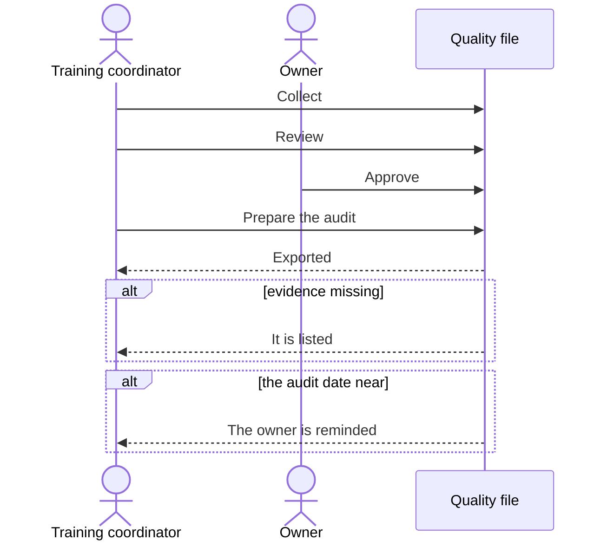

🏠 [Specs](../../../../README.md) › 🏷️ [Sectors](../../../README.md) › 🎓 [SC12 Education and training](../../README.md) ›
📝 [Use cases](../README.md) › 📝 [Use cases: FL-SC12-04 Quality and reports](README.md) ›
📝 UC-SC12-12 Keep the Qualiopi evidence file

# 📝 UC-SC12-12 Keep the Qualiopi evidence file

**Status:** ✅ specified

## Summary

The coordinator collects the evidence each quality criterion needs, reviews it with the owner and prepares the audit.

## Personas

- [U38 Training coordinator](../../../../01-users/personas/u38-training-coordinator.md)
- [U13 Owner](../../../../01-users/personas/u13-owner.md)

## Goal

Evidence ready for the audit.

## Trigger

Continuous; before an audit.

## Frequency

Monthly.

## Preconditions

- The SC12 sector pack is installed for the company,
  [UC-F14-02](../../../../02-functional/f14-plugin-store/use-cases/01-find-and-install/uc-f14-02-install-a-plugin-or-sector-pack.md),
  and its users have their roles,
  [UC-F1-06](../../../../02-functional/f01-administration/use-cases/04-edit-a-role/uc-f01-06-edit-a-role-and-its-record-rules.md).

## Postconditions

- **Success:** the file is complete.
- **Failed:** missing evidence is listed.

## Main flow

1. Evidence is collected on [S-SC12-12 Quality file](../../screens/04-quality-and-reports/s-sc12-12-quality-file.md)
   ([BR-SC12-07](../../business-rules/br-sc12-07-quality-evidence-kept.md)).
2. The coordinator reviews by criterion.
3. The owner approves.
4. The audit file is exported.

## Alternative flows

- 4a. A surveillance audit: only the period's evidence is exported.

## Error flows

- 2e. Evidence missing: it is listed.
- 4e. The audit date near: the owner is reminded.
- Any step: a call to a service or an outside system fails: it is retried first
  ([BR-F3-32](../../../../02-functional/f03-assistant/business-rules/br-f03-32-retry-before-an-error.md)), then the
  error message pattern ([D122](../../../../06-decisions/ux/d122-error-message-standard.md)) says what failed; what was
  typed is kept.

## Business rules

- [BR-SC12-07 Quality evidence kept](../../business-rules/br-sc12-07-quality-evidence-kept.md)

## Entities

- [E-SC12-12 Quality evidence](../../data/e-sc12-12-quality-evidence.md)

## Permissions

The training coordinator and owner roles; the record rules of their role and site apply,
[UC-F1-06](../../../../02-functional/f01-administration/use-cases/04-edit-a-role/uc-f01-06-edit-a-role-and-its-record-rules.md).

## Notifications

None beyond the in-app updates of the records concerned.

## Audit events

Every creation, change and state change of quality evidence records, with who, when and the values before and after
(T3).

## AI involvement

The AI assistant answers questions on the quality evidence records of this use case, with links, and prepares them as
drafts the user confirms. It works within the user's rights,
[BR-F3-34](../../../../02-functional/f03-assistant/business-rules/br-f03-34-every-capability-is-reachable-from-the-assistant.md),
and never deletes or does anything irreversible without the user's confirmation,
[BR-F3-07](../../../../02-functional/f03-assistant/business-rules/br-f03-07-no-deletes-no-irreversible-acts.md).

## API, MCP and A2A exposure

Through the API and webhooks (T5) and the MCP and A2A gateway (T6), with the caller's rights,
[BR-F3-34](../../../../02-functional/f03-assistant/business-rules/br-f03-34-every-capability-is-reachable-from-the-assistant.md),
reading, creating and changing the records of this use case; nothing irreversible without a person's confirmation.

## Screens

- [S-SC12-12 Quality file](../../screens/04-quality-and-reports/s-sc12-12-quality-file.md)

## Flowchart

See [FL-SC12-04 Quality and reports](../../flows/fl-sc12-04-quality-and-reports.md#flowchart).

## Sequence diagram

## Acceptance criteria

1. **Given** the example training centre's criterion 1 for S-41 with needs.pdf **when** it is reviewed **then** it is
   complete.
2. **Given** S-41 without needs assessments **when** the file is reviewed **then** it is listed.

## Non-functional notes

[D408](../../../../06-decisions/technical/d408-performance-and-profiles.md)'s targets
([performance](../../../../05-non-functional/performance.md)): 95 % of screens within 1 second; lists paged on the
server, the first page within 1 second; reports within 5 seconds or in the background. WCAG 2.2 AA and RGAA
([D46](../../../../06-decisions/ux/d46-accessibility-standard.md)).

## Regulatory references

Legal values from the France country pack:
[CR-FR-157 Qualiopi quality certification](../../../../10-country-packs/france/education/cr-fr-157-qualiopi.md).

## Related use cases

- [UC-SC12-13 Produce the yearly report](uc-sc12-13-produce-the-yearly-report.md)

## Open questions

None.

---

⬅️ [UC-SC12-11 Manage trainers](../01-offer-and-sessions/uc-sc12-11-manage-trainers.md) · ⬆️ [Up](README.md) ·
➡️ [UC-SC12-13 Produce the yearly report](uc-sc12-13-produce-the-yearly-report.md)
