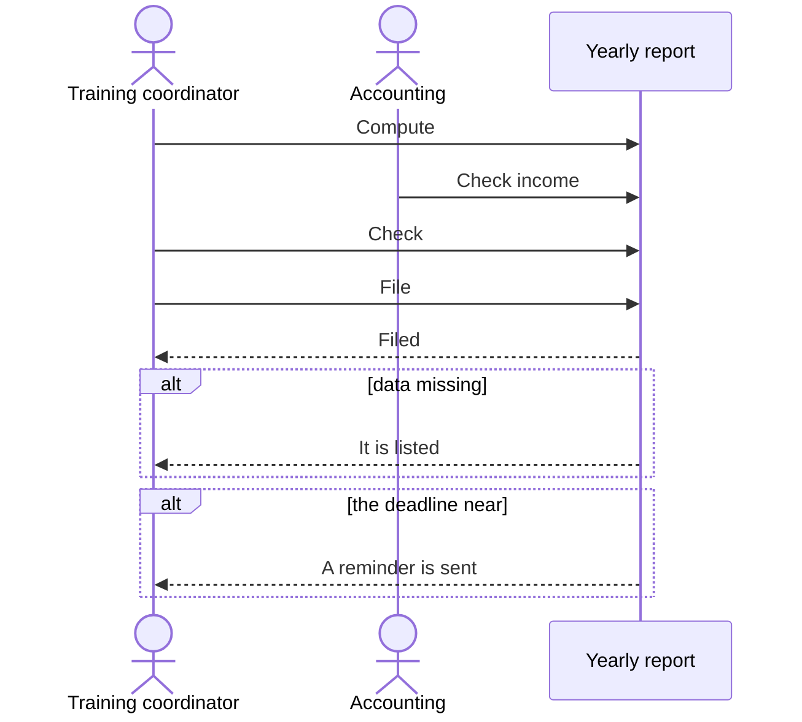

🏠 [Specs](../../../../README.md) › 🏷️ [Sectors](../../../README.md) › 🎓 [SC12 Education and training](../../README.md) ›
📝 [Use cases](../README.md) › 📝 [Use cases: FL-SC12-04 Quality and reports](README.md) ›
📝 UC-SC12-13 Produce the yearly report

# 📝 UC-SC12-13 Produce the yearly report

**Status:** ✅ specified

## Summary

The coordinator and accounting compute the yearly training provider report from sessions, learners, hours and income,
check and file it.

## Personas

- [U38 Training coordinator](../../../../01-users/personas/u38-training-coordinator.md)
- [U05 Accounting](../../../../01-users/personas/u05-accounting.md)

## Goal

The report filed on time from records.

## Trigger

The year end.

## Frequency

Yearly.

## Preconditions

- The SC12 sector pack is installed for the company,
  [UC-F14-02](../../../../02-functional/f14-plugin-store/use-cases/01-find-and-install/uc-f14-02-install-a-plugin-or-sector-pack.md),
  and its users have their roles,
  [UC-F1-06](../../../../02-functional/f01-administration/use-cases/04-edit-a-role/uc-f01-06-edit-a-role-and-its-record-rules.md).

## Postconditions

- **Success:** the report is filed.
- **Failed:** missing data is listed.

## Main flow

1. The report is computed on [S-SC12-13 Yearly report](../../screens/04-quality-and-reports/s-sc12-13-yearly-report.md)
   ([BR-SC12-08](../../business-rules/br-sc12-08-yearly-report-from-the-records.md)).
2. Accounting checks income.
3. The coordinator checks figures.
4. It is filed.

## Alternative flows

- 4a. A corrected report: a new version is filed.

## Error flows

- 1e. Data missing: it is listed.
- 4e. The deadline near: a reminder is sent.
- Any step: a call to a service or an outside system fails: it is retried first
  ([BR-F3-32](../../../../02-functional/f03-assistant/business-rules/br-f03-32-retry-before-an-error.md)), then the
  error message pattern ([D122](../../../../06-decisions/ux/d122-error-message-standard.md)) says what failed; what was
  typed is kept.

## Business rules

- [BR-SC12-08 Yearly report from the records](../../business-rules/br-sc12-08-yearly-report-from-the-records.md)

## Entities

- [E-SC12-13 Yearly training report](../../data/e-sc12-13-yearly-training-report.md)

## Permissions

The training coordinator and accounting roles; the record rules of their role and site apply,
[UC-F1-06](../../../../02-functional/f01-administration/use-cases/04-edit-a-role/uc-f01-06-edit-a-role-and-its-record-rules.md).

## Notifications

None beyond the in-app updates of the records concerned.

## Audit events

Every creation, change and state change of yearly report records, with who, when and the values before and after (T3).

## AI involvement

The AI assistant answers questions on the yearly report records of this use case, with links, and prepares them as
drafts the user confirms. It works within the user's rights,
[BR-F3-34](../../../../02-functional/f03-assistant/business-rules/br-f03-34-every-capability-is-reachable-from-the-assistant.md),
and never deletes or does anything irreversible without the user's confirmation,
[BR-F3-07](../../../../02-functional/f03-assistant/business-rules/br-f03-07-no-deletes-no-irreversible-acts.md).

## API, MCP and A2A exposure

Through the API and webhooks (T5) and the MCP and A2A gateway (T6), with the caller's rights,
[BR-F3-34](../../../../02-functional/f03-assistant/business-rules/br-f03-34-every-capability-is-reachable-from-the-assistant.md),
reading, creating and changing the records of this use case; nothing irreversible without a person's confirmation.

## Screens

- [S-SC12-13 Yearly report](../../screens/04-quality-and-reports/s-sc12-13-yearly-report.md)

## Flowchart

See [FL-SC12-04 Quality and reports](../../flows/fl-sc12-04-quality-and-reports.md#flowchart).

## Sequence diagram

## Acceptance criteria

1. **Given** the example training centre's 2026 with 412 learners **when** it is computed **then** it shows 412
   learners.
2. **Given** sessions without hours **when** it is computed **then** it is listed.

## Non-functional notes

[D408](../../../../06-decisions/technical/d408-performance-and-profiles.md)'s targets
([performance](../../../../05-non-functional/performance.md)): 95 % of screens within 1 second; lists paged on the
server, the first page within 1 second; reports within 5 seconds or in the background. WCAG 2.2 AA and RGAA
([D46](../../../../06-decisions/ux/d46-accessibility-standard.md)).

## Regulatory references

Legal values from the France country pack:
[CR-FR-156 Yearly training provider report (BPF)](../../../../10-country-packs/france/education/cr-fr-156-training-report-bpf.md).

## Related use cases

- [UC-SC12-12 Keep the Qualiopi evidence file](uc-sc12-12-keep-the-qualiopi-evidence-file.md)

## Open questions

None.

---

⬅️ [UC-SC12-12 Keep the Qualiopi evidence file](uc-sc12-12-keep-the-qualiopi-evidence-file.md) · ⬆️ [Up](README.md) ·
➡️ [UC-SC12-14 Handle complaints and incidents](uc-sc12-14-handle-complaints-and-incidents.md)
