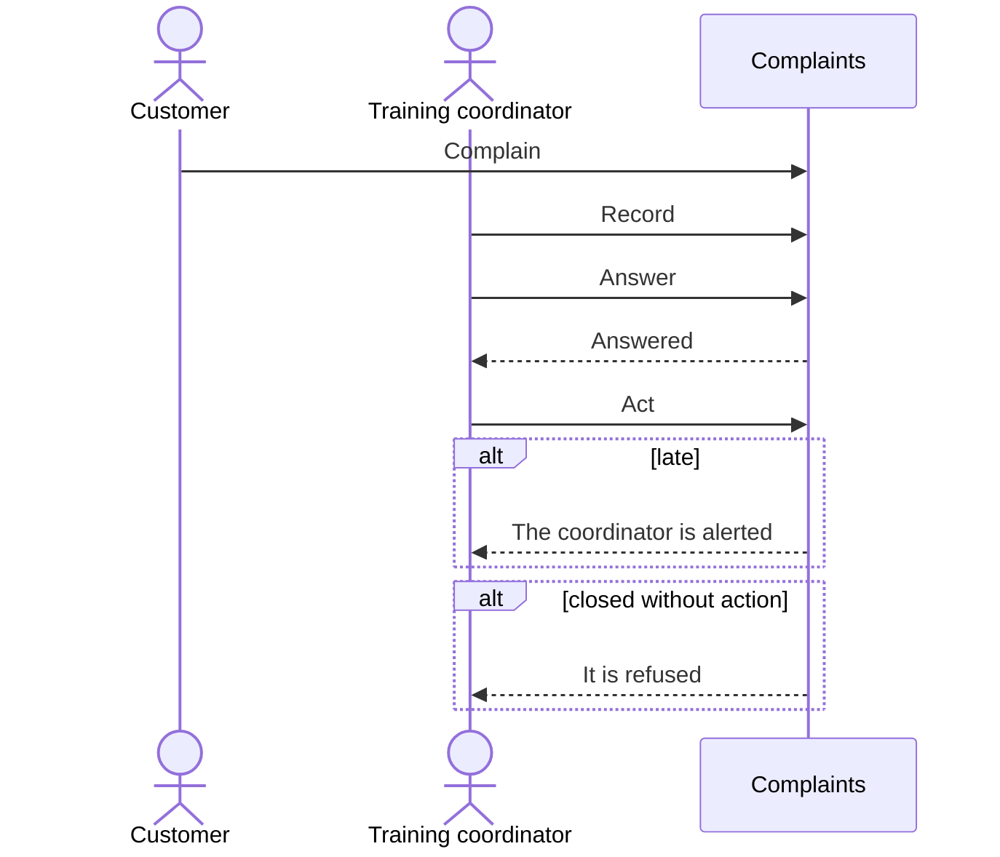

🏠 [Specs](../../../../README.md) › 🏷️ [Sectors](../../../README.md) › 🎓 [SC12 Education and training](../../README.md) ›
📝 [Use cases](../README.md) › 📝 [Use cases: FL-SC12-04 Quality and reports](README.md) ›
📝 UC-SC12-14 Handle complaints and incidents

# 📝 UC-SC12-14 Handle complaints and incidents

**Status:** ✅ specified

## Summary

The coordinator records complaints and incidents, answers them and acts; they feed the quality review.

## Personas

- [U38 Training coordinator](../../../../01-users/personas/u38-training-coordinator.md)
- [U09 Customer](../../../../01-users/personas/u09-customer.md)

## Goal

Complaints answered and used.

## Trigger

A complaint or incident.

## Frequency

A few a month.

## Preconditions

- The SC12 sector pack is installed for the company,
  [UC-F14-02](../../../../02-functional/f14-plugin-store/use-cases/01-find-and-install/uc-f14-02-install-a-plugin-or-sector-pack.md),
  and its users have their roles,
  [UC-F1-06](../../../../02-functional/f01-administration/use-cases/04-edit-a-role/uc-f01-06-edit-a-role-and-its-record-rules.md).

## Postconditions

- **Success:** the complaint is answered and closed.
- **Failed:** a late complaint alerts.

## Main flow

1. The learner complains on [S-SC12-14 Complaints](../../screens/04-quality-and-reports/s-sc12-14-complaints.md).
2. The coordinator records it ([BR-SC12-10](../../business-rules/br-sc12-10-complaints-answered.md)).
3. The coordinator answers.
4. An action is recorded and kept as evidence.

## Alternative flows

- 1a. An incident during a session: the trainer records it.

## Error flows

- 3e. Late: the coordinator is alerted.
- 4e. Closed without action: it is refused.
- Any step: a call to a service or an outside system fails: it is retried first
  ([BR-F3-32](../../../../02-functional/f03-assistant/business-rules/br-f03-32-retry-before-an-error.md)), then the
  error message pattern ([D122](../../../../06-decisions/ux/d122-error-message-standard.md)) says what failed; what was
  typed is kept.

## Business rules

- [BR-SC12-10 Complaints answered](../../business-rules/br-sc12-10-complaints-answered.md)

## Entities

- [E-SC12-09 Survey answer](../../data/e-sc12-09-survey-answer.md)

## Permissions

The training coordinator and customer roles; the record rules of their role and site apply,
[UC-F1-06](../../../../02-functional/f01-administration/use-cases/04-edit-a-role/uc-f01-06-edit-a-role-and-its-record-rules.md).

## Notifications

None beyond the in-app updates of the records concerned.

## Audit events

Every creation, change and state change of survey answer records, with who, when and the values before and after (T3).

## AI involvement

The AI assistant answers questions on the survey answer records of this use case, with links, and prepares them as
drafts the user confirms. It works within the user's rights,
[BR-F3-34](../../../../02-functional/f03-assistant/business-rules/br-f03-34-every-capability-is-reachable-from-the-assistant.md),
and never deletes or does anything irreversible without the user's confirmation,
[BR-F3-07](../../../../02-functional/f03-assistant/business-rules/br-f03-07-no-deletes-no-irreversible-acts.md).

## API, MCP and A2A exposure

Through the API and webhooks (T5) and the MCP and A2A gateway (T6), with the caller's rights,
[BR-F3-34](../../../../02-functional/f03-assistant/business-rules/br-f03-34-every-capability-is-reachable-from-the-assistant.md),
reading, creating and changing the records of this use case; nothing irreversible without a person's confirmation.

## Screens

- [S-SC12-14 Complaints](../../screens/04-quality-and-reports/s-sc12-14-complaints.md)

## Flowchart

See [FL-SC12-04 Quality and reports](../../flows/fl-sc12-04-quality-and-reports.md#flowchart).

## Sequence diagram

## Acceptance criteria

1. **Given** the example training centre's complaint about room 2's heating **when** it is answered **then** the action
   shows in the quality file.
2. **Given** a complaint of 4 December unanswered **when** the delay passes **then** the coordinator is alerted.

## Non-functional notes

[D408](../../../../06-decisions/technical/d408-performance-and-profiles.md)'s targets
([performance](../../../../05-non-functional/performance.md)): 95 % of screens within 1 second; lists paged on the
server, the first page within 1 second; reports within 5 seconds or in the background. WCAG 2.2 AA and RGAA
([D46](../../../../06-decisions/ux/d46-accessibility-standard.md)).

## Regulatory references

None specific to this use case; the sector's legal rules are listed in [SC12 regulatory](../../regulatory.md).

## Related use cases

- [UC-SC12-12 Keep the Qualiopi evidence file](uc-sc12-12-keep-the-qualiopi-evidence-file.md)

## Open questions

None.

---

⬅️ [UC-SC12-13 Produce the yearly report](uc-sc12-13-produce-the-yearly-report.md) · ⬆️ [Up](README.md) ·
➡️ [UC-SC12-15](../05-private-school/uc-sc12-15-enrol-students-in-a-private-school.md)
