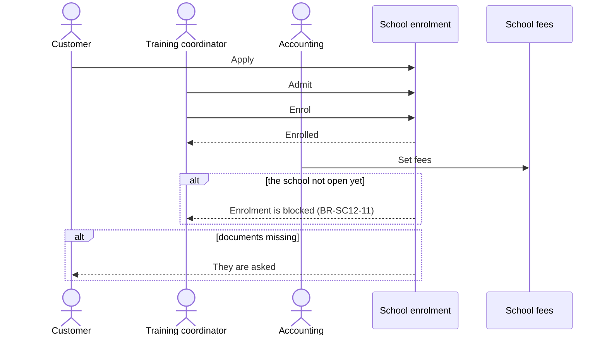

🏠 [Specs](../../../../README.md) › 🏷️ [Sectors](../../../README.md) › 🎓 [SC12 Education and training](../../README.md) ›
📝 [Use cases](../README.md) › 📝 [Use cases: FL-SC12-05 Private school](README.md) ›
📝 UC-SC12-15 Enrol students in a private school

# 📝 UC-SC12-15 Enrol students in a private school

**Status:** ✅ specified

## Summary

Parents apply, the school admits and enrols students; the school opens only after its declaration period.

## Personas

- [U38 Training coordinator](../../../../01-users/personas/u38-training-coordinator.md)
- [U09 Customer](../../../../01-users/personas/u09-customer.md)
- [U05 Accounting](../../../../01-users/personas/u05-accounting.md)

## Goal

Students enrolled for the year.

## Trigger

An application.

## Frequency

Yearly campaign.

## Preconditions

- The SC12 sector pack is installed for the company,
  [UC-F14-02](../../../../02-functional/f14-plugin-store/use-cases/01-find-and-install/uc-f14-02-install-a-plugin-or-sector-pack.md),
  and its users have their roles,
  [UC-F1-06](../../../../02-functional/f01-administration/use-cases/04-edit-a-role/uc-f01-06-edit-a-role-and-its-record-rules.md).

## Postconditions

- **Success:** the student is enrolled.
- **Failed:** the application waits or is refused.

## Main flow

1. Parents apply on the portal on
   [S-SC12-15 School enrolment](../../screens/05-private-school/s-sc12-15-school-enrolment.md),
   [UC-F2-20](../../../../02-functional/f02-no-code-configuration/use-cases/09-portals-and-offline-forms/uc-f02-20-expose-a-record-type-on-a-portal.md).
2. The coordinator admits.
3. The student is enrolled.
4. Fees are set ([UC-SC12-19](uc-sc12-19-bill-school-fees-and-grants.md)).

## Alternative flows

- 2a. A waiting list: the student waits for a place.

## Error flows

- 3e. The school not open yet: enrolment is blocked
  ([BR-SC12-11](../../business-rules/br-sc12-11-school-opened-after-declaration.md)).
- 1e. Documents missing: they are asked.
- Any step: a call to a service or an outside system fails: it is retried first
  ([BR-F3-32](../../../../02-functional/f03-assistant/business-rules/br-f03-32-retry-before-an-error.md)), then the
  error message pattern ([D122](../../../../06-decisions/ux/d122-error-message-standard.md)) says what failed; what was
  typed is kept.

## Business rules

- [BR-SC12-11 School opened after declaration](../../business-rules/br-sc12-11-school-opened-after-declaration.md)
- [BR-F2-20 A portal shows only the chosen fields of the person's own records](../../../../02-functional/f02-no-code-configuration/business-rules/br-f02-20-a-portal-shows-only-the-chosen-fields-of-the-persons-own-records.md)

## Entities

- [E-SC12-14 Student](../../data/e-sc12-14-student.md)

## Permissions

The training coordinator, customer and accounting roles; the record rules of their role and site apply,
[UC-F1-06](../../../../02-functional/f01-administration/use-cases/04-edit-a-role/uc-f01-06-edit-a-role-and-its-record-rules.md).

## Notifications

None beyond the in-app updates of the records concerned.

## Audit events

Every creation, change and state change of student records, with who, when and the values before and after (T3).

## AI involvement

The AI assistant answers questions on the student records of this use case, with links, and prepares them as drafts the
user confirms. It works within the user's rights,
[BR-F3-34](../../../../02-functional/f03-assistant/business-rules/br-f03-34-every-capability-is-reachable-from-the-assistant.md),
and never deletes or does anything irreversible without the user's confirmation,
[BR-F3-07](../../../../02-functional/f03-assistant/business-rules/br-f03-07-no-deletes-no-irreversible-acts.md).

## API, MCP and A2A exposure

Through the API and webhooks (T5) and the MCP and A2A gateway (T6), with the caller's rights,
[BR-F3-34](../../../../02-functional/f03-assistant/business-rules/br-f03-34-every-capability-is-reachable-from-the-assistant.md),
reading, creating and changing the records of this use case; nothing irreversible without a person's confirmation.

## Screens

- [S-SC12-15 School enrolment](../../screens/05-private-school/s-sc12-15-school-enrolment.md)
- [S-SC12-19 School fees](../../screens/05-private-school/s-sc12-19-school-fees.md)

## Flowchart

See [FL-SC12-05 Private school](../../flows/fl-sc12-05-private-school.md#flowchart).

## Sequence diagram

## Acceptance criteria

1. **Given** the example training centre's school with L. Martin applying for 6e B **when** she is admitted **then** she
   is enrolled in 6e B.
2. **Given** a school whose declaration period has not ended **when** a student is enrolled **then** enrolment is
   blocked ([BR-SC12-11](../../business-rules/br-sc12-11-school-opened-after-declaration.md)).

## Non-functional notes

[D408](../../../../06-decisions/technical/d408-performance-and-profiles.md)'s targets
([performance](../../../../05-non-functional/performance.md)): 95 % of screens within 1 second; lists paged on the
server, the first page within 1 second; reports within 5 seconds or in the background. WCAG 2.2 AA and RGAA
([D46](../../../../06-decisions/ux/d46-accessibility-standard.md)).

## Regulatory references

Legal values from the France country pack:
[CR-FR-160 Opening a private school](../../../../10-country-packs/france/education/cr-fr-160-private-school-declaration.md).

## Related use cases

- [UC-SC12-16 Organise classes and timetables](uc-sc12-16-organise-classes-and-timetables.md)

## Open questions

None.

---

⬅️ [UC-SC12-14](../04-quality-and-reports/uc-sc12-14-handle-complaints-and-incidents.md) · ⬆️ [Up](README.md) ·
➡️ [UC-SC12-16 Organise classes and timetables](uc-sc12-16-organise-classes-and-timetables.md)
