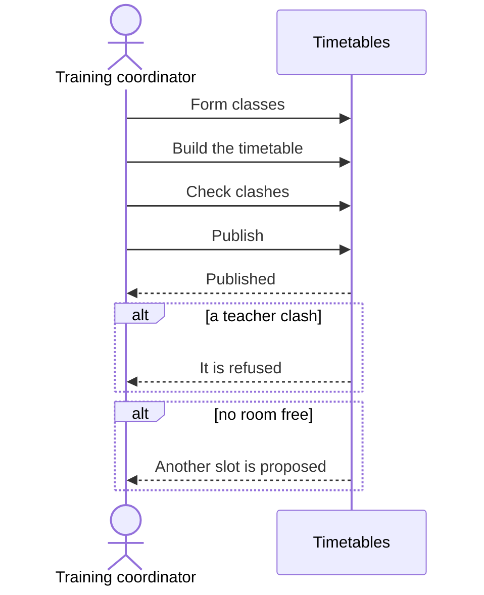

🏠 [Specs](../../../../README.md) › 🏷️ [Sectors](../../../README.md) › 🎓 [SC12 Education and training](../../README.md) ›
📝 [Use cases](../README.md) › 📝 [Use cases: FL-SC12-05 Private school](README.md) ›
📝 UC-SC12-16 Organise classes and timetables

# 📝 UC-SC12-16 Organise classes and timetables

**Status:** ✅ specified

## Summary

The coordinator forms classes and builds the timetable with teachers and rooms on the shared booking engine, then
publishes it.

## Personas

- [U38 Training coordinator](../../../../01-users/personas/u38-training-coordinator.md)

## Goal

A timetable with no clash.

## Trigger

The school year.

## Frequency

Yearly, with changes.

## Preconditions

- The SC12 sector pack is installed for the company,
  [UC-F14-02](../../../../02-functional/f14-plugin-store/use-cases/01-find-and-install/uc-f14-02-install-a-plugin-or-sector-pack.md),
  and its users have their roles,
  [UC-F1-06](../../../../02-functional/f01-administration/use-cases/04-edit-a-role/uc-f01-06-edit-a-role-and-its-record-rules.md).

## Postconditions

- **Success:** the timetable is published.
- **Failed:** clashes are refused.

## Main flow

1. The coordinator forms classes on [S-SC12-16 Timetables](../../screens/05-private-school/s-sc12-16-timetables.md).
2. Lessons are placed with teachers and rooms,
   [UC-F2-19](../../../../02-functional/f02-no-code-configuration/use-cases/08-views-and-bookings/uc-f02-19-book-a-resource.md).
3. Clashes are refused,
   [BR-F2-18](../../../../02-functional/f02-no-code-configuration/business-rules/br-f02-18-one-booking-per-resource-and-slot.md).
4. The timetable goes to the portal.

## Alternative flows

- 1a. Option groups: groups across classes are formed.

## Error flows

- 3e. A teacher clash: it is refused.
- 2e. No room free: another slot is proposed.
- Any step: a call to a service or an outside system fails: it is retried first
  ([BR-F3-32](../../../../02-functional/f03-assistant/business-rules/br-f03-32-retry-before-an-error.md)), then the
  error message pattern ([D122](../../../../06-decisions/ux/d122-error-message-standard.md)) says what failed; what was
  typed is kept.

## Business rules

- [BR-SC12-09 Trainers qualified for the course](../../business-rules/br-sc12-09-trainers-qualified-for-the-course.md)
- [BR-F2-18 One booking per resource and slot](../../../../02-functional/f02-no-code-configuration/business-rules/br-f02-18-one-booking-per-resource-and-slot.md)

## Entities

- [E-SC12-15 Class](../../data/e-sc12-15-class.md)
- [E-SC12-02 Course session](../../data/e-sc12-02-course-session.md)

## Permissions

The training coordinator roles; the record rules of their role and site apply,
[UC-F1-06](../../../../02-functional/f01-administration/use-cases/04-edit-a-role/uc-f01-06-edit-a-role-and-its-record-rules.md).

## Notifications

None beyond the in-app updates of the records concerned.

## Audit events

Every creation, change and state change of class, session records, with who, when and the values before and after (T3).

## AI involvement

The AI assistant answers questions on the class, session records of this use case, with links, and prepares them as
drafts the user confirms. It works within the user's rights,
[BR-F3-34](../../../../02-functional/f03-assistant/business-rules/br-f03-34-every-capability-is-reachable-from-the-assistant.md),
and never deletes or does anything irreversible without the user's confirmation,
[BR-F3-07](../../../../02-functional/f03-assistant/business-rules/br-f03-07-no-deletes-no-irreversible-acts.md).

## API, MCP and A2A exposure

Through the API and webhooks (T5) and the MCP and A2A gateway (T6), with the caller's rights,
[BR-F3-34](../../../../02-functional/f03-assistant/business-rules/br-f03-34-every-capability-is-reachable-from-the-assistant.md),
reading, creating and changing the records of this use case; nothing irreversible without a person's confirmation.

## Screens

- [S-SC12-16 Timetables](../../screens/05-private-school/s-sc12-16-timetables.md)

## Flowchart

See [FL-SC12-05 Private school](../../flows/fl-sc12-05-private-school.md#flowchart).

## Sequence diagram

## Acceptance criteria

1. **Given** the example training centre's 6e B with 9 teachers **when** the timetable is published **then** no teacher
   has two lessons at once.
2. **Given** a teacher in 6e B and 5e A on Monday at 9:00 **when** both are placed **then** it is refused.

## Non-functional notes

[D408](../../../../06-decisions/technical/d408-performance-and-profiles.md)'s targets
([performance](../../../../05-non-functional/performance.md)): 95 % of screens within 1 second; lists paged on the
server, the first page within 1 second; reports within 5 seconds or in the background. WCAG 2.2 AA and RGAA
([D46](../../../../06-decisions/ux/d46-accessibility-standard.md)).

## Regulatory references

None specific to this use case; the sector's legal rules are listed in [SC12 regulatory](../../regulatory.md).

## Related use cases

- [UC-SC12-17 Record grades and report cards](uc-sc12-17-record-grades-and-report-cards.md)

## Open questions

None.

---

⬅️ [UC-SC12-15 Enrol students in a private school](uc-sc12-15-enrol-students-in-a-private-school.md) ·
⬆️ [Up](README.md) · ➡️ [UC-SC12-17 Record grades and report cards](uc-sc12-17-record-grades-and-report-cards.md)
