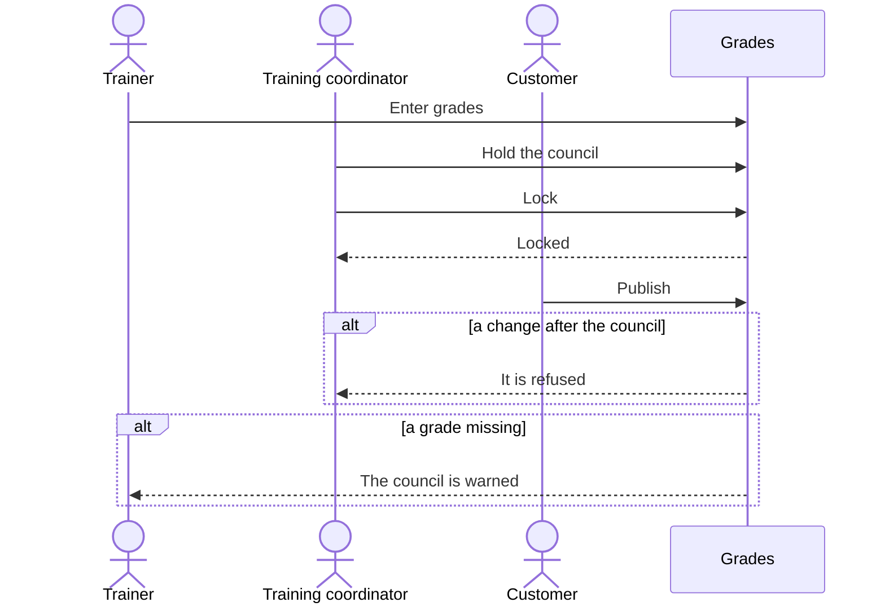

🏠 [Specs](../../../../README.md) › 🏷️ [Sectors](../../../README.md) › 🎓 [SC12 Education and training](../../README.md) ›
📝 [Use cases](../README.md) › 📝 [Use cases: FL-SC12-05 Private school](README.md) ›
📝 UC-SC12-17 Record grades and report cards

# 📝 UC-SC12-17 Record grades and report cards

**Status:** ✅ specified

## Summary

Teachers enter grades, the class council approves report cards, and they are published; grades lock after the council.

## Personas

- [U39 Trainer](../../../../01-users/personas/u39-trainer.md)
- [U38 Training coordinator](../../../../01-users/personas/u38-training-coordinator.md)
- [U09 Customer](../../../../01-users/personas/u09-customer.md)

## Goal

Report cards approved and published.

## Trigger

The term end.

## Frequency

Per term.

## Preconditions

- The SC12 sector pack is installed for the company,
  [UC-F14-02](../../../../02-functional/f14-plugin-store/use-cases/01-find-and-install/uc-f14-02-install-a-plugin-or-sector-pack.md),
  and its users have their roles,
  [UC-F1-06](../../../../02-functional/f01-administration/use-cases/04-edit-a-role/uc-f01-06-edit-a-role-and-its-record-rules.md).

## Postconditions

- **Success:** report cards are published.
- **Failed:** grades stay open.

## Main flow

1. Teachers enter grades on [S-SC12-17 Grades](../../screens/05-private-school/s-sc12-17-grades.md).
2. The council approves report cards.
3. Grades lock ([BR-SC12-13](../../business-rules/br-sc12-13-grades-locked-after-the-council.md)).
4. Parents see the report card on the portal.

## Alternative flows

- 1a. Competence-based grading: levels replace marks.

## Error flows

- 3e. A change after the council: it is refused.
- 1e. A grade missing: the council is warned.
- Any step: a call to a service or an outside system fails: it is retried first
  ([BR-F3-32](../../../../02-functional/f03-assistant/business-rules/br-f03-32-retry-before-an-error.md)), then the
  error message pattern ([D122](../../../../06-decisions/ux/d122-error-message-standard.md)) says what failed; what was
  typed is kept.

## Business rules

- [BR-SC12-13 Grades locked after the council](../../business-rules/br-sc12-13-grades-locked-after-the-council.md)

## Entities

- [E-SC12-16 Grade](../../data/e-sc12-16-grade.md)

## Permissions

The trainer, training coordinator and customer roles; the record rules of their role and site apply,
[UC-F1-06](../../../../02-functional/f01-administration/use-cases/04-edit-a-role/uc-f01-06-edit-a-role-and-its-record-rules.md).

## Notifications

None beyond the in-app updates of the records concerned.

## Audit events

Every creation, change and state change of grade records, with who, when and the values before and after (T3).

## AI involvement

The AI assistant answers questions on the grade records of this use case, with links, and prepares them as drafts the
user confirms. It works within the user's rights,
[BR-F3-34](../../../../02-functional/f03-assistant/business-rules/br-f03-34-every-capability-is-reachable-from-the-assistant.md),
and never deletes or does anything irreversible without the user's confirmation,
[BR-F3-07](../../../../02-functional/f03-assistant/business-rules/br-f03-07-no-deletes-no-irreversible-acts.md).

## API, MCP and A2A exposure

Through the API and webhooks (T5) and the MCP and A2A gateway (T6), with the caller's rights,
[BR-F3-34](../../../../02-functional/f03-assistant/business-rules/br-f03-34-every-capability-is-reachable-from-the-assistant.md),
reading, creating and changing the records of this use case; nothing irreversible without a person's confirmation.

## Screens

- [S-SC12-17 Grades](../../screens/05-private-school/s-sc12-17-grades.md)

## Flowchart

See [FL-SC12-05 Private school](../../flows/fl-sc12-05-private-school.md#flowchart).

## Sequence diagram

## Acceptance criteria

1. **Given** the example training centre's L. Martin with 15/20 in maths in term 1 **when** the council approves
   **then** the grade is locked.
2. **Given** L. Martin's maths grade **when** a teacher edits it **then** it is refused.

## Non-functional notes

[D408](../../../../06-decisions/technical/d408-performance-and-profiles.md)'s targets
([performance](../../../../05-non-functional/performance.md)): 95 % of screens within 1 second; lists paged on the
server, the first page within 1 second; reports within 5 seconds or in the background. WCAG 2.2 AA and RGAA
([D46](../../../../06-decisions/ux/d46-accessibility-standard.md)).

## Regulatory references

None specific to this use case; the sector's legal rules are listed in [SC12 regulatory](../../regulatory.md).

## Related use cases

- [UC-SC12-18 Follow pupils' attendance and inform parents](uc-sc12-18-follow-pupils-attendance-and-inform-parents.md)

## Open questions

None.

---

⬅️ [UC-SC12-16 Organise classes and timetables](uc-sc12-16-organise-classes-and-timetables.md) · ⬆️ [Up](README.md) ·
➡️ [UC-SC12-18](uc-sc12-18-follow-pupils-attendance-and-inform-parents.md)
