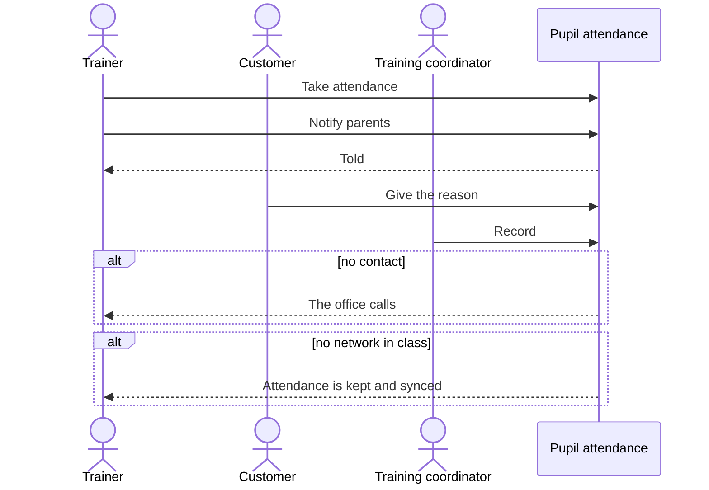

🏠 [Specs](../../../../README.md) › 🏷️ [Sectors](../../../README.md) › 🎓 [SC12 Education and training](../../README.md) ›
📝 [Use cases](../README.md) › 📝 [Use cases: FL-SC12-05 Private school](README.md) ›
📝 UC-SC12-18 Follow pupils' attendance and inform parents

# 📝 UC-SC12-18 Follow pupils' attendance and inform parents

**Status:** ✅ specified

## Summary

Teachers take attendance; parents are told of an absence the same day on the parents' portal; the reason is recorded.

## Personas

- [U39 Trainer](../../../../01-users/personas/u39-trainer.md)
- [U09 Customer](../../../../01-users/personas/u09-customer.md)
- [U38 Training coordinator](../../../../01-users/personas/u38-training-coordinator.md)

## Goal

Parents know the same day.

## Trigger

Each lesson.

## Frequency

Daily.

## Preconditions

- The SC12 sector pack is installed for the company,
  [UC-F14-02](../../../../02-functional/f14-plugin-store/use-cases/01-find-and-install/uc-f14-02-install-a-plugin-or-sector-pack.md),
  and its users have their roles,
  [UC-F1-06](../../../../02-functional/f01-administration/use-cases/04-edit-a-role/uc-f01-06-edit-a-role-and-its-record-rules.md).

## Postconditions

- **Success:** parents are told and the reason recorded.
- **Failed:** the office calls.

## Main flow

1. The teacher takes attendance on
   [S-SC12-18 Pupil attendance](../../screens/05-private-school/s-sc12-18-pupil-attendance.md).
2. Parents are told the same day ([BR-SC12-12](../../business-rules/br-sc12-12-pupils-absences-to-parents.md)).
3. Parents give the reason on the portal,
   [UC-F2-20](../../../../02-functional/f02-no-code-configuration/use-cases/09-portals-and-offline-forms/uc-f02-20-expose-a-record-type-on-a-portal.md).
4. The reason is recorded.

## Alternative flows

- 4a. Repeated absences: a meeting is proposed.

## Error flows

- 2e. No contact: the office calls.
- 1e. No network in class: attendance is kept and synced.
- Any step: a call to a service or an outside system fails: it is retried first
  ([BR-F3-32](../../../../02-functional/f03-assistant/business-rules/br-f03-32-retry-before-an-error.md)), then the
  error message pattern ([D122](../../../../06-decisions/ux/d122-error-message-standard.md)) says what failed; what was
  typed is kept.

## Business rules

- [BR-SC12-12 Pupils' absences to parents](../../business-rules/br-sc12-12-pupils-absences-to-parents.md)
- [BR-F2-20 A portal shows only the chosen fields of the person's own records](../../../../02-functional/f02-no-code-configuration/business-rules/br-f02-20-a-portal-shows-only-the-chosen-fields-of-the-persons-own-records.md)

## Entities

- [E-SC12-17 Pupil absence](../../data/e-sc12-17-pupil-absence.md)

## Permissions

The trainer, customer and training coordinator roles; the record rules of their role and site apply,
[UC-F1-06](../../../../02-functional/f01-administration/use-cases/04-edit-a-role/uc-f01-06-edit-a-role-and-its-record-rules.md).

## Notifications

None beyond the in-app updates of the records concerned.

## Audit events

Every creation, change and state change of pupil absence records, with who, when and the values before and after (T3).

## AI involvement

The AI assistant answers questions on the pupil absence records of this use case, with links, and prepares them as
drafts the user confirms. It works within the user's rights,
[BR-F3-34](../../../../02-functional/f03-assistant/business-rules/br-f03-34-every-capability-is-reachable-from-the-assistant.md),
and never deletes or does anything irreversible without the user's confirmation,
[BR-F3-07](../../../../02-functional/f03-assistant/business-rules/br-f03-07-no-deletes-no-irreversible-acts.md).

## API, MCP and A2A exposure

Through the API and webhooks (T5) and the MCP and A2A gateway (T6), with the caller's rights,
[BR-F3-34](../../../../02-functional/f03-assistant/business-rules/br-f03-34-every-capability-is-reachable-from-the-assistant.md),
reading, creating and changing the records of this use case; nothing irreversible without a person's confirmation.

## Screens

- [S-SC12-18 Pupil attendance](../../screens/05-private-school/s-sc12-18-pupil-attendance.md)

## Flowchart

See [FL-SC12-05 Private school](../../flows/fl-sc12-05-private-school.md#flowchart).

## Sequence diagram

## Acceptance criteria

1. **Given** the example training centre's L. Martin absent on 4 December **when** attendance is taken **then** her
   parents are told that day.
2. **Given** L. Martin's parents without phone or email **when** she is absent **then** the office calls.

## Non-functional notes

[D408](../../../../06-decisions/technical/d408-performance-and-profiles.md)'s targets
([performance](../../../../05-non-functional/performance.md)): 95 % of screens within 1 second; lists paged on the
server, the first page within 1 second; reports within 5 seconds or in the background. WCAG 2.2 AA and RGAA
([D46](../../../../06-decisions/ux/d46-accessibility-standard.md)).

## Regulatory references

None specific to this use case; the sector's legal rules are listed in [SC12 regulatory](../../regulatory.md).

## Related use cases

- [UC-SC12-17 Record grades and report cards](uc-sc12-17-record-grades-and-report-cards.md)

## Open questions

None.

---

⬅️ [UC-SC12-17 Record grades and report cards](uc-sc12-17-record-grades-and-report-cards.md) · ⬆️ [Up](README.md) ·
➡️ [UC-SC12-19 Bill school fees and grants](uc-sc12-19-bill-school-fees-and-grants.md)
