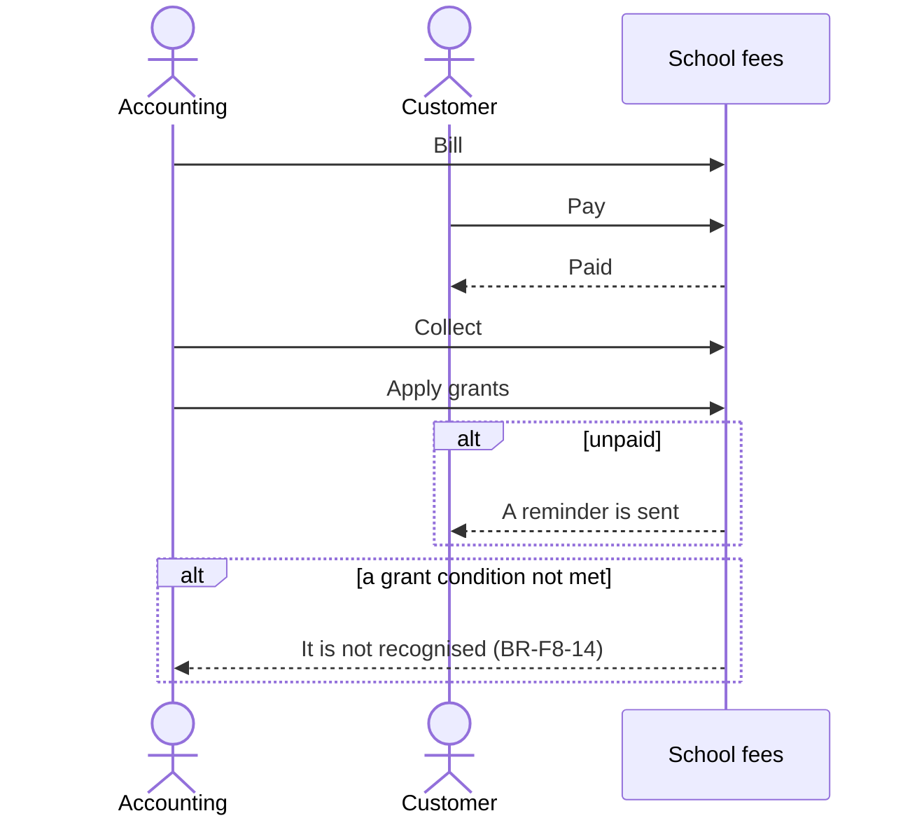

🏠 [Specs](../../../../README.md) › 🏷️ [Sectors](../../../README.md) › 🎓 [SC12 Education and training](../../README.md) ›
📝 [Use cases](../README.md) › 📝 [Use cases: FL-SC12-05 Private school](README.md) ›
📝 UC-SC12-19 Bill school fees and grants

# 📝 UC-SC12-19 Bill school fees and grants

**Status:** ✅ specified

## Summary

Accounting bills fees by period, collects them, and accounts for grants received with the shared grant accounting.

## Personas

- [U05 Accounting](../../../../01-users/personas/u05-accounting.md)
- [U09 Customer](../../../../01-users/personas/u09-customer.md)

## Goal

Fees collected, grants accounted.

## Trigger

Each period.

## Frequency

Quarterly.

## Preconditions

- The SC12 sector pack is installed for the company,
  [UC-F14-02](../../../../02-functional/f14-plugin-store/use-cases/01-find-and-install/uc-f14-02-install-a-plugin-or-sector-pack.md),
  and its users have their roles,
  [UC-F1-06](../../../../02-functional/f01-administration/use-cases/04-edit-a-role/uc-f01-06-edit-a-role-and-its-record-rules.md).

## Postconditions

- **Success:** fees are paid and grants recorded.
- **Failed:** unpaid fees are reminded.

## Main flow

1. Fees are billed on [S-SC12-19 School fees](../../screens/05-private-school/s-sc12-19-school-fees.md).
2. Parents pay.
3. Payments are matched.
4. Grants are recorded,
   [UC-F8-22](../../../../02-functional/f08-accounting/use-cases/07-client-money-grants-and-non-profits/uc-f08-22-account-for-a-grant.md).

## Alternative flows

- 1a. A siblings' reduction: the reduction applies.

## Error flows

- 2e. Unpaid: a reminder is sent.
- 4e. A grant condition not met: it is not recognised,
  [BR-F8-14](../../../../02-functional/f08-accounting/business-rules/br-f08-14-a-grant-is-earned-as-its-conditions-are-met.md).
- Any step: a call to a service or an outside system fails: it is retried first
  ([BR-F3-32](../../../../02-functional/f03-assistant/business-rules/br-f03-32-retry-before-an-error.md)), then the
  error message pattern ([D122](../../../../06-decisions/ux/d122-error-message-standard.md)) says what failed; what was
  typed is kept.

## Business rules

- [BR-SC12-14 Learners' data kept no longer than needed](../../business-rules/br-sc12-14-learners-data-kept-no-longer-than-needed.md)
- [BR-F8-14 A grant is earned as its conditions are met](../../../../02-functional/f08-accounting/business-rules/br-f08-14-a-grant-is-earned-as-its-conditions-are-met.md)

## Entities

- [E-SC12-18 School fee](../../data/e-sc12-18-school-fee.md)
- [E-F8-18 Grant](../../../../02-functional/f08-accounting/data/e-f08-18-grant.md)

## Permissions

The accounting and customer roles; the record rules of their role and site apply,
[UC-F1-06](../../../../02-functional/f01-administration/use-cases/04-edit-a-role/uc-f01-06-edit-a-role-and-its-record-rules.md).

## Notifications

None beyond the in-app updates of the records concerned.

## Audit events

Every creation, change and state change of school fee, grant records, with who, when and the values before and after
(T3).

## AI involvement

The AI assistant answers questions on the school fee, grant records of this use case, with links, and prepares them as
drafts the user confirms. It works within the user's rights,
[BR-F3-34](../../../../02-functional/f03-assistant/business-rules/br-f03-34-every-capability-is-reachable-from-the-assistant.md),
and never deletes or does anything irreversible without the user's confirmation,
[BR-F3-07](../../../../02-functional/f03-assistant/business-rules/br-f03-07-no-deletes-no-irreversible-acts.md).

## API, MCP and A2A exposure

Through the API and webhooks (T5) and the MCP and A2A gateway (T6), with the caller's rights,
[BR-F3-34](../../../../02-functional/f03-assistant/business-rules/br-f03-34-every-capability-is-reachable-from-the-assistant.md),
reading, creating and changing the records of this use case; nothing irreversible without a person's confirmation.

## Screens

- [S-SC12-19 School fees](../../screens/05-private-school/s-sc12-19-school-fees.md)

## Flowchart

See [FL-SC12-05 Private school](../../flows/fl-sc12-05-private-school.md#flowchart).

## Sequence diagram

## Acceptance criteria

1. **Given** the example training centre's L. Martin's Q1 fee of 1,200 EUR **when** it is billed **then** her parents
   owe 1,200 EUR.
2. **Given** L. Martin's Q1 fee of 1,200 EUR unpaid **when** the due date passes **then** a reminder is sent.

## Non-functional notes

[D408](../../../../06-decisions/technical/d408-performance-and-profiles.md)'s targets
([performance](../../../../05-non-functional/performance.md)): 95 % of screens within 1 second; lists paged on the
server, the first page within 1 second; reports within 5 seconds or in the background. WCAG 2.2 AA and RGAA
([D46](../../../../06-decisions/ux/d46-accessibility-standard.md)).

## Regulatory references

None specific to this use case; the sector's legal rules are listed in [SC12 regulatory](../../regulatory.md).

## Related use cases

- [UC-SC12-15 Enrol students in a private school](uc-sc12-15-enrol-students-in-a-private-school.md)

## Open questions

None.

---

⬅️ [UC-SC12-18](uc-sc12-18-follow-pupils-attendance-and-inform-parents.md) · ⬆️ [Up](README.md) ·
➡️ [UC-SC12-20 Ask the AI assistant](../03-deliver-and-assess/uc-sc12-20-ask-the-assistant.md)
