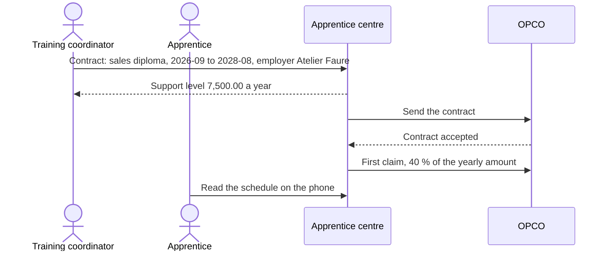

🏠 [Specs](../../../../README.md) › 🏷️ [Sectors](../../../README.md) › 🎓 [SC12 Education and training](../../README.md) ›
📝 [Use cases](../README.md) › 📝 [Use cases: FL-SC12-06 Apprentices, driving schools, nurseries, canteens](README.md) ›
📝 UC-SC12-21 Run an apprentice training centre

# 📝 UC-SC12-21 Run an apprentice training centre

**Status:** ✅ specified

## Summary

An apprentice training centre (CFA) trains apprentices who work for an employer under an apprenticeship contract. The
coordinator records each contract, with its diploma and its dates; the centre is paid by the skills operator (OPCO) of
the employer at the support level set for the diploma, counted pro rata of the days done and paid in
instalments, and the apprentice follows their schedule on the
phone.

## Personas

- [U38 Training coordinator](../../../../01-users/personas/u38-training-coordinator.md)
- [U01 Employee](../../../../01-users/personas/u01-employee.md)

## Goal

Every contract shows its diploma, dates and support level, and the centre's funding is claimed from the OPCO for exactly
the period the apprentice follows.

## Trigger

An employer and an apprentice sign a contract, an instalment falls due, or a contract is broken or ends.

## Frequency

Dozens to hundreds of contracts a year per centre; a few funding claims a year per contract, on the OPCO's instalment dates.

## Preconditions

- The employer is a customer
  ([E-F6-01](../../../../02-functional/f06-customers-and-sales/data/e-f06-01-customer-record.md)) and the apprentice is
  enrolled in a course session ([E-SC12-03 Enrolment](../../data/e-sc12-03-enrolment.md),
  [E-SC12-02 Course session](../../data/e-sc12-02-course-session.md)).
- The centre's declaration number and its quality label are recorded
  ([E-SC12-04 Training agreement](../../data/e-sc12-04-training-agreement.md)).

## Postconditions

- **Succeeded:** the contract is saved
  ([E-SC12-20 Apprenticeship contract](../../data/e-sc12-20-apprenticeship-contract.md)) with its diploma, dates, OPCO
  and support level; the funding claimed follows the instalments and the days done.
- **Failed:** no funding is claimed for a contract with no support level; the missing level or dates are shown.

## Main flow

1. The coordinator opens the apprentice centre screen
   ([S-SC12-21](../../screens/06-apprentices-driving-nurseries-and-canteens/s-sc12-21-cfa.md)) and records the contract:
   apprentice, employer, diploma, start and end dates, and the employer's OPCO.
2. SimpleERP reads the support level for the diploma from the country pack or the branch's table and shows it on the
   contract ([BR-SC12-16](../../business-rules/br-sc12-16-funding-follows-the-contracts-support-level.md)).
3. The contract is sent to the OPCO for its agreement; the contract becomes Registered when the OPCO accepts.
4. At each instalment (40 % within 30 days of the first invoice, 30 % in the seventh month, 20 % in the tenth month,
   then the balance), the centre counts the days done under the contract and prepares the funding claim for the OPCO
   ([UC-SC12-10](../02-enrol-and-fund/uc-sc12-10-bill-learners-employers-and-funders.md)).
5. The apprentice sees their schedule and their absences on the phone; the employer sees the attendance.
6. At the end of the contract, the last claim is prepared and the contract is Ended.

## Alternative flows

- 3a. The OPCO asks for a correction: the contract is changed and sent again, the history is kept.
- 4a. The apprentice changes employer: the contract is ended and a new one is recorded for the rest of the course.
- 4b. The contract is broken: while the apprentice stays in the centre to find a new employer, the funding goes on pro
  rata of the days for up to six months or until the new contract, then stops.

## Error flows

- 2e. No support level exists for the diploma: the contract stays Draft and the level is asked from the branch or
  entered by hand with its source.
- 4e. A claim covers days after the funding's end (six months after the break, or the new contract): the claim is cut
  and the reason is shown.
- 3e. The OPCO rejects the contract: the reason is shown and the centre corrects it.
- Any step: a service does not answer; the call is retried first
  ([BR-F3-32](../../../../02-functional/f03-assistant/business-rules/br-f03-32-retry-before-an-error.md)), then the
  message follows the error pattern ([D122](../../../../06-decisions/ux/d122-error-message-standard.md)) and what the
  user typed stays on the screen.

## Business rules

- [BR-SC12-16](../../business-rules/br-sc12-16-funding-follows-the-contracts-support-level.md)
- [BR-SC12-05 Funding split by funder](../../business-rules/br-sc12-05-funding-split-by-funder.md)
- [BR-SC12-03](../../business-rules/br-sc12-03-training-sold-under-an-agreement.md)
- [BR-SC12-14](../../business-rules/br-sc12-14-learners-data-kept-no-longer-than-needed.md)

## Entities

- [E-SC12-20 Apprenticeship contract](../../data/e-sc12-20-apprenticeship-contract.md): created, changed, closed
- [E-SC12-05 Training funding](../../data/e-sc12-05-training-funding.md): created, the funding line of each instalment
- [E-SC12-03 Enrolment](../../data/e-sc12-03-enrolment.md): read, the apprentice's enrolment
- [E-F6-01](../../../../02-functional/f06-customers-and-sales/data/e-f06-01-customer-record.md): read, the employer

## Permissions

Training coordinator records and sends contracts and claims; the apprentice reads their own schedule. The
employer sees the contracts and the attendance of their apprentices only.

## Notifications

The coordinator, in the app: the OPCO has accepted or rejected a contract, a contract ends in 60 days. The apprentice,
on the phone: a change of schedule.

## Audit events

Each contract created, registered, changed, broken or ended; each claim with its days, support level and amount; who
and when.

## AI involvement

No AI step of its own. The AI assistant may open the screen and prefill it from the user's words; the user checks and
confirms
[BR-F3-07](../../../../02-functional/f03-assistant/business-rules/br-f03-07-no-deletes-no-irreversible-acts.md).

## API, MCP and A2A exposure

T5 operations of the capability for the personas above: create, read, update and list. The MCP tool of the
capability may read and propose, never confirm alone. No A2A skill.

## Screens

- [S-SC12-21](../../screens/06-apprentices-driving-nurseries-and-canteens/s-sc12-21-cfa.md)

## Flowchart

See
[FL-SC12-06 Apprentices, driving schools, nurseries, canteens](../../flows/fl-sc12-06-apprentices-driving-nurseries-and-canteens.md#flowchart).

## Sequence diagram

## Acceptance criteria

1. **Given** a two-year contract with a support level of 7,500.00 EUR a year **when** the first instalment is claimed
   **then** the claim is 3,000.00 EUR (40 %).
2. **Given** a contract broken on 2026-12-15 and a new contract on 2027-02-01 **when** a claim for February is prepared
   **then** it is refused for the old contract.
3. **Given** a diploma with no support level **when** the contract is saved **then** it stays Draft and asks for the
   level.
4. **Given** a contract rejected by the OPCO **when** the answer arrives **then** the reason is shown and the contract
   is corrected.

## Non-functional notes

The screen answers within 2 seconds for 10,000 records; every change is audited.

## Regulatory references

An apprenticeship contract is signed between an employer and an apprentice; the training centre is paid by
the employer's skills operator, which sets a support level for each diploma, and the contract is registered with it.
The OPCO pays a yearly amount by diploma, counted pro rata of the days done and paid in instalments (40 %, 30 %, 20 %,
then the balance, for contracts from 2025-07-01); after a break, payment goes on pro rata of the days for up to six
months while the apprentice looks for a new employer (Code du travail R6332-25). The levels are data of the France
pack and the branches. Related:
[CR-FR-155](../../../../10-country-packs/france/education/cr-fr-155-training-provider-declaration.md),
[CR-FR-157](../../../../10-country-packs/france/education/cr-fr-157-qualiopi.md),
[CR-FR-158](../../../../10-country-packs/france/education/cr-fr-158-training-agreement.md).

- France-pack rule:
  [CR-FR-244 Apprenticeship funding by the OPCO](../../../../10-country-packs/france/education/cr-fr-244-apprenticeship-funding.md)

## Related use cases

- [UC-SC12-22 Run a driving school](uc-sc12-22-run-a-driving-school.md)
- [UC-SC12-04 Get funding](../02-enrol-and-fund/uc-sc12-04-get-funding.md)
- [UC-SC12-06](../03-deliver-and-assess/uc-sc12-06-sign-attendance-per-half-day.md)

## Open questions

None.

---

⬅️ [UC-SC12-20 Ask the AI assistant](../03-deliver-and-assess/uc-sc12-20-ask-the-assistant.md) · ⬆️ [Up](README.md) ·
➡️ [UC-SC12-22 Run a driving school](uc-sc12-22-run-a-driving-school.md)
