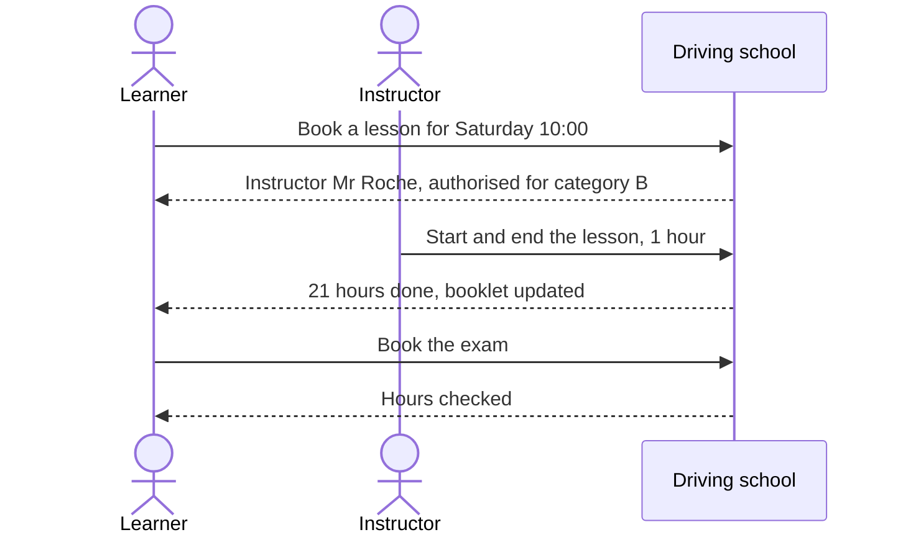

🏠 [Specs](../../../../README.md) › 🏷️ [Sectors](../../../README.md) › 🎓 [SC12 Education and training](../../README.md) ›
📝 [Use cases](../README.md) › 📝 [Use cases: FL-SC12-06 Apprentices, driving schools, nurseries, canteens](README.md) ›
📝 UC-SC12-22 Run a driving school

# 📝 UC-SC12-22 Run a driving school

**Status:** ✅ specified

## Summary

A driving school teaches learners to drive. The school keeps its approval and each instructor's authorisation to teach
current, books lessons on the phone, records each lesson in the learner's training booklet, and follows the learner's
progress to the exam.

## Personas

- [U38 Training coordinator](../../../../01-users/personas/u38-training-coordinator.md)
- [U39 Trainer](../../../../01-users/personas/u39-trainer.md)

## Goal

Every lesson is given by an authorised instructor in a registered vehicle and recorded in the booklet, and no lesson is
booked with an instructor whose authorisation has lapsed.

## Trigger

A learner books a lesson, a lesson is given, or an authorisation approaches its end.

## Frequency

Dozens of lessons a day in a school.

## Preconditions

- The learner is a customer
  ([E-F6-01](../../../../02-functional/f06-customers-and-sales/data/e-f06-01-customer-record.md)) with a signed training
  contract.
- The instructors and their authorisations are recorded as trainers
  ([E-SC12-11 Trainer profile](../../data/e-sc12-11-trainer-profile.md)).
- The vehicles are registered.

## Postconditions

- **Succeeded:** the lesson is saved ([E-SC12-21 Driving lesson](../../data/e-sc12-21-driving-lesson.md)) with its
  instructor, vehicle, time and booklet entry; the learner's hours are updated.
- **Failed:** no lesson is booked with an unauthorised instructor; the reason is shown.

## Main flow

1. The coordinator opens the driving school screen
   ([S-SC12-22](../../screens/06-apprentices-driving-nurseries-and-canteens/s-sc12-22-driving-school.md)) and sees the
   week's planning of instructors and vehicles.
2. The learner books a lesson on the phone; the screen offers the instructors who are authorised for the licence
   category ([BR-SC12-17](../../business-rules/br-sc12-17-lessons-are-taught-by-an-authorised-instructor.md)) and the
   free vehicles.
3. The instructor, on the phone, starts the lesson and ends it with the content and the notes; the lesson is Done and
   enters the booklet.
4. The hours done are added to the learner's total; the learner sees their progress on the phone.
5. When the learner is ready, the coordinator books the exam and the hours are checked against the minimum.
6. The lessons are billed to the learner
   ([UC-SC12-10](../02-enrol-and-fund/uc-sc12-10-bill-learners-employers-and-funders.md)).

## Alternative flows

- 2a. The learner cancels in time: the lesson is cancelled with no charge; cancelled late, it is charged as the contract
  says.
- 3a. The learner does not come: the lesson is Missed and charged as the contract says.
- 5a. The learner pays with the personal training account: the funding line is prepared
  ([UC-SC12-04](../02-enrol-and-fund/uc-sc12-04-get-funding.md)).

## Error flows

- 2e. The instructor's authorisation has ended or does not cover the category: the booking is refused and the
  coordinator is told.
- 3e. The vehicle's inspection is overdue: the vehicle is not offered.
- 5e. The learner has too few hours for the exam: the booking of the exam is refused with the hours missing.
- Any step: a service does not answer; the call is retried first
  ([BR-F3-32](../../../../02-functional/f03-assistant/business-rules/br-f03-32-retry-before-an-error.md)), then the
  message follows the error pattern ([D122](../../../../06-decisions/ux/d122-error-message-standard.md)) and what the
  user typed stays on the screen.

## Business rules

- [BR-SC12-17](../../business-rules/br-sc12-17-lessons-are-taught-by-an-authorised-instructor.md)
- [BR-SC12-09](../../business-rules/br-sc12-09-trainers-qualified-for-the-course.md)
- [BR-SC12-04 Attendance per half-day](../../business-rules/br-sc12-04-attendance-per-half-day.md)

## Entities

- [E-SC12-21 Driving lesson](../../data/e-sc12-21-driving-lesson.md): created, changed
- [E-SC12-11 Trainer profile](../../data/e-sc12-11-trainer-profile.md): read, the instructor and their authorisation
- [E-SC12-05 Training funding](../../data/e-sc12-05-training-funding.md): created, the funding line if the learner pays
  with their training account
- [E-F6-01](../../../../02-functional/f06-customers-and-sales/data/e-f06-01-customer-record.md): read, the learner

## Permissions

Coordinator plans and books; the instructor records their lessons; the learner books their own. An instructor
sees only their own planning.

## Notifications

The learner, on the phone: a lesson is booked, a reminder the day before. The coordinator: an authorisation ends in 60
days, a vehicle inspection is due.

## Audit events

Each lesson booked, given, cancelled or missed, with the instructor, vehicle and time; each refusal; each booklet entry;
who and when.

## AI involvement

No AI step of its own. The AI assistant may open the screen and prefill it from the user's words; the user checks and
confirms
[BR-F3-07](../../../../02-functional/f03-assistant/business-rules/br-f03-07-no-deletes-no-irreversible-acts.md).

## API, MCP and A2A exposure

T5 operations of the capability for the personas above: create, read, update and list. The MCP tool of the
capability may read and propose, never confirm alone. No A2A skill.

## Screens

- [S-SC12-22](../../screens/06-apprentices-driving-nurseries-and-canteens/s-sc12-22-driving-school.md)

## Flowchart

See
[FL-SC12-06 Apprentices, driving schools, nurseries, canteens](../../flows/fl-sc12-06-apprentices-driving-nurseries-and-canteens.md#flowchart).

## Sequence diagram

## Acceptance criteria

1. **Given** an instructor whose authorisation ended yesterday **when** a lesson is booked with them **then** it is
   refused.
2. **Given** a lesson of 1 hour recorded as Done **when** the instructor ends it **then** the learner's hours increase
   by 1.
3. **Given** a lesson cancelled 48 hours before with a 24 hours notice rule **when** the learner cancels **then** no
   charge is made.
4. **Given** a learner with 18 hours when the exam needs 20 **when** the exam is booked **then** it is refused with 2
   hours missing.

## Non-functional notes

The screen answers within 2 seconds for 10,000 records; every change is audited.

## Regulatory references

A driving school is approved by the authority of its department, and each instructor needs a valid
authorisation to teach for the category, renewed at set intervals; lessons are recorded in the learner's training
booklet, and the school sets the learner's contract and hours. The values are data of the France pack, written later.
Related: [CR-FR-159](../../../../10-country-packs/france/education/cr-fr-159-personal-training-account.md) (the personal
training account may fund a driving licence within its cap),
[CR-FR-158](../../../../10-country-packs/france/education/cr-fr-158-training-agreement.md).

## Related use cases

- [UC-SC12-21 Run an apprentice training centre](uc-sc12-21-run-an-apprentice-training-centre.md)
- [UC-SC12-23 Run a nursery](uc-sc12-23-run-a-nursery.md)
- [UC-SC12-11 Manage trainers](../01-offer-and-sessions/uc-sc12-11-manage-trainers.md)
- [UC-SC12-04 Get funding](../02-enrol-and-fund/uc-sc12-04-get-funding.md)

## Open questions

None.

---

⬅️ [UC-SC12-21 Run an apprentice training centre](uc-sc12-21-run-an-apprentice-training-centre.md) ·
⬆️ [Up](README.md) · ➡️ [UC-SC12-23 Run a nursery](uc-sc12-23-run-a-nursery.md)
