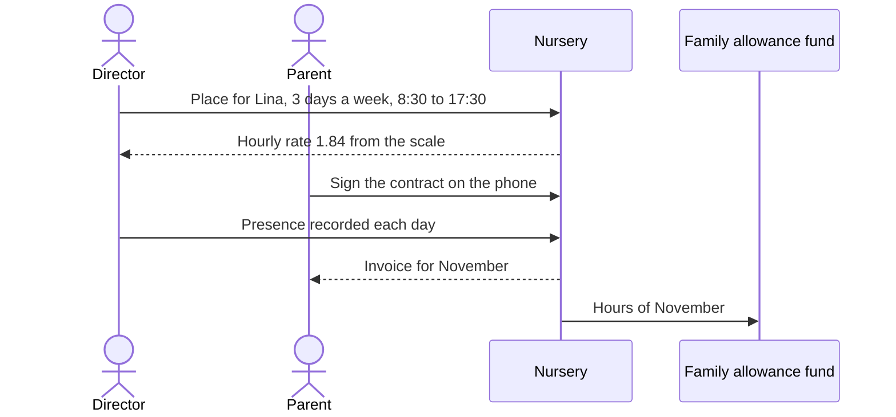

🏠 [Specs](../../../../README.md) › 🏷️ [Sectors](../../../README.md) › 🎓 [SC12 Education and training](../../README.md) ›
📝 [Use cases](../README.md) › 📝 [Use cases: FL-SC12-06 Apprentices, driving schools, nurseries, canteens](README.md) ›
📝 UC-SC12-23 Run a nursery

# 📝 UC-SC12-23 Run a nursery

**Status:** 🔄 waiting for the owner

## Summary

A nursery looks after children under the contract signed with their family. The hourly rate the family pays follows the
scale of the family allowance fund, which depends on the family's income and its size; the fund pays the rest of the
cost. The director books the places by hour, the parents see the hours and the invoice on the phone, and the nursery
reports the hours to the fund.

## Personas

- [U38 Training coordinator](../../../../01-users/personas/u38-training-coordinator.md)
- [U09 Customer](../../../../01-users/personas/u09-customer.md)

## Goal

Every place is booked with its contracted hours, the family pays the hourly rate of the scale, and the hours done are
reported to the fund so that it pays the nursery.

## Trigger

A family signs a contract, a month ends, or a family's income changes.

## Frequency

Daily presence entries; one invoice and one report per month.

## Preconditions

- The family is a customer
  ([E-F6-01](../../../../02-functional/f06-customers-and-sales/data/e-f06-01-customer-record.md)) with its income
  reference from the fund.
- The nursery's places, opening hours and the fund's scale are recorded.

## Postconditions

- **Succeeded:** the place is saved ([E-SC12-22 Childcare place](../../data/e-sc12-22-childcare-place.md)) with its
  hours and hourly rate; each month's invoice and report follow the hours done.
- **Failed:** no place is confirmed without a contract and an hourly rate; the missing income reference is shown.

## Main flow

1. The director opens the nursery screen
   ([S-SC12-23](../../screens/06-apprentices-driving-nurseries-and-canteens/s-sc12-23-nursery.md)) and records the
   child's place: the days and hours of the contract, the start date and the family's income reference.
2. SimpleERP computes the hourly rate from the scale: the income times the rate for the family's size, within the floor
   and the ceiling ([BR-SC12-18](../../business-rules/br-sc12-18-hourly-funding-follows-the-caf-scale.md)).
3. The family signs the contract on the phone
   [UC-F6-04](../../../../02-functional/f06-customers-and-sales/use-cases/02-quote-to-order/uc-f06-04-accept-or-sign-a-quote.md).
4. Each day, the staff record the child's arrival and departure; the hours done are counted against the contract.
5. At the month end, the invoice is issued to the family at the hourly rate
   [UC-F6-06](../../../../02-functional/f06-customers-and-sales/use-cases/03-invoice-and-get-paid/uc-f06-06-invoice-deposits-progress-and-final.md),
   and the hours are reported to the fund for its payment.
6. At the start of the year, the family's income reference is updated and the rate is recomputed.

## Alternative flows

- 2a. The family's income is not known: the ceiling rate is used until the reference is received.
- 4a. The child is absent for a reason the contract accepts (illness with a certificate): the hours are deducted from
  the bill.
- 5a. The family has a second child at the nursery: the rate for the family's size is applied to each.

## Error flows

- 2e. No scale is loaded for the date: the rate cannot be computed and the director is asked to load it.
- 4e. The hours done exceed the contract: the extra hours are billed apart and the family is told.
- 5e. The fund rejects the report: the reason is shown and the report is corrected.
- Any step: a service does not answer; the call is retried first
  ([BR-F3-32](../../../../02-functional/f03-assistant/business-rules/br-f03-32-retry-before-an-error.md)), then the
  message follows the error pattern ([D122](../../../../06-decisions/ux/d122-error-message-standard.md)) and what the
  user typed stays on the screen.

## Business rules

- [BR-SC12-18](../../business-rules/br-sc12-18-hourly-funding-follows-the-caf-scale.md)
- [BR-SC12-05 Funding split by funder](../../business-rules/br-sc12-05-funding-split-by-funder.md)
- [BR-SC12-14](../../business-rules/br-sc12-14-learners-data-kept-no-longer-than-needed.md)

## Entities

- [E-SC12-22 Childcare place](../../data/e-sc12-22-childcare-place.md): created, changed, closed
- [E-F6-05 Invoice](../../../../02-functional/f06-customers-and-sales/data/e-f06-05-invoice.md): created, the monthly
  invoice
- [E-F6-01](../../../../02-functional/f06-customers-and-sales/data/e-f06-01-customer-record.md): read, the family
- [E-SC12-05 Training funding](../../data/e-sc12-05-training-funding.md): created, the fund's payment line

## Permissions

Director records places, contracts and reports; staff record presence; the family sees its own child's hours and
invoices. A child's data is visible only to the nursery staff and the parents.

## Notifications

The family, on the phone: the contract to sign, the month's invoice. The director: an income reference to update, the
fund's answer.

## Audit events

Each place created, changed or ended; each hourly rate computed with its scale and income; each presence record, invoice
and report; who and when.

## AI involvement

No AI step of its own. The AI assistant may open the screen and prefill it from the user's words; the user checks and
confirms
[BR-F3-07](../../../../02-functional/f03-assistant/business-rules/br-f03-07-no-deletes-no-irreversible-acts.md).

## API, MCP and A2A exposure

T5 operations of the capability for the personas above: create, read, update and list. The MCP tool of the
capability may read and propose, never confirm alone. No A2A skill.

## Screens

- [S-SC12-23](../../screens/06-apprentices-driving-nurseries-and-canteens/s-sc12-23-nursery.md)

## Flowchart

See
[FL-SC12-06 Apprentices, driving schools, nurseries, canteens](../../flows/fl-sc12-06-apprentices-driving-nurseries-and-canteens.md#flowchart).

## Sequence diagram

## Acceptance criteria

1. **Given** an income of 2,400.00 EUR a month, a rate of 0.0615 % for a family of two children and a ceiling above it
   **when** the hourly rate is computed **then** it is 1.48 EUR an hour.
2. **Given** an income above the ceiling **when** the rate is computed **then** the ceiling rate is used.
3. **Given** no income reference **when** the rate is computed **then** the ceiling rate is used until the reference
   arrives.
4. **Given** hours done above the contract **when** the invoice is prepared **then** the extra hours are billed apart.

## Non-functional notes

The screen answers within 2 seconds for 10,000 records; every change is audited.

## Regulatory references

A nursery funded by the family allowance fund applies the fund's scale: the family pays an hourly rate that
is a percentage of its monthly income, lower for larger families, within a floor and a ceiling, and the fund pays the
nursery the rest of the cost for the hours done. The nursery reports the hours to the fund. The percentages, the floor
and the ceiling are data of the France pack by date, written later. Related:
[CR-FR-137](../../../../10-country-packs/france/health-practice/cr-fr-137-medical-secrecy.md).

- France-pack rule, (Proposed) until its law is read:
  [CR-FR-245 Nursery hourly funding (PSU)](../../../../10-country-packs/france/education/cr-fr-245-nursery-psu.md)

## Related use cases

- [UC-SC12-22 Run a driving school](uc-sc12-22-run-a-driving-school.md)
- [UC-SC12-24 Run the canteen and activities](uc-sc12-24-run-the-canteen-and-activities.md)
- [UC-SC12-19](../05-private-school/uc-sc12-19-bill-school-fees-and-grants.md)
- [UC-SC12-18](../05-private-school/uc-sc12-18-follow-pupils-attendance-and-inform-parents.md)

## Open questions

None.

---

⬅️ [UC-SC12-22 Run a driving school](uc-sc12-22-run-a-driving-school.md) · ⬆️ [Up](README.md) ·
➡️ [UC-SC12-24 Run the canteen and activities](uc-sc12-24-run-the-canteen-and-activities.md)
