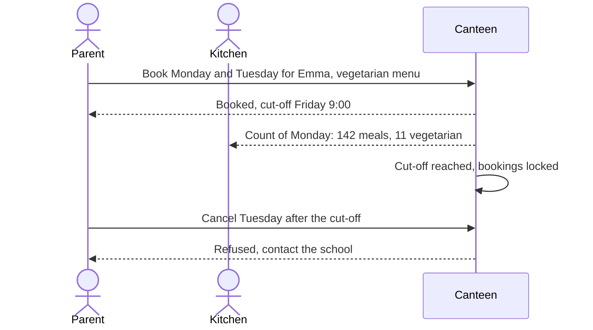

🏠 [Specs](../../../../README.md) › 🏷️ [Sectors](../../../README.md) › 🎓 [SC12 Education and training](../../README.md) ›
📝 [Use cases](../README.md) › 📝 [Use cases: FL-SC12-06 Apprentices, driving schools, nurseries, canteens](README.md) ›
📝 UC-SC12-24 Run the canteen and activities

# 📝 UC-SC12-24 Run the canteen and activities

**Status:** ✅ specified

## Summary

A school or an activity centre books meals and after-school activities for its pupils. Parents book on the phone and the
kitchen sees the count; each booking closes at the cut-off time, after which it can no longer be changed or cancelled
free of charge. Meals and activities are billed to the family at the school's rate.

## Personas

- [U38 Training coordinator](../../../../01-users/personas/u38-training-coordinator.md)
- [U09 Customer](../../../../01-users/personas/u09-customer.md)

## Goal

Every meal and activity is booked before its cut-off, the kitchen gets the exact count, and the family is billed for
what was booked.

## Trigger

A parent books or cancels a meal, the cut-off time comes, or a month ends.

## Frequency

Hundreds of bookings a day in a school; one invoice a month per family.

## Preconditions

- The pupil is enrolled ([E-SC12-14 Student](../../data/e-sc12-14-student.md)) and the parent is a customer
  ([E-F6-01](../../../../02-functional/f06-customers-and-sales/data/e-f06-01-customer-record.md)).
- The school's menus, rates and cut-off times are recorded.

## Postconditions

- **Succeeded:** the booking is saved ([E-SC12-23 Meal booking](../../data/e-sc12-23-meal-booking.md)) with its date,
  menu and state; the kitchen's count is updated and the booking is billed.
- **Failed:** no booking changes after its cut-off; the reason and the cut-off time are shown.

## Main flow

1. The coordinator opens the canteen screen
   ([S-SC12-24](../../screens/06-apprentices-driving-nurseries-and-canteens/s-sc12-24-canteen.md)) and sets the week's
   menus and the cut-off time.
2. The parent books meals and activities on the phone for each day, with the pupil's diet and allergens
   ([CR-FR-107](../../../../10-country-packs/france/consumer/cr-fr-107-allergen-information.md)).
3. The kitchen sees the count per menu and per diet for each day.
4. At the cut-off time, the day's bookings are Locked
   ([BR-SC12-19](../../business-rules/br-sc12-19-bookings-close-at-the-cut-off-time.md)); a change after it needs the
   coordinator.
5. The pupil's meal is marked Served at the canteen; absences recorded by the school cancel the meal
   ([UC-SC12-18](../05-private-school/uc-sc12-18-follow-pupils-attendance-and-inform-parents.md)).
6. At the month end, the family is billed
   ([UC-SC12-19](../05-private-school/uc-sc12-19-bill-school-fees-and-grants.md)).

## Alternative flows

- 4a. A pupil is ill after the cut-off with a certificate: the coordinator cancels the meal and no charge is made.
- 2a. The pupil has a regular booking (every Monday): a standing booking creates the meals and the parent may cancel
  each before its cut-off.
- 3a. A menu is changed by the kitchen: the parents who booked it are told.

## Error flows

- 2e. The parent books after the cut-off: the booking is refused and the cut-off time is shown.
- 2e. The pupil's allergen is in the menu: a warning is shown and the booking needs another menu.
- 5e. A meal is served that was not booked: it is recorded apart and the coordinator decides how it is billed.
- Any step: a service does not answer; the call is retried first
  ([BR-F3-32](../../../../02-functional/f03-assistant/business-rules/br-f03-32-retry-before-an-error.md)), then the
  message follows the error pattern ([D122](../../../../06-decisions/ux/d122-error-message-standard.md)) and what the
  user typed stays on the screen.

## Business rules

- [BR-SC12-19](../../business-rules/br-sc12-19-bookings-close-at-the-cut-off-time.md)
- [BR-SC12-12](../../business-rules/br-sc12-12-pupils-absences-to-parents.md)
- [BR-SC12-14](../../business-rules/br-sc12-14-learners-data-kept-no-longer-than-needed.md)

## Entities

- [E-SC12-23 Meal booking](../../data/e-sc12-23-meal-booking.md): created, changed
- [E-SC12-14 Student](../../data/e-sc12-14-student.md): read, the pupil
- [E-SC12-17 Pupil absence](../../data/e-sc12-17-pupil-absence.md): read, the absences that cancel a meal
- [E-SC12-18 School fee](../../data/e-sc12-18-school-fee.md): created, the canteen line of the school bill

## Permissions

Coordinator sets menus and cut-offs and changes locked bookings; parents book and cancel their own pupils' meals; the
kitchen reads counts. The kitchen sees diets and allergens, never the family's other data.

## Notifications

The parent, on the phone: a booking is confirmed, the cut-off is in 2 hours, a menu is changed. The kitchen: the count
of the day.

## Audit events

Each booking, cancellation, lock and change after the lock, with who, when and the reason; each meal served.

## AI involvement

No AI step of its own. The AI assistant may open the screen and prefill it from the user's words; the user checks and
confirms
[BR-F3-07](../../../../02-functional/f03-assistant/business-rules/br-f03-07-no-deletes-no-irreversible-acts.md).

## API, MCP and A2A exposure

T5 operations of the capability for the personas above: create, read, update and list. The MCP tool of the
capability may read and propose, never confirm alone. No A2A skill.

## Screens

- [S-SC12-24](../../screens/06-apprentices-driving-nurseries-and-canteens/s-sc12-24-canteen.md)

## Flowchart

See
[FL-SC12-06 Apprentices, driving schools, nurseries, canteens](../../flows/fl-sc12-06-apprentices-driving-nurseries-and-canteens.md#flowchart).

## Sequence diagram

## Acceptance criteria

1. **Given** a cut-off at 9:00 on Friday for Monday's meals **when** a parent books at 9:05 **then** the booking is
   refused with the cut-off time.
2. **Given** a booking before the cut-off **when** the parent cancels at 8:30 **then** the meal is cancelled with no
   charge.
3. **Given** a pupil allergic to an ingredient of the menu **when** the parent books it **then** a warning is shown and
   the booking is refused.
4. **Given** a pupil absent with a certificate after the cut-off **when** the coordinator cancels the meal **then** no
   charge is made.

## Non-functional notes

The screen answers within 2 seconds for 10,000 records; every change is audited.

## Regulatory references

A canteen shows the allergens of each meal and keeps the prices set by the school or the local authority; the
cut-off times are the school's own rules. The France-pack rule on allergens is already written
([CR-FR-107](../../../../10-country-packs/france/consumer/cr-fr-107-allergen-information.md)); the cut-off has no legal
rule.

## Related use cases

- [UC-SC12-23 Run a nursery](uc-sc12-23-run-a-nursery.md)
- [UC-SC12-18](../05-private-school/uc-sc12-18-follow-pupils-attendance-and-inform-parents.md)
- [UC-SC12-19](../05-private-school/uc-sc12-19-bill-school-fees-and-grants.md)

## Open questions

None.

---

⬅️ [UC-SC12-23 Run a nursery](uc-sc12-23-run-a-nursery.md) · ⬆️ [Up](README.md)
