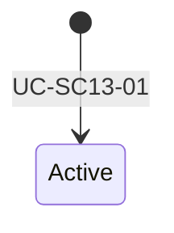

🏠 [Specs](../../../README.md) › 🏷️ [Sectors](../../README.md) › 🌾 [SC13 Agriculture and food](../README.md) ›
🗃️ [Data](README.md) › 🗃️ E-SC13-02 Crop plan

# 🗃️ E-SC13-02 Crop plan

**Status:** 🔄 waiting for the owner

## Purpose

A crop on a plot for a season.

## Fields

| Name | Type | Required | Validation | Default | Example | Personal data | Custom fields |
|---|---|---|---|---|---|---|---|
| plot, season, crop | records | yes | - | - | Les Prés, 2027, wheat | no | no |

## Relations

(Proposed) As its use cases.

## Lifecycle

## Indexes and search

(Proposed) By number, date, partner.

## Retention

Kept for the period of its kind of record in the country pack (D293), or else its kind's default in the
[retention schedule](../../../05-non-functional/data-retention.md).

## Audit

Every change.

## Import and export

(Proposed) CSV, FEC where relevant.

## Used by

- [UC-SC13-01](../use-cases/01-crops/uc-sc13-01-map-plots-and-plan-crops.md)
- [UC-SC13-18](../use-cases/03-farm-business/uc-sc13-18-follow-costs-per-crop-herd-and-product.md)

## Open questions

None.

---

⬅️ [E-SC13-01 Plot](e-sc13-01-plot.md) · ⬆️ [Up](README.md) ·
➡️ [E-SC13-03 Field operation](e-sc13-03-field-operation.md)
