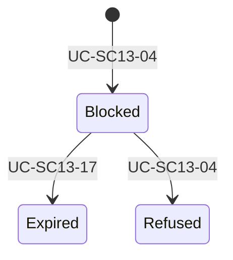

🏠 [Specs](../../../README.md) › 🏷️ [Sectors](../../README.md) › 🌾 [SC13 Agriculture and food](../README.md) ›
🗃️ [Data](README.md) › 🗃️ E-SC13-04 Lot

# 🗃️ E-SC13-04 Lot

**Status:** 🔄 waiting for the owner

## Purpose

A harvest or batch lot.

## Fields

| Name | Type | Required | Validation | Default | Example | Personal data | Custom fields |
|---|---|---|---|---|---|---|---|
| number, product, quantity | records | yes | BR-SC13-06 | auto | W-2611, wheat, 32 t | no | no |
| origin, blocked | links, yes or no | yes | - | no | Les Prés | no | no |

## Relations

(Proposed) As its use cases.

## Lifecycle

## Indexes and search

(Proposed) By number, date, partner.

## Retention

Lots per [CR-FR-061 Food traceability](../../../10-country-packs/france/products/cr-fr-061-food-traceability.md).

## Audit

Every change.

## Import and export

(Proposed) CSV, FEC where relevant.

## Used by

- [UC-SC13-04](../use-cases/01-crops/uc-sc13-04-record-harvests-yields-and-lots.md)
- [UC-SC13-13](../use-cases/05-food-processing/uc-sc13-13-manage-recipes-and-batches-for-processing.md)
- [UC-SC13-14](../use-cases/05-food-processing/uc-sc13-14-trace-lots-from-field-to-customer.md)
- [UC-SC13-17](../use-cases/05-food-processing/uc-sc13-17-manage-shelf-life-rotation-and-recalls.md)

## Open questions

None.

---

⬅️ [E-SC13-03 Field operation](e-sc13-03-field-operation.md) · ⬆️ [Up](README.md) ·
➡️ [E-SC13-05 Animal](e-sc13-05-animal.md)
