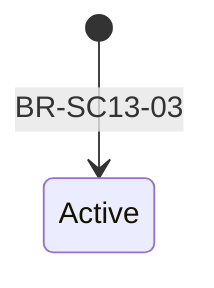

🏠 [Specs](../../../README.md) › 🏷️ [Sectors](../../README.md) › 🌾 [SC13 Agriculture and food](../README.md) ›
🗃️ [Data](README.md) › 🗃️ E-SC13-05 Animal

# 🗃️ E-SC13-05 Animal

**Status:** ✅ specified

## Purpose

An identified animal.

## Fields

| Name | Type | Required | Validation | Default | Example | Personal data | Custom fields |
|---|---|---|---|---|---|---|---|
| identifier, species, birth | records | yes | BR-SC13-03 | - | FR 69 1234 5678, cow, 2024 | no | no |
| movements | list | no | - | - | bought 2025 | no | no |

## Relations

As its use cases.

## Lifecycle

## Indexes and search

By number, date, partner.

## Retention

Kept for the period of its kind of record in the country pack (D293), or else its kind's default in the
[retention schedule](../../../05-non-functional/data-retention.md).

## Audit

Every change.

## Import and export

CSV, FEC where relevant.

## Used by

- [UC-SC13-05](../use-cases/02-livestock/uc-sc13-05-identify-animals-and-keep-the-herd-register.md)
- [UC-SC13-07](../use-cases/03-farm-business/uc-sc13-07-declare-cap-aid.md)
- [UC-SC13-20](../use-cases/03-farm-business/uc-sc13-20-ask-the-assistant.md)

## Open questions

None.

---

⬅️ [E-SC13-04 Lot](e-sc13-04-lot.md) · ⬆️ [Up](README.md) ·
➡️ [E-SC13-06 Veterinary treatment](e-sc13-06-veterinary-treatment.md)
