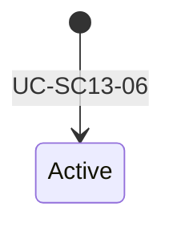

🏠 [Specs](../../../README.md) › 🏷️ [Sectors](../../README.md) › 🌾 [SC13 Agriculture and food](../README.md) ›
🗃️ [Data](README.md) › 🗃️ E-SC13-06 Veterinary treatment

# 🗃️ E-SC13-06 Veterinary treatment

**Status:** 🔄 waiting for the owner

## Purpose

A treatment and its withdrawal.

## Fields

| Name | Type | Required | Validation | Default | Example | Personal data | Custom fields |
|---|---|---|---|---|---|---|---|
| animal, product, date | records | yes | BR-SC13-04 | - | FR 69..., product Y, 3 Dec | no | no |
| withdrawal end | date | yes | - | - | 7 Dec | no | no |

## Relations

(Proposed) As its use cases.

## Lifecycle

## Indexes and search

(Proposed) By number, date, partner.

## Retention

Kept for the period of its kind of record in the country pack (D293), or else its kind's default in the
[retention schedule](../../../05-non-functional/data-retention.md).

## Audit

Every change.

## Import and export

(Proposed) CSV, FEC where relevant.

## Used by

- [UC-SC13-06](../use-cases/02-livestock/uc-sc13-06-record-veterinary-treatments.md)

## Open questions

None.

---

⬅️ [E-SC13-05 Animal](e-sc13-05-animal.md) · ⬆️ [Up](README.md) · ➡️ [E-SC13-07 Machine](e-sc13-07-machine.md)
