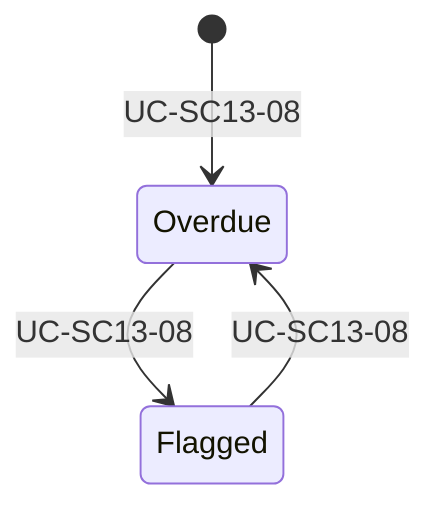

🏠 [Specs](../../../README.md) › 🏷️ [Sectors](../../README.md) › 🌾 [SC13 Agriculture and food](../README.md) ›
🗃️ [Data](README.md) › 🗃️ E-SC13-07 Machine

# 🗃️ E-SC13-07 Machine

**Status:** 🔄 waiting for the owner

## Purpose

A farm machine.

## Fields

| Name | Type | Required | Validation | Default | Example | Personal data | Custom fields |
|---|---|---|---|---|---|---|---|
| name, hours, fuel | records | yes | - | - | tractor T1, 4 210 h | no | no |

## Relations

(Proposed) As its use cases.

## Lifecycle

## Indexes and search

(Proposed) By number, date, partner.

## Retention

Kept for the period of its kind of record in the country pack (D293), or else its kind's default in the
[retention schedule](../../../05-non-functional/data-retention.md).

## Audit

Every change.

## Import and export

(Proposed) CSV, FEC where relevant.

## Used by

- [UC-SC13-08](../use-cases/03-farm-business/uc-sc13-08-manage-machinery-fuel-and-maintenance.md)
- [UC-SC13-18](../use-cases/03-farm-business/uc-sc13-18-follow-costs-per-crop-herd-and-product.md)

## Open questions

None.

---

⬅️ [E-SC13-06 Veterinary treatment](e-sc13-06-veterinary-treatment.md) · ⬆️ [Up](README.md) ·
➡️ [E-SC13-08 Seasonal contract](e-sc13-08-seasonal-contract.md)
