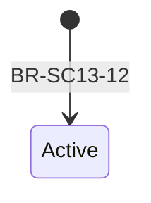

🏠 [Specs](../../../README.md) › 🏷️ [Sectors](../../README.md) › 🌾 [SC13 Agriculture and food](../README.md) ›
🗃️ [Data](README.md) › 🗃️ E-SC13-08 Seasonal contract

# 🗃️ E-SC13-08 Seasonal contract

**Status:** ✅ specified

## Purpose

A seasonal worker's contract.

## Fields

| Name | Type | Required | Validation | Default | Example | Personal data | Custom fields |
|---|---|---|---|---|---|---|---|
| worker, dates, wage | records | yes | BR-SC13-12 | - | P. L., Sep, 1.1 x minimum | yes | no |

## Relations

As its use cases.

## Lifecycle

## Indexes and search

By number, date, partner.

## Retention

As an accounting record:
[CR-FR-002 Accounting records kept 10 years](../../../10-country-packs/france/accounting/cr-fr-002-accounting-records-kept-ten-years.md).

## Audit

Every change.

## Import and export

CSV, FEC where relevant.

## Used by

- [UC-SC13-09](../use-cases/03-farm-business/uc-sc13-09-employ-seasonal-workers.md)
- [UC-SC13-19](../use-cases/03-farm-business/uc-sc13-19-report-to-the-accountant-and-the-farmers-social-insurance.md)

## Open questions

None.

---

⬅️ [E-SC13-07 Machine](e-sc13-07-machine.md) · ⬆️ [Up](README.md) ·
➡️ [E-SC13-09 Direct sale](e-sc13-09-direct-sale.md)
