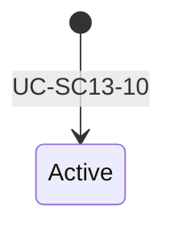

🏠 [Specs](../../../README.md) › 🏷️ [Sectors](../../README.md) › 🌾 [SC13 Agriculture and food](../README.md) ›
🗃️ [Data](README.md) › 🗃️ E-SC13-09 Direct sale

# 🗃️ E-SC13-09 Direct sale

**Status:** ✅ specified

## Purpose

A sale at the farm or market.

## Fields

| Name | Type | Required | Validation | Default | Example | Personal data | Custom fields |
|---|---|---|---|---|---|---|---|
| lot, quantity, place | records | yes | - | - | W-2611, 5 kg flour, market | no | no |

## Relations

As its use cases.

## Lifecycle

## Indexes and search

By number, date, partner.

## Retention

As an accounting record:
[CR-FR-002 Accounting records kept 10 years](../../../10-country-packs/france/accounting/cr-fr-002-accounting-records-kept-ten-years.md).

## Audit

Every change.

## Import and export

CSV, FEC where relevant.

## Used by

- [UC-SC13-10](../use-cases/04-sales-and-certification/uc-sc13-10-sell-directly.md)

## Open questions

None.

---

⬅️ [E-SC13-08 Seasonal contract](e-sc13-08-seasonal-contract.md) · ⬆️ [Up](README.md) ·
➡️ [E-SC13-10 Cooperative statement](e-sc13-10-cooperative-statement.md)
