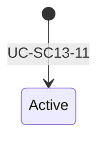

🏠 [Specs](../../../README.md) › 🏷️ [Sectors](../../README.md) › 🌾 [SC13 Agriculture and food](../README.md) ›
🗃️ [Data](README.md) › 🗃️ E-SC13-10 Cooperative statement

# 🗃️ E-SC13-10 Cooperative statement

**Status:** 🔄 waiting for the owner

## Purpose

Deliveries and payments.

## Fields

| Name | Type | Required | Validation | Default | Example | Personal data | Custom fields |
|---|---|---|---|---|---|---|---|
| delivery, tonnage, price | records | yes | BR-SC13-13 | - | 12 Jul, 30 t, 210 | no | no |

## Relations

(Proposed) As its use cases.

## Lifecycle

## Indexes and search

(Proposed) By number, date, partner.

## Retention

As an accounting record:
[CR-FR-002 Accounting records kept 10 years](../../../10-country-packs/france/accounting/cr-fr-002-accounting-records-kept-ten-years.md).

## Audit

Every change.

## Import and export

(Proposed) CSV, FEC where relevant.

## Used by

- [UC-SC13-11](../use-cases/04-sales-and-certification/uc-sc13-11-deliver-to-the-cooperative-and-follow-payments.md)

## Open questions

None.

---

⬅️ [E-SC13-09 Direct sale](e-sc13-09-direct-sale.md) · ⬆️ [Up](README.md) ·
➡️ [E-SC13-11 Organic record](e-sc13-11-organic-record.md)
