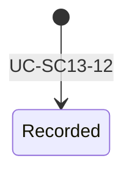

🏠 [Specs](../../../README.md) › 🏷️ [Sectors](../../README.md) › 🌾 [SC13 Agriculture and food](../README.md) ›
🗃️ [Data](README.md) › 🗃️ E-SC13-11 Organic record

# 🗃️ E-SC13-11 Organic record

**Status:** ✅ specified

## Purpose

Evidence for the organic control.

## Fields

| Name | Type | Required | Validation | Default | Example | Personal data | Custom fields |
|---|---|---|---|---|---|---|---|
| plot or lot, document | records | yes | BR-SC13-08 | - | Les Prés, seed invoice | no | no |

## Relations

As its use cases.

## Lifecycle

## Indexes and search

By number, date, partner.

## Retention

Kept for the period of its kind of record in the country pack (D293), or else its kind's default in the
[retention schedule](../../../05-non-functional/data-retention.md).

## Audit

Every change.

## Import and export

CSV, FEC where relevant.

## Used by

- [UC-SC13-12](../use-cases/04-sales-and-certification/uc-sc13-12-keep-organic-certification-records.md)

## Open questions

None.

---

⬅️ [E-SC13-10 Cooperative statement](e-sc13-10-cooperative-statement.md) · ⬆️ [Up](README.md) ·
➡️ [E-SC13-12 Batch](e-sc13-12-batch.md)
