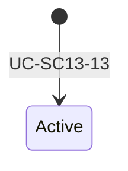

🏠 [Specs](../../../README.md) › 🏷️ [Sectors](../../README.md) › 🌾 [SC13 Agriculture and food](../README.md) ›
🗃️ [Data](README.md) › 🗃️ E-SC13-12 Batch

# 🗃️ E-SC13-12 Batch

**Status:** 🔄 waiting for the owner

## Purpose

A processing batch of the shared recipes capability
([E-F12-25 Recipe](../../../02-functional/f12-manufacturing/data/e-f12-25-recipe.md)), with what the farm adds: the
farm's lots used and the output lot.

## Fields

| Name | Type | Required | Validation | Default | Example | Personal data | Custom fields |
|---|---|---|---|---|---|---|---|
| recipe, lots used, output lot | records | yes | BR-SC13-06 | - | jam, apples A-3, J-77 | no | no |

## Relations

(Proposed) As its use cases.

## Lifecycle

## Indexes and search

(Proposed) By number, date, partner.

## Retention

Lots per [CR-FR-061 Food traceability](../../../10-country-packs/france/products/cr-fr-061-food-traceability.md).

## Audit

Every change.

## Import and export

(Proposed) CSV, FEC where relevant.

## Used by

- [UC-SC13-13](../use-cases/05-food-processing/uc-sc13-13-manage-recipes-and-batches-for-processing.md)
- [UC-SC13-14](../use-cases/05-food-processing/uc-sc13-14-trace-lots-from-field-to-customer.md)

## Open questions

None.

---

⬅️ [E-SC13-11 Organic record](e-sc13-11-organic-record.md) · ⬆️ [Up](README.md) ·
➡️ [E-SC13-13 Hygiene reading](e-sc13-13-hygiene-reading.md)
