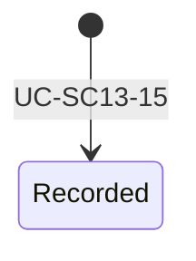

🏠 [Specs](../../../README.md) › 🏷️ [Sectors](../../README.md) › 🌾 [SC13 Agriculture and food](../README.md) ›
🗃️ [Data](README.md) › 🗃️ E-SC13-13 Hygiene reading

# 🗃️ E-SC13-13 Hygiene reading

**Status:** 🔄 waiting for the owner

## Purpose

A processing hygiene record.

## Fields

| Name | Type | Required | Validation | Default | Example | Personal data | Custom fields |
|---|---|---|---|---|---|---|---|
| place, value, time | records | yes | BR-SC13-09 | - | cold room, 3 °C, 08:00 | no | no |

## Relations

(Proposed) As its use cases.

## Lifecycle

## Indexes and search

(Proposed) By number, date, partner.

## Retention

Kept for the period of its kind of record in the country pack (D293), or else its kind's default in the
[retention schedule](../../../05-non-functional/data-retention.md).

## Audit

Every change.

## Import and export

(Proposed) CSV, FEC where relevant.

## Used by

- [UC-SC13-15](../use-cases/05-food-processing/uc-sc13-15-run-haccp-and-hygiene-records.md)

## Open questions

None.

---

⬅️ [E-SC13-12 Batch](e-sc13-12-batch.md) · ⬆️ [Up](README.md) ·
➡️ [E-SC13-14 Product label](e-sc13-14-product-label.md)
