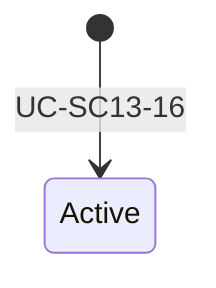

🏠 [Specs](../../../README.md) › 🏷️ [Sectors](../../README.md) › 🌾 [SC13 Agriculture and food](../README.md) ›
🗃️ [Data](README.md) › 🗃️ E-SC13-14 Product label

# 🗃️ E-SC13-14 Product label

**Status:** ✅ specified

## Purpose

A label from a recipe.

## Fields

| Name | Type | Required | Validation | Default | Example | Personal data | Custom fields |
|---|---|---|---|---|---|---|---|
| product, ingredients, allergens | records | yes | BR-SC13-07 | - | walnut cake, nuts | no | no |

## Relations

As its use cases.

## Lifecycle

## Indexes and search

By number, date, partner.

## Retention

Kept for the period of its kind of record in the country pack (D293), or else its kind's default in the
[retention schedule](../../../05-non-functional/data-retention.md).

## Audit

Every change.

## Import and export

CSV, FEC where relevant.

## Used by

- [UC-SC13-16](../use-cases/05-food-processing/uc-sc13-16-label-products.md)

## Open questions

None.

---

⬅️ [E-SC13-13 Hygiene reading](e-sc13-13-hygiene-reading.md) · ⬆️ [Up](README.md) ·
➡️ [E-SC13-15 Recall](e-sc13-15-recall.md)
