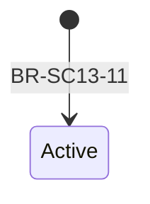

🏠 [Specs](../../../README.md) › 🏷️ [Sectors](../../README.md) › 🌾 [SC13 Agriculture and food](../README.md) ›
🗃️ [Data](README.md) › 🗃️ E-SC13-15 Recall

# 🗃️ E-SC13-15 Recall

**Status:** ✅ specified

## Purpose

A recall of lots.

## Fields

| Name | Type | Required | Validation | Default | Example | Personal data | Custom fields |
|---|---|---|---|---|---|---|---|
| lots, reason, customers | records | yes | BR-SC13-11 | - | J-77, glass, 14 | no | no |

## Relations

As its use cases.

## Lifecycle

## Indexes and search

By number, date, partner.

## Retention

Lots per [CR-FR-061 Food traceability](../../../10-country-packs/france/products/cr-fr-061-food-traceability.md).

## Audit

Every change.

## Import and export

CSV, FEC where relevant.

## Used by

- [UC-SC13-17](../use-cases/05-food-processing/uc-sc13-17-manage-shelf-life-rotation-and-recalls.md)

## Open questions

None.

---

⬅️ [E-SC13-14 Product label](e-sc13-14-product-label.md) · ⬆️ [Up](README.md) ·
➡️ [E-SC13-16 CAP aid declaration](e-sc13-16-cap-aid-declaration.md)
