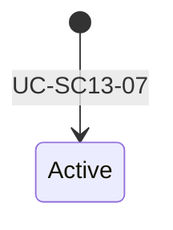

🏠 [Specs](../../../README.md) › 🏷️ [Sectors](../../README.md) › 🌾 [SC13 Agriculture and food](../README.md) ›
🗃️ [Data](README.md) › 🗃️ E-SC13-16 CAP aid declaration

# 🗃️ E-SC13-16 CAP aid declaration

**Status:** 🔄 waiting for the owner

## Purpose

(Proposed) The CAP aid declaration the flow charts name with the words "Aid"
([FL-SC13-03](../flows/fl-sc13-03-farm-business.md)). The owner decided to create it
([D516](../../../06-decisions/foundations/d516-naming-rules-and-the-seven-classes-of-names.md)); what it holds waits for
the owner's confirmation.

## Fields

(Proposed) To define with the owner: the flow charts name the record, not its fields.

## Relations

(Proposed) To define with the owner, from the use cases below.

## Lifecycle

## Indexes and search

(Proposed) To define with the owner.

## Retention

(Proposed) As the other records of its capability, to confirm with the owner.

## Audit

(Proposed) Every change, as the other records of its capability.

## Import and export

(Proposed) To define with the owner.

## Used by

- [UC-SC13-07 Declare CAP aid](../use-cases/03-farm-business/uc-sc13-07-declare-cap-aid.md)

## Open questions

(Proposed) Its fields, relations and states wait for the owner (waiting list, step 36e).

---

⬅️ [E-SC13-15 Recall](e-sc13-15-recall.md) · ⬆️ [Up](README.md) · ➡️ [E-SC13-17 Vine plot](e-sc13-17-vine-plot.md)
