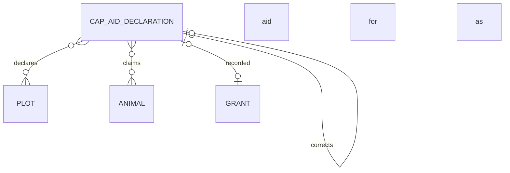
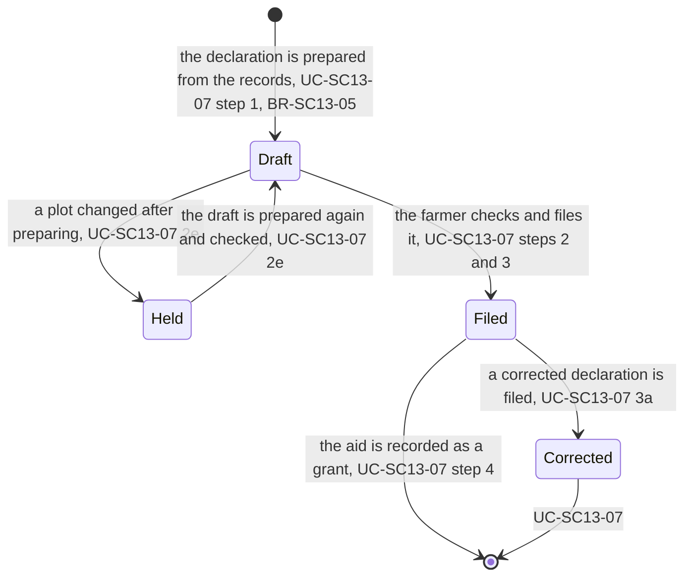

🏠 [Specs](../../../README.md) › 🏷️ [Sectors](../../README.md) › 🌾 [SC13 Agriculture and food](../README.md) ›
🗃️ [Data](README.md) › 🗃️ E-SC13-16 CAP aid declaration

# 🗃️ E-SC13-16 CAP aid declaration

**Status:** ✅ specified

## Purpose

The CAP aid declaration the flow charts name with the words "Aid" ([FL-SC13-03](../flows/fl-sc13-03-farm-business.md)).
The owner decided to create it
([D516](../../../06-decisions/foundations/d516-naming-rules-and-the-seven-classes-of-names.md)); its fields are derived
from the specifications and confirmed by the owner (D572).

## Fields

| Name | Type | Required | Validation | Default | Example | Personal data | Custom fields |
|---|---|---|---|---|---|---|---|
| title | text | yes | not empty | - | CAP aid 2027 | no | no |
| campaign | year | yes | one declaration per campaign, corrections apart | - | 2027 | no | no |
| plots | lines with plot (E-SC13-01), crop and area, computed | yes | from the records, BR-SC13-05 | computed | 18 plots, 86 ha; Les Prés 4.2 ha of wheat | no | no |
| animal aid | animals (E-SC13-05) counted, computed | no | from the herd records | computed | 64 cows | no | no |
| organic plots | area in hectares, computed | no | from the plots' organic field | computed | 4.2 ha | no | no |
| checks | per item, OK or to check, computed | yes | all OK to file | computed | plots OK | no | no |
| file by | date | yes | the campaign's deadline, as [CR-FR-164](../../../10-country-packs/france/agriculture/cr-fr-164-cap-aid-declaration.md) says | computed | 2027-05-15 | no | no |
| filed on | date | no | set at filing | - | 2027-05-02 | no | no |
| corrects | CAP aid declaration | no | a filed declaration of the same campaign | - | CAP aid 2027 | no | no |
| grant | grant (E-F8-18) | no | set when the aid is recorded | - | CAP aid 2027, 18,400 EUR | no | no |
| state | Draft, Held, Filed, Corrected | yes | the lifecycle below | Draft | Filed | no | no |

The declaration is prepared from plots, crops and herds, checked by the farmer, filed on the official service and the
aid recorded as a grant; a plot changed after preparing sends it back to a check, the deadline near reminds the farmer,
and a correction after filing is a corrected declaration
([UC-SC13-07](../use-cases/03-farm-business/uc-sc13-07-declare-cap-aid.md) steps 1 to 4, 3a, 2e, 3e, its postconditions
and acceptance criteria, [BR-SC13-05](../business-rules/br-sc13-05-aid-declared-from-the-records.md)). The title and
the state are the columns of [S-SC13-L16 CAP aid declarations](../screens/00-lists/s-sc13-l16-cap-aid-declarations.md),
whose example rows read "CAP aid 2026"; the plots, animal aid, organic plots and their checks are those of the
[S-SC13-07 Aid declaration](../screens/03-farm-business/s-sc13-07-aid-declaration.md) mock-up, "Draft from the
records", where a filed declaration is read-only.

## Relations

- [E-SC13-01 Plot](e-sc13-01-plot.md): the plots, their crops, areas and organic status
- [E-SC13-02 Crop plan](e-sc13-02-crop-plan.md): the crops of the campaign
- [E-SC13-05 Animal](e-sc13-05-animal.md): the herd the animal aid is claimed for
- [E-F8-18 Grant](../../../02-functional/f08-accounting/data/e-f08-18-grant.md): the aid received, accounted with
  [UC-F8-22](../../../02-functional/f08-accounting/use-cases/07-client-money-grants-and-non-profits/uc-f08-22-account-for-a-grant.md)

## Lifecycle

## Indexes and search

By title and state, the sort and facet of
[S-SC13-L16 CAP aid declarations](../screens/00-lists/s-sc13-l16-cap-aid-declarations.md); searched by title and
campaign.

## Retention

As the other records of its capability.

## Audit

Every change, as the other records of its capability.

## Import and export

The declaration is exported for the official service, as the
[S-SC13-07 Aid declaration](../screens/03-farm-business/s-sc13-07-aid-declaration.md) mock-up shows ("Export for the
official service", Télépac in France,
[CR-FR-164](../../../10-country-packs/france/agriculture/cr-fr-164-cap-aid-declaration.md)); CSV or XLSX export of the
rows and columns the user may see, from
[S-SC13-L16 CAP aid declarations](../screens/00-lists/s-sc13-l16-cap-aid-declarations.md), audited (T3); no import.

## Used by

- [UC-SC13-07 Declare CAP aid](../use-cases/03-farm-business/uc-sc13-07-declare-cap-aid.md)

## Open questions

None.

---

⬅️ [E-SC13-15 Recall](e-sc13-15-recall.md) · ⬆️ [Up](README.md) · ➡️ [E-SC13-17 Vine plot](e-sc13-17-vine-plot.md)
