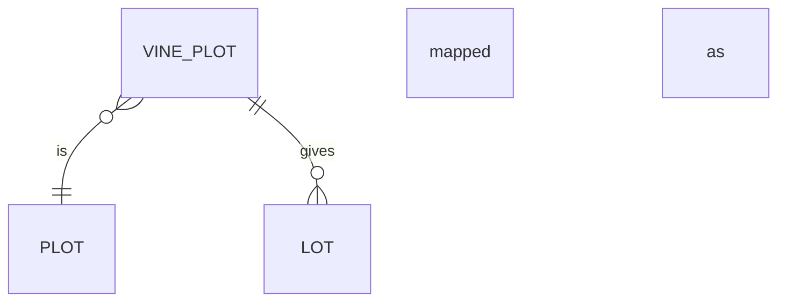
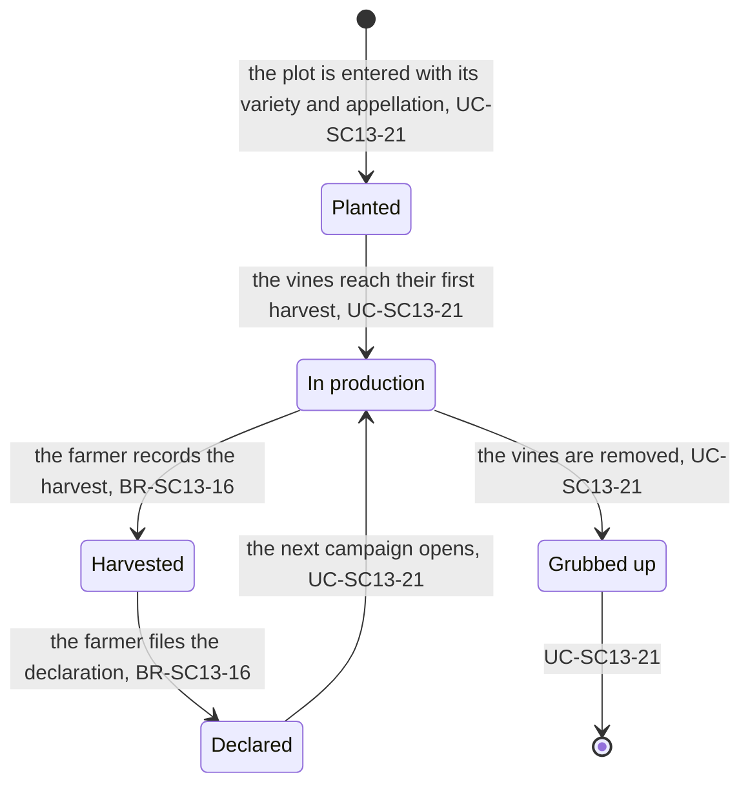

🏠 [Specs](../../../README.md) › 🏷️ [Sectors](../../README.md) › 🌾 [SC13 Agriculture and food](../README.md) ›
🗃️ [Data](README.md) › 🗃️ E-SC13-17 Vine plot

# 🗃️ E-SC13-17 Vine plot

**Status:** ✅ specified

## Purpose

One vine plot as the wine estate declares it: its variety, appellation, area and the harvest of the campaign
([D557](../../../06-decisions/sectors/d557-benchmark-gaps-sc13-agriculture-and-food.md)). It is not the mapped plot of
the crop plan ([E-SC13-01 Plot](e-sc13-01-plot.md)): it adds the appellation, the yield limit and the declaration state
that only vines need.

## Fields

| Name | Type | Required | Validation | Default | Example | Personal data | Custom fields |
|---|---|---|---|---|---|---|---|
| plot | plot (E-SC13-01) | yes | a mapped plot of the company | - | P12 | no | no |
| variety | text | yes | a grape variety of the catalogue | - | Grenache | no | no |
| appellation | text | yes | an appellation of the country pack | - | Red AOP | no | no |
| area | number in hectares | yes | above 0 and not above the plot's area | from the plot | 2.0 | no | no |
| planting year | year | no | not in the future | - | 2004 | no | no |
| harvest | number in hectolitres | no | 0 or more | - | 130 | no | no |
| yield limit | number in hectolitres per hectare | no | from the appellation | - | 60 | no | no |
| excess | number in hectolitres | no | harvest above the limit times the area | 0 | 10 | no | no |
| declared on | date | no | not before the harvest | - | 2026-10-28 | no | no |
| state | Planted, In production, Harvested, Declared, Grubbed up | yes | the lifecycle below | Planted | In production | no | no |
| owner | user | yes | a user of the company | the creator | Claire P. | yes | no |

## Relations

- [E-SC13-01 Plot](e-sc13-01-plot.md)
- [E-SC13-04 Lot](e-sc13-04-lot.md)
- [E-F8-06 Tax return](../../../02-functional/f08-accounting/data/e-f08-06-tax-return.md)

## Lifecycle

## Indexes and search

By plot, variety, appellation, campaign and state.

## Retention

Kept ten years with the accounting records
([CR-FR-002](../../../10-country-packs/france/accounting/cr-fr-002-accounting-records-kept-ten-years.md)).

## Audit

Every change of area, variety, appellation, harvest and declaration, with who, when and the old and new value.

## Import and export

Export of the harvest declaration lines for the customs portal; import of the plots from the parcel register
as CSV.

## Used by

- [UC-SC13-21](../use-cases/06-vineyards-contractors-and-cooperatives/uc-sc13-21-run-the-vineyard-and-the-cellar.md)
- [UC-SC13-04](../use-cases/01-crops/uc-sc13-04-record-harvests-yields-and-lots.md)

## Open questions

None.

---

⬅️ [E-SC13-16 CAP aid declaration](e-sc13-16-cap-aid-declaration.md) · ⬆️ [Up](README.md) ·
➡️ [E-SC13-18 Field job](e-sc13-18-field-job.md)
