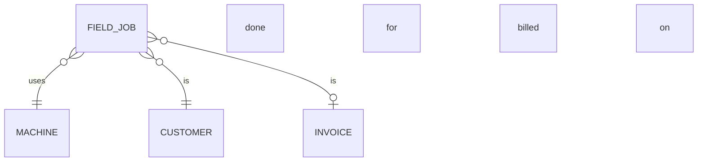
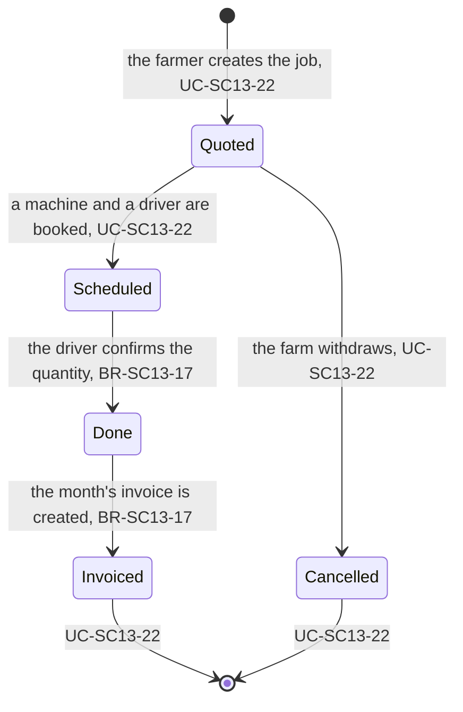

🏠 [Specs](../../../README.md) › 🏷️ [Sectors](../../README.md) › 🌾 [SC13 Agriculture and food](../README.md) ›
🗃️ [Data](README.md) › 🗃️ E-SC13-18 Field job

# 🗃️ E-SC13-18 Field job

**Status:** ✅ specified

## Purpose

One piece of work done for a farm with a machine and a driver, billed by the hectare or by the hour
([D557](../../../06-decisions/sectors/d557-benchmark-gaps-sc13-agriculture-and-food.md)). It is not a rental
([E-F6-09 Rental](../../../02-functional/f06-customers-and-sales/data/e-f06-09-rental.md)): the contractor supplies the
driver and the work, not only the machine.

## Fields

| Name | Type | Required | Validation | Default | Example | Personal data | Custom fields |
|---|---|---|---|---|---|---|---|
| farm | customer (E-F6-01) | yes | a customer of the company | - | Ferme Aubin | no | no |
| work | text | yes | a work of the catalogue | - | Baling | no | no |
| field | text | no | a field of the farm | - | Les Longs Champs | no | no |
| basis | hectare, hour | yes | one of the two | hectare | hectare | no | no |
| price | amount in EUR | yes | 0 or more | - | 42.00 | no | no |
| quantity | number in hectares or hours | no | above 0, in the basis | - | 13.8 | no | no |
| machine | machine (E-SC13-07) | yes | free at that time | - | Press 2 | no | no |
| driver | employee (E-F9-01) | yes | free at that time | - | Lucas | no | no |
| date | date | yes | - | today | 2026-06-12 | no | no |
| state | Quoted, Scheduled, Done, Invoiced, Cancelled | yes | the lifecycle below | Quoted | Scheduled | no | no |
| owner | user | yes | a user of the company | the creator | Claire P. | yes | no |

## Relations

- [E-SC13-07 Machine](e-sc13-07-machine.md)
- [E-F6-01](../../../02-functional/f06-customers-and-sales/data/e-f06-01-customer-record.md)
- [E-F6-05 Invoice](../../../02-functional/f06-customers-and-sales/data/e-f06-05-invoice.md)
- [E-F9-01](../../../02-functional/f09-hr-and-projects/data/e-f09-01-employee-record.md)

## Lifecycle

## Indexes and search

By farm, work, machine, driver, date and state.

## Retention

Kept ten years with the invoices
([CR-FR-002](../../../10-country-packs/france/accounting/cr-fr-002-accounting-records-kept-ten-years.md)).

## Audit

Every change of basis, price, quantity, machine and driver, with who, when and the old and new value.

## Import and export

Export of the jobs of a month as CSV for the farm; import of the field list of a farm as CSV.

## Used by

- [UC-SC13-22](../use-cases/06-vineyards-contractors-and-cooperatives/uc-sc13-22-work-as-an-agricultural-contractor.md)
- [UC-SC13-08](../use-cases/03-farm-business/uc-sc13-08-manage-machinery-fuel-and-maintenance.md)

## Open questions

None.

---

⬅️ [E-SC13-17 Vine plot](e-sc13-17-vine-plot.md) · ⬆️ [Up](README.md) ·
➡️ [E-SC13-19 Member delivery](e-sc13-19-member-delivery.md)
