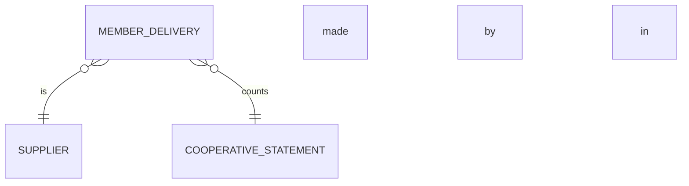
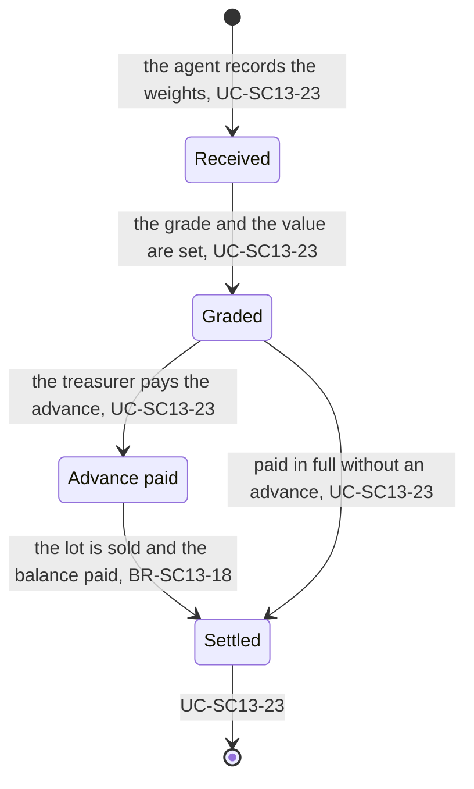

🏠 [Specs](../../../README.md) › 🏷️ [Sectors](../../README.md) › 🌾 [SC13 Agriculture and food](../README.md) ›
🗃️ [Data](README.md) › 🗃️ E-SC13-19 Member delivery

# 🗃️ E-SC13-19 Member delivery

**Status:** ✅ specified

## Purpose

One delivery of a member to the cooperative with its weight, grade and value, which is paid in an advance and a balance
and counts for the member's rebate
([D557](../../../06-decisions/sectors/d557-benchmark-gaps-sc13-agriculture-and-food.md)). It is not the statement of the
member ([E-SC13-10 Cooperative statement](e-sc13-10-cooperative-statement.md)): the statement adds up the deliveries of
a period.

## Fields

| Name | Type | Required | Validation | Default | Example | Personal data | Custom fields |
|---|---|---|---|---|---|---|---|
| member | supplier (E-F7-01) | yes | a member of the cooperative | - | 0412 Aubin | no | no |
| product | item (E-F7-06) | yes | a collected product | - | Wheat | no | no |
| gross weight | number in tonnes | yes | above 0 | - | 18.2 | no | no |
| tare | number in tonnes | yes | 0 or more and below the gross weight | - | 5.8 | no | no |
| net weight | number in tonnes | yes | gross minus tare | computed | 12.4 | no | no |
| grade | text | no | a grade of the grid | - | 1 | no | no |
| value | amount in EUR | no | net weight times the grade's price | - | 2,852.00 | no | no |
| advance | amount in EUR | no | not above the value | 0 | 1,426.00 | no | no |
| rebate | amount in EUR | no | 0 or more | 0 | 0.00 | no | no |
| delivered on | date | yes | - | today | 2026-07-14 | no | no |
| state | Received, Graded, Advance paid, Settled | yes | the lifecycle below | Received | Graded | no | no |
| owner | user | yes | a user of the company | the creator | Claire P. | yes | no |

## Relations

- [E-F7-01](../../../02-functional/f07-purchasing-and-stock/data/e-f07-01-supplier-record.md)
- [E-F7-06 Item](../../../02-functional/f07-purchasing-and-stock/data/e-f07-06-item.md)
- [E-SC13-10 Cooperative statement](e-sc13-10-cooperative-statement.md)

## Lifecycle

## Indexes and search

By member, product, grade, harvest year and state.

## Retention

Kept ten years with the accounting records
([CR-FR-002](../../../10-country-packs/france/accounting/cr-fr-002-accounting-records-kept-ten-years.md)).

## Audit

Every weight, grade, advance, balance and rebate, with who, when and the old and new value.

## Import and export

Import of weighbridge tickets as CSV; export of the members' statements as PDF.

## Used by

- [UC-SC13-23](../use-cases/06-vineyards-contractors-and-cooperatives/uc-sc13-23-run-a-cooperative.md)
- [UC-SC13-11](../use-cases/04-sales-and-certification/uc-sc13-11-deliver-to-the-cooperative-and-follow-payments.md)

## Open questions

None.

---

⬅️ [E-SC13-18 Field job](e-sc13-18-field-job.md) · ⬆️ [Up](README.md) ·
➡️ [E-SC13-20 Basket subscription](e-sc13-20-basket-subscription.md)
