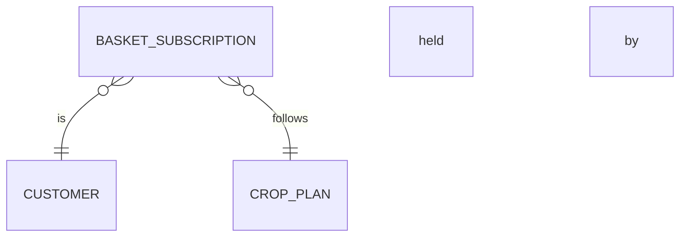
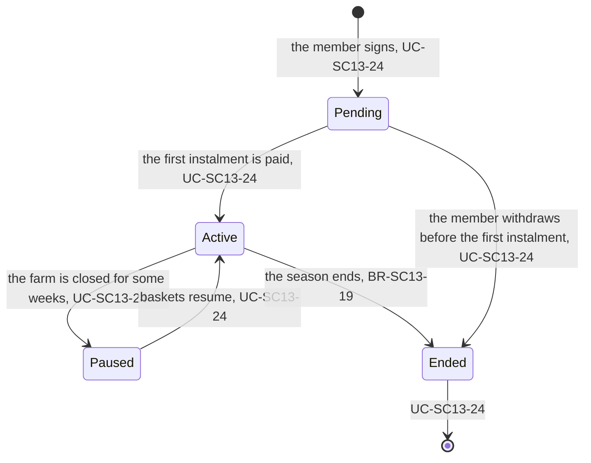

🏠 [Specs](../../../README.md) › 🏷️ [Sectors](../../README.md) › 🌾 [SC13 Agriculture and food](../README.md) ›
🗃️ [Data](README.md) › 🗃️ E-SC13-20 Basket subscription

# 🗃️ E-SC13-20 Basket subscription

**Status:** ✅ specified

## Purpose

The contract of one member for the baskets of one season, with its size, pick-up point, price and instalments
([D557](../../../06-decisions/sectors/d557-benchmark-gaps-sc13-agriculture-and-food.md)). It is not the generic
subscription contract
([E-F6-07](../../../02-functional/f06-customers-and-sales/data/e-f06-07-subscription-contract.md)): the baskets follow
the harvest, have absences and swaps, and the price is fixed for the season.

## Fields

| Name | Type | Required | Validation | Default | Example | Personal data | Custom fields |
|---|---|---|---|---|---|---|---|
| member | customer (E-F6-01) | yes | a customer of the company | - | Marie L. | no | no |
| season | crop plan (E-SC13-02) | yes | an open season | - | Summer 2026 | no | no |
| size | small, medium, large | yes | one of the three | medium | medium | no | no |
| pick-up point | text | yes | from the settings | - | Market | no | no |
| first week | number | yes | within the season | 1 | 1 | no | no |
| price | amount in EUR | yes | weeks times the weekly price of the size | computed | 360.00 | no | no |
| instalments | list of date and amount | yes | adds up to the price | monthly | 90.00 on 2026-05-01 | no | no |
| absences | list of weeks | no | before the cut-off, within the season | none | 27 | no | no |
| signed on | date | yes | - | today | 2026-04-18 | no | no |
| state | Pending, Active, Paused, Ended | yes | the lifecycle below | Pending | Active | no | no |
| owner | user | yes | a user of the company | the creator | Claire P. | yes | no |

## Relations

- [E-F6-01](../../../02-functional/f06-customers-and-sales/data/e-f06-01-customer-record.md)
- [E-SC13-02 Crop plan](e-sc13-02-crop-plan.md)
- [E-F6-07](../../../02-functional/f06-customers-and-sales/data/e-f06-07-subscription-contract.md)

## Lifecycle

## Indexes and search

By member, season, size, pick-up point and state.

## Retention

Kept for the season and three years after, and ten years for the payments
([CR-FR-002](../../../10-country-packs/france/accounting/cr-fr-002-accounting-records-kept-ten-years.md)).

## Audit

Every contract, instalment, absence, swap and pick-up, with who, when and the old and new value.

## Import and export

Export of the week's pick-up list per point as PDF; import of members as CSV.

## Used by

- [UC-SC13-24](../use-cases/06-vineyards-contractors-and-cooperatives/uc-sc13-24-sell-basket-subscriptions.md)
- [UC-SC13-10 Sell directly](../use-cases/04-sales-and-certification/uc-sc13-10-sell-directly.md)

## Open questions

None.

---

⬅️ [E-SC13-19 Member delivery](e-sc13-19-member-delivery.md) · ⬆️ [Up](README.md) ·
➡️ [E-SC13-21 Timber lot](e-sc13-21-timber-lot.md)
