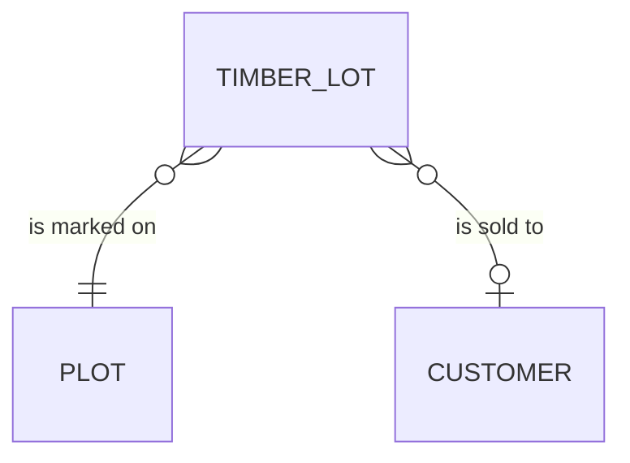
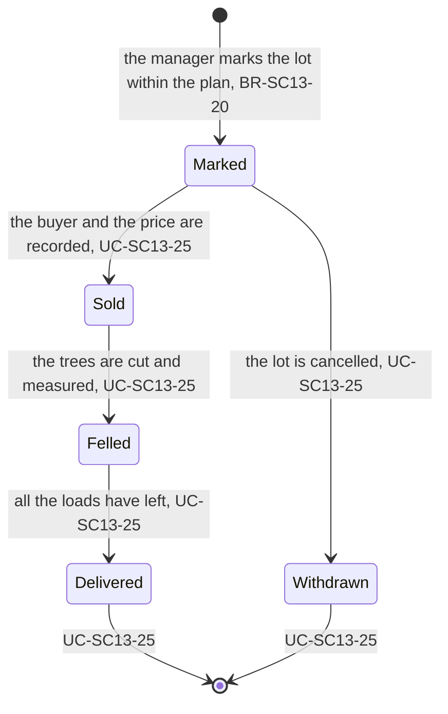

🏠 [Specs](../../../README.md) › 🏷️ [Sectors](../../README.md) › 🌾 [SC13 Agriculture and food](../README.md) ›
🗃️ [Data](README.md) › 🗃️ E-SC13-21 Timber lot

# 🗃️ E-SC13-21 Timber lot

**Status:** ✅ specified

## Purpose

One lot of timber marked on a parcel, sold standing or felled, and followed until it is delivered
([D557](../../../06-decisions/sectors/d557-benchmark-gaps-sc13-agriculture-and-food.md)). It is not a harvest lot of a
crop ([E-SC13-04 Lot](e-sc13-04-lot.md)): its volume is bound by the management plan and it is sold by the cubic metre.

## Fields

| Name | Type | Required | Validation | Default | Example | Personal data | Custom fields |
|---|---|---|---|---|---|---|---|
| parcel | plot (E-SC13-01) | yes | a parcel with a management plan | - | P4 | no | no |
| species | text | yes | a species of the catalogue | - | Oak | no | no |
| estimated volume | number in cubic metres | yes | above 0, within the plan | - | 200 | no | no |
| measured volume | number in cubic metres | no | above 0 | - | 188 | no | no |
| sale kind | standing, felled | no | one of the two | - | standing | no | no |
| price | amount in EUR per cubic metre | no | 0 or more | - | 62.00 | no | no |
| buyer | customer (E-F6-01) | no | a customer of the company | - | Scierie Dumas | no | no |
| felling year | year | yes | a year of the plan | - | 2026 | no | no |
| state | Marked, Sold, Felled, Delivered, Withdrawn | yes | the lifecycle below | Marked | Sold | no | no |
| owner | user | yes | a user of the company | the creator | Claire P. | yes | no |

## Relations

- [E-SC13-01 Plot](e-sc13-01-plot.md)
- [E-SC13-04 Lot](e-sc13-04-lot.md)
- [E-F6-01](../../../02-functional/f06-customers-and-sales/data/e-f06-01-customer-record.md)

## Lifecycle

## Indexes and search

By parcel, species, felling year, buyer and state.

## Retention

Kept ten years with the management plan and the invoices
([CR-FR-002](../../../10-country-packs/france/accounting/cr-fr-002-accounting-records-kept-ten-years.md)).

## Audit

Every marking, sale, measure and load, with who, when and the old and new value.

## Import and export

Export of the year's fellings against the plan as CSV; import of the plan's volumes as CSV.

## Used by

- [UC-SC13-25](../use-cases/06-vineyards-contractors-and-cooperatives/uc-sc13-25-manage-forests-and-timber-sales.md)
- [UC-SC13-14](../use-cases/05-food-processing/uc-sc13-14-trace-lots-from-field-to-customer.md)

## Open questions

None.

---

⬅️ [E-SC13-20 Basket subscription](e-sc13-20-basket-subscription.md) · ⬆️ [Up](README.md)
