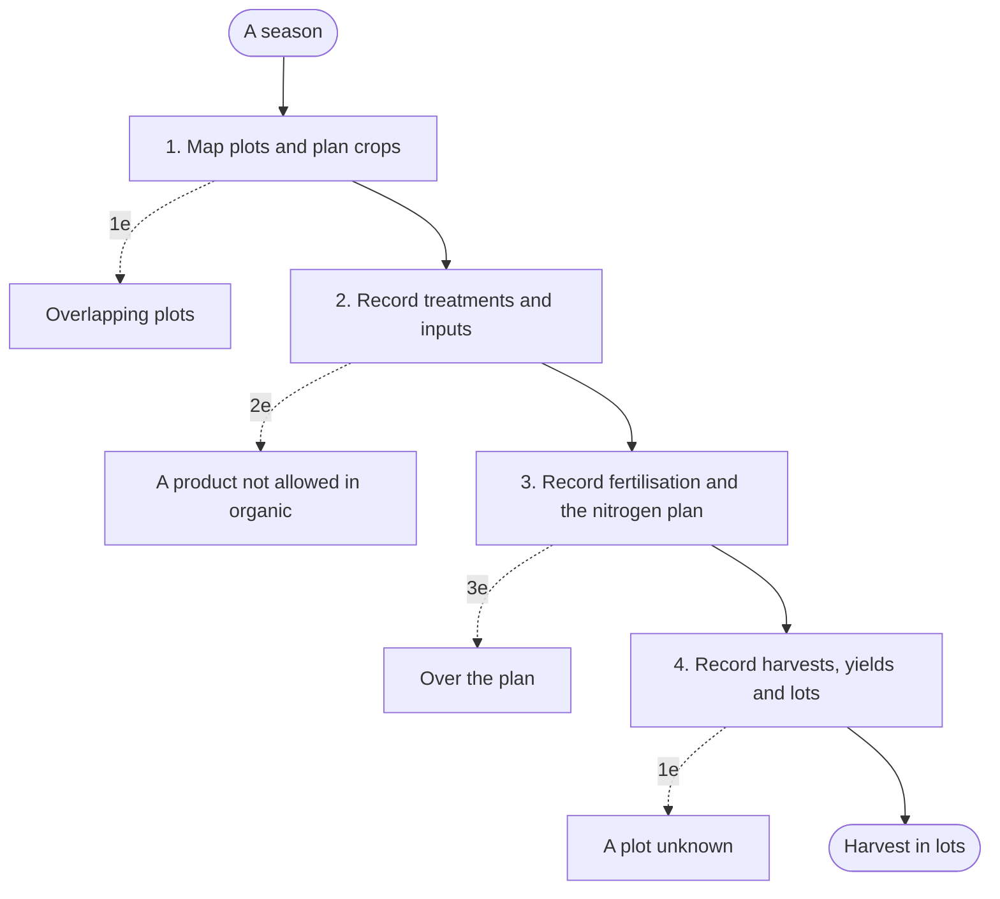

🏠 [Specs](../../../README.md) › 🏷️ [Sectors](../../README.md) › 🌾 [SC13 Agriculture and food](../README.md) ›
🔀 [Flows](README.md) › 🔀 FL-SC13-01 Crops

# 🔀 FL-SC13-01 Crops

**Status:** ✅ specified

## Summary

Crops: plots, treatments, fertilisation and harvests, offline in the field. It covers
[UC-SC13-01 Map plots and plan crops](../use-cases/01-crops/uc-sc13-01-map-plots-and-plan-crops.md),
[UC-SC13-02 Record treatments and inputs](../use-cases/01-crops/uc-sc13-02-record-treatments-and-inputs.md),
[UC-SC13-03 Record fertilisation and the nitrogen plan](../use-cases/01-crops/uc-sc13-03-record-fertilisation-and-the-nitrogen-plan.md),
[UC-SC13-04 Record harvests, yields and lots](../use-cases/01-crops/uc-sc13-04-record-harvests-yields-and-lots.md).

## Personas

- [U14 Field worker](../../../01-users/personas/u14-field-worker.md)
- [U40 Farmer](../../../01-users/personas/u40-farmer.md)

## Flowchart

## Sequence diagram

See each use case.

## Steps

| Step | Persona | Screen | Use case | What happens |
|---|---|---|---|---|
| 1 | U40 | [S-SC13-01](../screens/01-crops/s-sc13-01-plots.md) | [UC-SC13-01](../use-cases/01-crops/uc-sc13-01-map-plots-and-plan-crops.md) | The farmer draws or imports plots with their area and organic status, plans each season's crop and follows the rotation |
| 2 | U40, U14 | [S-SC13-02](../screens/01-crops/s-sc13-02-treatments.md) | [UC-SC13-02](../use-cases/01-crops/uc-sc13-02-record-treatments-and-inputs.md) | The farmer or a field worker records each plant-protection treatment with product, dose, plot, date and operator on the phone, offline in the field |
| 3 | U40 | [S-SC13-03](../screens/01-crops/s-sc13-03-fertilisation.md) | [UC-SC13-03](../use-cases/01-crops/uc-sc13-03-record-fertilisation-and-the-nitrogen-plan.md) | The farmer plans fertilisation, records inputs and compares them with the plan |
| 4 | U40 | [S-SC13-04](../screens/01-crops/s-sc13-04-harvests.md) | [UC-SC13-04](../use-cases/01-crops/uc-sc13-04-record-harvests-yields-and-lots.md) | The farmer records the harvest, creates the lot linked to its plots, and stores it |

### Entities and screens

| Entity | States in this flow | Shown at step and screen | Aggregated view |
|---|---|---|---|
| [E-SC13-02 Crop plan](../data/e-sc13-02-crop-plan.md) | Active | 1 [S-SC13-01](../screens/01-crops/s-sc13-01-plots.md) | Crop plans |
| [E-SC13-01 Plot](../data/e-sc13-01-plot.md) | New, Refused | 1 [S-SC13-01](../screens/01-crops/s-sc13-01-plots.md) | Plots |
| [E-SC13-03 Field operation](../data/e-sc13-03-field-operation.md) | Active | 2 [S-SC13-02](../screens/01-crops/s-sc13-02-treatments.md); 3 [S-SC13-03](../screens/01-crops/s-sc13-03-fertilisation.md) | Field operations |
| [E-F7-06 Item](../../../02-functional/f07-purchasing-and-stock/data/e-f07-06-item.md) | Active | Shown elsewhere: [S-F7-21 Stock levels](../../../02-functional/f07-purchasing-and-stock/screens/03-replenish/s-f07-21-stock-levels.md) | Items |
| [E-SC13-11 Organic record](../data/e-sc13-11-organic-record.md) | Recorded | Shown elsewhere: [S-SC13-12 Organic](../screens/04-sales-and-certification/s-sc13-12-organic.md) | Organic records |
| [E-SC13-04 Lot](../data/e-sc13-04-lot.md) | Blocked, Refused | 4 [S-SC13-04](../screens/01-crops/s-sc13-04-harvests.md) | Lots |

## Errors

- [UC-SC13-01](../use-cases/01-crops/uc-sc13-01-map-plots-and-plan-crops.md) 1e. Overlapping plots: the plot is refused.
- [UC-SC13-01](../use-cases/01-crops/uc-sc13-01-map-plots-and-plan-crops.md) 3e. A crop repeated against the rotation:
  the farmer is warned.
- [UC-SC13-02](../use-cases/01-crops/uc-sc13-02-record-treatments-and-inputs.md) 2e. A product not allowed in organic:
  it is refused on organic plots.
- [UC-SC13-02](../use-cases/01-crops/uc-sc13-02-record-treatments-and-inputs.md) 2f. The dose or the area treated
  missing: it is flagged (a missing operator is accepted).
- [UC-SC13-03](../use-cases/01-crops/uc-sc13-03-record-fertilisation-and-the-nitrogen-plan.md) 3e. Over the plan: the
  farmer is warned.
- [UC-SC13-03](../use-cases/01-crops/uc-sc13-03-record-fertilisation-and-the-nitrogen-plan.md) 2e. A plot unknown: it is
  refused.
- [UC-SC13-04](../use-cases/01-crops/uc-sc13-04-record-harvests-yields-and-lots.md) 1e. A plot unknown: it is refused.
- [UC-SC13-04](../use-cases/01-crops/uc-sc13-04-record-harvests-yields-and-lots.md) 2e. Organic and conventional mixed:
  the lot is refused ([BR-SC13-08](../business-rules/br-sc13-08-organic-kept-apart.md)).

## Images

Every step and error, for each persona taking part, in light and dark mode (D120). Steps are numbered as in the Steps
table; E rows are the error cases.

| Step | Persona | Device | Light | Dark |
|---|---|---|---|---|
| 1 | U40 | desktop | [light](../images/01-crops/u40-farmer/1-plots-desktop-light.png) | [dark](../images/01-crops/u40-farmer/1-plots-desktop-dark.png) |
| 1 | U40 | phone | [light](../images/01-crops/u40-farmer/1-plots-phone-light.png) | [dark](../images/01-crops/u40-farmer/1-plots-phone-dark.png) |
| 2 | U40 | phone | [light](../images/01-crops/u40-farmer/2-treatment-phone-light.png) | [dark](../images/01-crops/u40-farmer/2-treatment-phone-dark.png) |
| 2 | U40 | desktop | [light](../images/01-crops/u40-farmer/2-treatment-desktop-light.png) | [dark](../images/01-crops/u40-farmer/2-treatment-desktop-dark.png) |
| 2 | U14 | phone | [light](../images/01-crops/u14-field-worker/2-treatment-phone-light.png) | [dark](../images/01-crops/u14-field-worker/2-treatment-phone-dark.png) |
| 3 | U40 | desktop | [light](../images/01-crops/u40-farmer/3-fertilisation-desktop-light.png) | [dark](../images/01-crops/u40-farmer/3-fertilisation-desktop-dark.png) |
| 3 | U40 | phone | [light](../images/01-crops/u40-farmer/3-fertilisation-phone-light.png) | [dark](../images/01-crops/u40-farmer/3-fertilisation-phone-dark.png) |
| 4 | U40 | phone | [light](../images/01-crops/u40-farmer/4-harvest-phone-light.png) | [dark](../images/01-crops/u40-farmer/4-harvest-phone-dark.png) |
| 4 | U40 | desktop | [light](../images/01-crops/u40-farmer/4-harvest-desktop-light.png) | [dark](../images/01-crops/u40-farmer/4-harvest-desktop-dark.png) |
| E1 | U40 | phone | [light](../images/01-crops/u40-farmer/e1-organic-input-phone-light.png) | [dark](../images/01-crops/u40-farmer/e1-organic-input-phone-dark.png) |
| E1 | U40 | desktop | [light](../images/01-crops/u40-farmer/e1-organic-input-desktop-light.png) | [dark](../images/01-crops/u40-farmer/e1-organic-input-desktop-dark.png) |

## Open questions

None.

---

⬆️ [Up](README.md) · ➡️ [FL-SC13-02 Livestock](fl-sc13-02-livestock.md)
