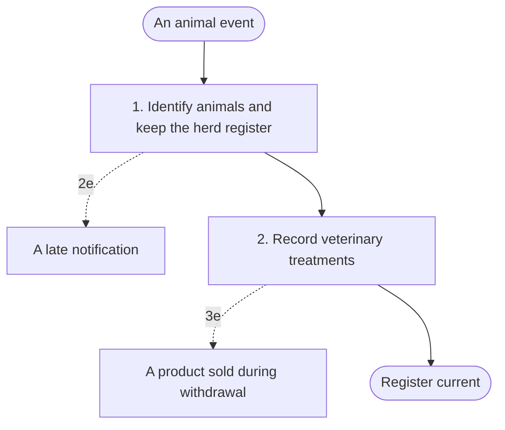

🏠 [Specs](../../../README.md) › 🏷️ [Sectors](../../README.md) › 🌾 [SC13 Agriculture and food](../README.md) ›
🔀 [Flows](README.md) › 🔀 FL-SC13-02 Livestock

# 🔀 FL-SC13-02 Livestock

**Status:** ✅ specified

## Summary

Livestock: the herd register and treatments. It covers
[UC-SC13-05 Identify animals and keep the herd register](../use-cases/02-livestock/uc-sc13-05-identify-animals-and-keep-the-herd-register.md),
[UC-SC13-06 Record veterinary treatments](../use-cases/02-livestock/uc-sc13-06-record-veterinary-treatments.md).

## Personas

- [U40 Farmer](../../../01-users/personas/u40-farmer.md)

## Flowchart

## Sequence diagram

See each use case.

## Steps

| Step | Persona | Screen | Use case | What happens |
|---|---|---|---|---|
| 1 | U40 | [S-SC13-05](../screens/02-livestock/s-sc13-05-herd.md) | [UC-SC13-05](../use-cases/02-livestock/uc-sc13-05-identify-animals-and-keep-the-herd-register.md) | The farmer records births, purchases, movements and deaths, notifies them within the delays and keeps the herd register |
| 2 | U40 | [S-SC13-06](../screens/02-livestock/s-sc13-06-veterinary.md) | [UC-SC13-06](../use-cases/02-livestock/uc-sc13-06-record-veterinary-treatments.md) | The farmer records treatments with their withdrawal period, products under withdrawal cannot be sold |

### Entities and screens

| Entity | States in this flow | Shown at step and screen | Aggregated view |
|---|---|---|---|
| [E-SC13-05 Animal](../data/e-sc13-05-animal.md) | Active | 1 [S-SC13-05](../screens/02-livestock/s-sc13-05-herd.md) | Animals |
| [E-SC13-06 Veterinary treatment](../data/e-sc13-06-veterinary-treatment.md) | Active | 2 [S-SC13-06](../screens/02-livestock/s-sc13-06-veterinary.md) | Veterinary treatments |
| [E-F7-06 Item](../../../02-functional/f07-purchasing-and-stock/data/e-f07-06-item.md) | Active | Shown elsewhere: [S-F7-21 Stock levels](../../../02-functional/f07-purchasing-and-stock/screens/03-replenish/s-f07-21-stock-levels.md) | Items |

## Errors

- [UC-SC13-05](../use-cases/02-livestock/uc-sc13-05-identify-animals-and-keep-the-herd-register.md) 2e. A late
  notification: the farmer is alerted.
- [UC-SC13-05](../use-cases/02-livestock/uc-sc13-05-identify-animals-and-keep-the-herd-register.md) 1e. An identifier
  already used: it is refused.
- [UC-SC13-06](../use-cases/02-livestock/uc-sc13-06-record-veterinary-treatments.md) 3e. A product sold during
  withdrawal: it is refused.
- [UC-SC13-06](../use-cases/02-livestock/uc-sc13-06-record-veterinary-treatments.md) 1e. A product without withdrawal:
  it is asked.

## Images

Every step and error, for each persona taking part, in light and dark mode (D120). Steps are numbered as in the Steps
table; E rows are the error cases.

| Step | Persona | Device | Light | Dark |
|---|---|---|---|---|
| 1 | U40 | phone | [light](../images/02-livestock/u40-farmer/1-herd-phone-light.png) | [dark](../images/02-livestock/u40-farmer/1-herd-phone-dark.png) |
| 1 | U40 | desktop | [light](../images/02-livestock/u40-farmer/1-herd-desktop-light.png) | [dark](../images/02-livestock/u40-farmer/1-herd-desktop-dark.png) |
| 2 | U40 | phone | [light](../images/02-livestock/u40-farmer/2-vet-phone-light.png) | [dark](../images/02-livestock/u40-farmer/2-vet-phone-dark.png) |
| 2 | U40 | desktop | [light](../images/02-livestock/u40-farmer/2-vet-desktop-light.png) | [dark](../images/02-livestock/u40-farmer/2-vet-desktop-dark.png) |
| E1 | U40 | desktop | [light](../images/02-livestock/u40-farmer/e1-withdrawal-desktop-light.png) | [dark](../images/02-livestock/u40-farmer/e1-withdrawal-desktop-dark.png) |
| E1 | U40 | phone | [light](../images/02-livestock/u40-farmer/e1-withdrawal-phone-light.png) | [dark](../images/02-livestock/u40-farmer/e1-withdrawal-phone-dark.png) |

## Open questions

None.

---

⬅️ [FL-SC13-01 Crops](fl-sc13-01-crops.md) · ⬆️ [Up](README.md) ·
➡️ [FL-SC13-03 Farm business](fl-sc13-03-farm-business.md)
