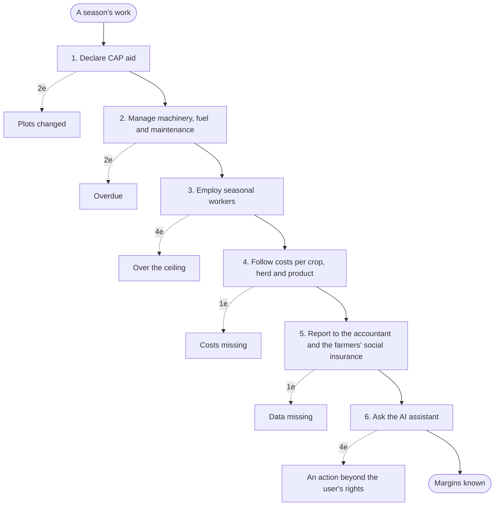

🏠 [Specs](../../../README.md) › 🏷️ [Sectors](../../README.md) › 🌾 [SC13 Agriculture and food](../README.md) ›
🔀 [Flows](README.md) › 🔀 FL-SC13-03 Farm business

# 🔀 FL-SC13-03 Farm business

**Status:** ✅ specified

## Summary

The farm business: aid on the shared grant accounting, machines, seasonal workers, costs, reports, the AI assistant. It
covers [UC-SC13-07 Declare CAP aid](../use-cases/03-farm-business/uc-sc13-07-declare-cap-aid.md),
[UC-SC13-08 Manage machinery, fuel and maintenance](../use-cases/03-farm-business/uc-sc13-08-manage-machinery-fuel-and-maintenance.md),
[UC-SC13-09 Employ seasonal workers](../use-cases/03-farm-business/uc-sc13-09-employ-seasonal-workers.md),
[UC-SC13-18 Follow costs per crop, herd and product](../use-cases/03-farm-business/uc-sc13-18-follow-costs-per-crop-herd-and-product.md),
[UC-SC13-19 Report to the accountant and the farmers' social insurance](../use-cases/03-farm-business/uc-sc13-19-report-to-the-accountant-and-the-farmers-social-insurance.md),
[UC-SC13-20 Ask the AI assistant](../use-cases/03-farm-business/uc-sc13-20-ask-the-assistant.md).

## Personas

- [U05 Accounting](../../../01-users/personas/u05-accounting.md)
- [U14 Field worker](../../../01-users/personas/u14-field-worker.md)
- [U40 Farmer](../../../01-users/personas/u40-farmer.md)

## Flowchart

## Sequence diagram

See each use case.

## Steps

| Step | Persona | Screen | Use case | What happens |
|---|---|---|---|---|
| 1 | U40, U05 | [S-SC13-07](../screens/03-farm-business/s-sc13-07-aid-declaration.md) | [UC-SC13-07](../use-cases/03-farm-business/uc-sc13-07-declare-cap-aid.md) | The farmer prepares the yearly CAP aid declaration from plots, crops and herds, checks it and files it, aid received is accounted for with the shared grant accounting |
| 2 | U40 | [S-SC13-08](../screens/03-farm-business/s-sc13-08-machinery.md) | [UC-SC13-08](../use-cases/03-farm-business/uc-sc13-08-manage-machinery-fuel-and-maintenance.md) | The farmer records machine use, fuel and repairs, plans maintenance and charges costs to crops |
| 3 | U40, U14 | [S-SC13-09](../screens/03-farm-business/s-sc13-09-seasonal-work.md) | [UC-SC13-09](../use-cases/03-farm-business/uc-sc13-09-employ-seasonal-workers.md) | The farmer hires seasonal workers, records their time in the field and sends pay inputs, the seasonal exemption applies within its ceiling |
| 4 | U40, U05 | [S-SC13-18](../screens/03-farm-business/s-sc13-18-costs.md) | [UC-SC13-18](../use-cases/03-farm-business/uc-sc13-18-follow-costs-per-crop-herd-and-product.md) | The farmer and accounting allocate costs and compute margins per crop, herd and product |
| 5 | U05, U40 | [S-SC13-19](../screens/03-farm-business/s-sc13-19-farm-reports.md) | [UC-SC13-19](../use-cases/03-farm-business/uc-sc13-19-report-to-the-accountant-and-the-farmers-social-insurance.md) | Accounting exports the books and declarations to the accountant and the farmers' social insurance, and archives them |
| 6 | U40 | [S-SC13-20](../screens/03-farm-business/s-sc13-20-farm-assistant.md) | [UC-SC13-20](../use-cases/03-farm-business/uc-sc13-20-ask-the-assistant.md) | The farmer asks the AI assistant about a plot's last treatment, animals to notify or aid deadlines, and can dictate a treatment in the cab |

### Entities and screens

| Entity | States in this flow | Shown at step and screen | Aggregated view |
|---|---|---|---|
| [E-SC13-02 Crop plan](../data/e-sc13-02-crop-plan.md) | Active | 4 [S-SC13-18](../screens/03-farm-business/s-sc13-18-costs.md) | Crop plans |
| [E-SC13-16 CAP aid declaration](../data/e-sc13-16-cap-aid-declaration.md) | Active | 1 [S-SC13-07](../screens/03-farm-business/s-sc13-07-aid-declaration.md) | CAP aid declarations |
| [E-SC13-01 Plot](../data/e-sc13-01-plot.md) | New, Refused | 1 [S-SC13-07](../screens/03-farm-business/s-sc13-07-aid-declaration.md) | Plots |
| [E-SC13-07 Machine](../data/e-sc13-07-machine.md) | Overdue, Flagged | 2 [S-SC13-08](../screens/03-farm-business/s-sc13-08-machinery.md); 4 [S-SC13-18](../screens/03-farm-business/s-sc13-18-costs.md) | Machines |
| [E-F12-10 Maintenance request](../../../02-functional/f12-manufacturing/data/e-f12-10-maintenance-request.md) | Active | Shown elsewhere: [S-F12-08 Maintenance](../../../02-functional/f12-manufacturing/screens/04-quality-and-maintenance/s-f12-08-maintenance.md) | Maintenance requests |
| [E-SC13-03 Field operation](../data/e-sc13-03-field-operation.md) | Active | 6 [S-SC13-20](../screens/03-farm-business/s-sc13-20-farm-assistant.md) | Field operations |
| [E-SC13-05 Animal](../data/e-sc13-05-animal.md) | Active | 1 [S-SC13-07](../screens/03-farm-business/s-sc13-07-aid-declaration.md); 6 [S-SC13-20](../screens/03-farm-business/s-sc13-20-farm-assistant.md) | Animals |
| [E-F7-06 Item](../../../02-functional/f07-purchasing-and-stock/data/e-f07-06-item.md) | Active | Shown elsewhere: [S-F7-21 Stock levels](../../../02-functional/f07-purchasing-and-stock/screens/03-replenish/s-f07-21-stock-levels.md) | Items |
| [E-F3-04 Assistant change batch](../../../02-functional/f03-assistant/data/e-f03-04-assistant-change-batch.md) | Proposed, Cancelled, Done, Partly done, Undone | Shown elsewhere: [S-F3-01 Assistant panel](../../../02-functional/f03-assistant/screens/01-ask-the-assistant/s-f03-01-assistant-panel.md) | Assistant change batches |
| [E-F1-03 User](../../../02-functional/f01-administration/data/e-f01-03-user.md) | Invited, Active, Deactivated | Shown elsewhere: [S-F1-03 Users](../../../02-functional/f01-administration/screens/03-user-lifecycle/s-f01-03-users.md) | Users |
| [E-F1-06 Role](../../../02-functional/f01-administration/data/e-f01-06-role.md) | Active | Shown elsewhere: [S-F1-06 Role editor](../../../02-functional/f01-administration/screens/04-edit-a-role/s-f01-06-role-editor.md) | Roles |
| [E-F13-03 Pay input](../../../02-functional/f13-payroll/data/e-f13-03-pay-input.md) | Open, Complete, Late, Closed | Shown elsewhere: [S-F13-03 Pay inputs](../../../02-functional/f13-payroll/screens/02-monthly-pay-run/s-f13-03-pay-inputs.md) | Pay inputs |

## Errors

- [UC-SC13-07](../use-cases/03-farm-business/uc-sc13-07-declare-cap-aid.md) 2e. Plots changed: the declaration is
  checked again.
- [UC-SC13-07](../use-cases/03-farm-business/uc-sc13-07-declare-cap-aid.md) 3e. The deadline near: the farmer is
  reminded.
- [UC-SC13-08](../use-cases/03-farm-business/uc-sc13-08-manage-machinery-fuel-and-maintenance.md) 2e. Overdue: the
  machine is flagged.
- [UC-SC13-08](../use-cases/03-farm-business/uc-sc13-08-manage-machinery-fuel-and-maintenance.md) 1e. No plot on the
  use: the cost goes to general.
- [UC-SC13-09](../use-cases/03-farm-business/uc-sc13-09-employ-seasonal-workers.md) 4e. Over the ceiling: no exemption
  applies.
- [UC-SC13-09](../use-cases/03-farm-business/uc-sc13-09-employ-seasonal-workers.md) 1e. No hiring declaration: work
  cannot start,
  [BR-F9-03](../../../02-functional/f09-hr-and-projects/business-rules/br-f09-03-dpae-before-the-first-day.md).
- [UC-SC13-18](../use-cases/03-farm-business/uc-sc13-18-follow-costs-per-crop-herd-and-product.md) 1e. Costs missing:
  they are shown.
- [UC-SC13-18](../use-cases/03-farm-business/uc-sc13-18-follow-costs-per-crop-herd-and-product.md) 3e. A year without
  data: it is shown empty.
- [UC-SC13-19](../use-cases/03-farm-business/uc-sc13-19-report-to-the-accountant-and-the-farmers-social-insurance.md)
  1e. Data missing: it is listed.
- [UC-SC13-19](../use-cases/03-farm-business/uc-sc13-19-report-to-the-accountant-and-the-farmers-social-insurance.md)
  2e. A declaration refused: the reason is shown.
- [UC-SC13-20](../use-cases/03-farm-business/uc-sc13-20-ask-the-assistant.md) 4e. An action beyond the user's rights:
  the AI assistant refuses.
- [UC-SC13-20](../use-cases/03-farm-business/uc-sc13-20-ask-the-assistant.md) 2e. No data: the AI assistant says so.

## Images

Every step and error, for each persona taking part, in light and dark mode (D120). Steps are numbered as in the Steps
table; E rows are the error cases.

| Step | Persona | Device | Light | Dark |
|---|---|---|---|---|
| 1 | U40 | desktop | [light](../images/03-farm-business/u40-farmer/1-aid-desktop-light.png) | [dark](../images/03-farm-business/u40-farmer/1-aid-desktop-dark.png) |
| 1 | U40 | phone | [light](../images/03-farm-business/u40-farmer/1-aid-phone-light.png) | [dark](../images/03-farm-business/u40-farmer/1-aid-phone-dark.png) |
| 1 | U05 | desktop | [light](../images/03-farm-business/u05-accounting/1-aid-desktop-light.png) | [dark](../images/03-farm-business/u05-accounting/1-aid-desktop-dark.png) |
| 2 | U40 | desktop | [light](../images/03-farm-business/u40-farmer/2-machinery-desktop-light.png) | [dark](../images/03-farm-business/u40-farmer/2-machinery-desktop-dark.png) |
| 2 | U40 | phone | [light](../images/03-farm-business/u40-farmer/2-machinery-phone-light.png) | [dark](../images/03-farm-business/u40-farmer/2-machinery-phone-dark.png) |
| 3 | U40 | desktop | [light](../images/03-farm-business/u40-farmer/3-seasonal-desktop-light.png) | [dark](../images/03-farm-business/u40-farmer/3-seasonal-desktop-dark.png) |
| 3 | U40 | phone | [light](../images/03-farm-business/u40-farmer/3-seasonal-phone-light.png) | [dark](../images/03-farm-business/u40-farmer/3-seasonal-phone-dark.png) |
| 3 | U14 | phone | [light](../images/03-farm-business/u14-field-worker/3-seasonal-phone-light.png) | [dark](../images/03-farm-business/u14-field-worker/3-seasonal-phone-dark.png) |
| 4 | U40 | desktop | [light](../images/03-farm-business/u40-farmer/4-costs-desktop-light.png) | [dark](../images/03-farm-business/u40-farmer/4-costs-desktop-dark.png) |
| 4 | U40 | phone | [light](../images/03-farm-business/u40-farmer/4-costs-phone-light.png) | [dark](../images/03-farm-business/u40-farmer/4-costs-phone-dark.png) |
| 4 | U05 | desktop | [light](../images/03-farm-business/u05-accounting/4-costs-desktop-light.png) | [dark](../images/03-farm-business/u05-accounting/4-costs-desktop-dark.png) |
| 5 | U05 | desktop | [light](../images/03-farm-business/u05-accounting/5-reports-desktop-light.png) | [dark](../images/03-farm-business/u05-accounting/5-reports-desktop-dark.png) |
| 5 | U40 | desktop | [light](../images/03-farm-business/u40-farmer/5-reports-desktop-light.png) | [dark](../images/03-farm-business/u40-farmer/5-reports-desktop-dark.png) |
| 5 | U40 | phone | [light](../images/03-farm-business/u40-farmer/5-reports-phone-light.png) | [dark](../images/03-farm-business/u40-farmer/5-reports-phone-dark.png) |
| 6 | U40 | phone | [light](../images/03-farm-business/u40-farmer/6-assistant-phone-light.png) | [dark](../images/03-farm-business/u40-farmer/6-assistant-phone-dark.png) |
| 6 | U40 | desktop | [light](../images/03-farm-business/u40-farmer/6-assistant-desktop-light.png) | [dark](../images/03-farm-business/u40-farmer/6-assistant-desktop-dark.png) |
| E1 | U40 | desktop | [light](../images/03-farm-business/u40-farmer/e1-aid-plot-changed-desktop-light.png) | [dark](../images/03-farm-business/u40-farmer/e1-aid-plot-changed-desktop-dark.png) |
| E1 | U40 | phone | [light](../images/03-farm-business/u40-farmer/e1-aid-plot-changed-phone-light.png) | [dark](../images/03-farm-business/u40-farmer/e1-aid-plot-changed-phone-dark.png) |

## Open questions

None.

---

⬅️ [FL-SC13-02 Livestock](fl-sc13-02-livestock.md) · ⬆️ [Up](README.md) ·
➡️ [FL-SC13-04 Sales and certification](fl-sc13-04-sales-and-certification.md)
