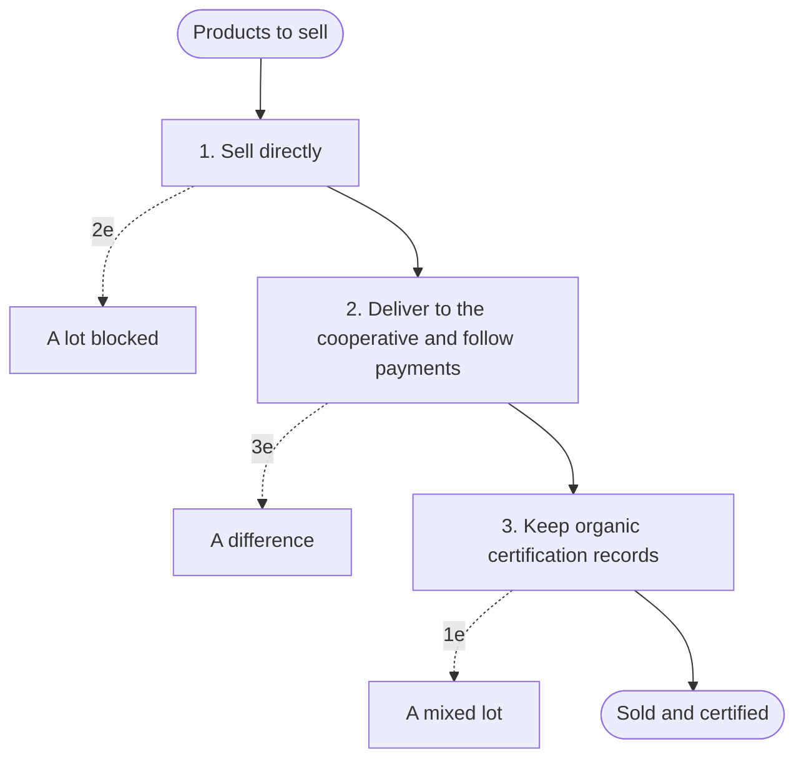

🏠 [Specs](../../../README.md) › 🏷️ [Sectors](../../README.md) › 🌾 [SC13 Agriculture and food](../README.md) ›
🔀 [Flows](README.md) › 🔀 FL-SC13-04 Sales and certification

# 🔀 FL-SC13-04 Sales and certification

**Status:** ✅ specified

## Summary

Sales and organic certification. It covers
[UC-SC13-10 Sell directly](../use-cases/04-sales-and-certification/uc-sc13-10-sell-directly.md),
[UC-SC13-11 Deliver to the cooperative and follow payments](../use-cases/04-sales-and-certification/uc-sc13-11-deliver-to-the-cooperative-and-follow-payments.md),
[UC-SC13-12 Keep organic certification records](../use-cases/04-sales-and-certification/uc-sc13-12-keep-organic-certification-records.md).

## Personas

- [U05 Accounting](../../../01-users/personas/u05-accounting.md)
- [U09 Customer](../../../01-users/personas/u09-customer.md)
- [U27 Quality manager](../../../01-users/personas/u27-quality-manager.md)
- [U40 Farmer](../../../01-users/personas/u40-farmer.md)

## Flowchart

## Sequence diagram

See each use case.

## Steps

| Step | Persona | Screen | Use case | What happens |
|---|---|---|---|---|
| 1 | U40, U09 | [S-SC13-10](../screens/04-sales-and-certification/s-sc13-10-direct-sales.md) | [UC-SC13-10](../use-cases/04-sales-and-certification/uc-sc13-10-sell-directly.md) | The farmer prepares products and sells them at the farm shop, markets or in baskets on the till, lots sold are recorded |
| 2 | U40, U05 | [S-SC13-11](../screens/04-sales-and-certification/s-sc13-11-cooperative.md) | [UC-SC13-11](../use-cases/04-sales-and-certification/uc-sc13-11-deliver-to-the-cooperative-and-follow-payments.md) | The farmer delivers to the cooperative, accounting matches its statements and payments |
| 3 | U40, U27 | [S-SC13-12](../screens/04-sales-and-certification/s-sc13-12-organic.md) | [UC-SC13-12](../use-cases/04-sales-and-certification/uc-sc13-12-keep-organic-certification-records.md) | The farmer keeps organic records, prepares the yearly control with the quality manager, and records the result |

### Entities and screens

| Entity | States in this flow | Shown at step and screen | Aggregated view |
|---|---|---|---|
| [E-F7-06 Item](../../../02-functional/f07-purchasing-and-stock/data/e-f07-06-item.md) | Active | Shown elsewhere: [S-F7-21 Stock levels](../../../02-functional/f07-purchasing-and-stock/screens/03-replenish/s-f07-21-stock-levels.md) | Items |
| [E-SC13-09 Direct sale](../data/e-sc13-09-direct-sale.md) | Active | 1 [S-SC13-10](../screens/04-sales-and-certification/s-sc13-10-direct-sales.md) | Direct sales |
| [E-SC13-04 Lot](../data/e-sc13-04-lot.md) | Blocked, Refused | Shown elsewhere: [S-SC13-04 Harvests](../screens/01-crops/s-sc13-04-harvests.md) | Lots |
| [E-SC13-10 Cooperative statement](../data/e-sc13-10-cooperative-statement.md) | Active | 2 [S-SC13-11](../screens/04-sales-and-certification/s-sc13-11-cooperative.md) | Cooperative statements |
| [E-F6-06 Customer payment](../../../02-functional/f06-customers-and-sales/data/e-f06-06-customer-payment.md) | Refused | Shown elsewhere: [S-F6-07 Payments and reconciliation](../../../02-functional/f06-customers-and-sales/screens/03-invoice-and-get-paid/s-f06-07-payments-and-reconciliation.md) | Customer payments |
| [E-SC13-11 Organic record](../data/e-sc13-11-organic-record.md) | Recorded | 3 [S-SC13-12](../screens/04-sales-and-certification/s-sc13-12-organic.md) | Organic records |
| [E-F9-12 Qualification](../../../02-functional/f09-hr-and-projects/data/e-f09-12-certification.md) | To verify, Verified, Rejected, Expired | Shown elsewhere: [S-F9-35 Employee qualifications](../../../02-functional/f09-hr-and-projects/screens/13-keep-qualifications/s-f09-35-employee-qualifications.md) | Certifications |

## Errors

- [UC-SC13-10](../use-cases/04-sales-and-certification/uc-sc13-10-sell-directly.md) 2e. A lot blocked: it cannot be
  sold.
- [UC-SC13-10](../use-cases/04-sales-and-certification/uc-sc13-10-sell-directly.md) 2f. Past its date: it is blocked
  ([BR-SC13-10](../business-rules/br-sc13-10-shelf-life-and-rotation.md)).
- [UC-SC13-11](../use-cases/04-sales-and-certification/uc-sc13-11-deliver-to-the-cooperative-and-follow-payments.md) 3e.
  A difference: it is shown.
- [UC-SC13-11](../use-cases/04-sales-and-certification/uc-sc13-11-deliver-to-the-cooperative-and-follow-payments.md) 4e.
  No payment: the farmer is told.
- [UC-SC13-12](../use-cases/04-sales-and-certification/uc-sc13-12-keep-organic-certification-records.md) 1e. A mixed
  lot: it is refused.
- [UC-SC13-12](../use-cases/04-sales-and-certification/uc-sc13-12-keep-organic-certification-records.md) 2e. A document
  missing: it is listed.

## Images

Every step and error, for each persona taking part, in light and dark mode (D120). Steps are numbered as in the Steps
table; E rows are the error cases.

| Step | Persona | Device | Light | Dark |
|---|---|---|---|---|
| 1 | U40 | desktop | [light](../images/04-sales-and-certification/u40-farmer/1-direct-desktop-light.png) | [dark](../images/04-sales-and-certification/u40-farmer/1-direct-desktop-dark.png) |
| 1 | U40 | phone | [light](../images/04-sales-and-certification/u40-farmer/1-direct-phone-light.png) | [dark](../images/04-sales-and-certification/u40-farmer/1-direct-phone-dark.png) |
| 1 | U09 | phone | [light](../images/04-sales-and-certification/u09-customer/1-direct-phone-light.png) | [dark](../images/04-sales-and-certification/u09-customer/1-direct-phone-dark.png) |
| 2 | U05 | desktop | [light](../images/04-sales-and-certification/u05-accounting/2-cooperative-desktop-light.png) | [dark](../images/04-sales-and-certification/u05-accounting/2-cooperative-desktop-dark.png) |
| 2 | U40 | desktop | [light](../images/04-sales-and-certification/u40-farmer/2-cooperative-desktop-light.png) | [dark](../images/04-sales-and-certification/u40-farmer/2-cooperative-desktop-dark.png) |
| 2 | U40 | phone | [light](../images/04-sales-and-certification/u40-farmer/2-cooperative-phone-light.png) | [dark](../images/04-sales-and-certification/u40-farmer/2-cooperative-phone-dark.png) |
| 3 | U27 | desktop | [light](../images/04-sales-and-certification/u27-quality-manager/3-organic-desktop-light.png) | [dark](../images/04-sales-and-certification/u27-quality-manager/3-organic-desktop-dark.png) |
| 3 | U27 | tablet | [light](../images/04-sales-and-certification/u27-quality-manager/3-organic-tablet-light.png) | [dark](../images/04-sales-and-certification/u27-quality-manager/3-organic-tablet-dark.png) |
| 3 | U40 | desktop | [light](../images/04-sales-and-certification/u40-farmer/3-organic-desktop-light.png) | [dark](../images/04-sales-and-certification/u40-farmer/3-organic-desktop-dark.png) |
| 3 | U40 | phone | [light](../images/04-sales-and-certification/u40-farmer/3-organic-phone-light.png) | [dark](../images/04-sales-and-certification/u40-farmer/3-organic-phone-dark.png) |
| E1 | U40 | desktop | [light](../images/04-sales-and-certification/u40-farmer/e1-lot-blocked-desktop-light.png) | [dark](../images/04-sales-and-certification/u40-farmer/e1-lot-blocked-desktop-dark.png) |
| E1 | U40 | phone | [light](../images/04-sales-and-certification/u40-farmer/e1-lot-blocked-phone-light.png) | [dark](../images/04-sales-and-certification/u40-farmer/e1-lot-blocked-phone-dark.png) |

## Open questions

None.

---

⬅️ [FL-SC13-03 Farm business](fl-sc13-03-farm-business.md) · ⬆️ [Up](README.md) ·
➡️ [FL-SC13-05 Food processing](fl-sc13-05-food-processing.md)
