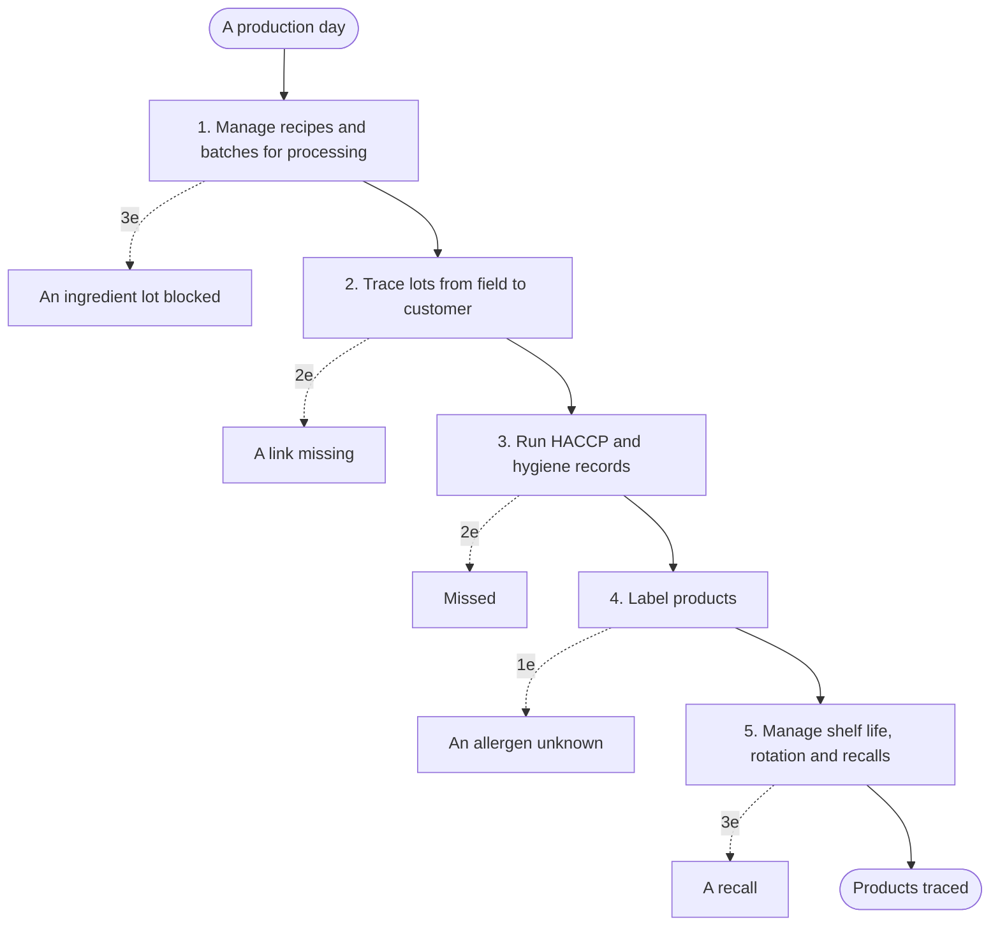

🏠 [Specs](../../../README.md) › 🏷️ [Sectors](../../README.md) › 🌾 [SC13 Agriculture and food](../README.md) ›
🔀 [Flows](README.md) › 🔀 FL-SC13-05 Food processing

# 🔀 FL-SC13-05 Food processing

**Status:** ✅ specified

## Summary

Food processing on the shared recipes: batches, traceability, hygiene, labels, recalls. It covers
[UC-SC13-13 Manage recipes and batches for processing](../use-cases/05-food-processing/uc-sc13-13-manage-recipes-and-batches-for-processing.md),
[UC-SC13-14 Trace lots from field to customer](../use-cases/05-food-processing/uc-sc13-14-trace-lots-from-field-to-customer.md),
[UC-SC13-15 Run HACCP and hygiene records](../use-cases/05-food-processing/uc-sc13-15-run-haccp-and-hygiene-records.md),
[UC-SC13-16 Label products](../use-cases/05-food-processing/uc-sc13-16-label-products.md),
[UC-SC13-17 Manage shelf life, rotation and recalls](../use-cases/05-food-processing/uc-sc13-17-manage-shelf-life-rotation-and-recalls.md).

## Personas

- [U15 Warehouse operator](../../../01-users/personas/u15-warehouse-operator.md)
- [U20 Production operator](../../../01-users/personas/u20-production-operator.md)
- [U21 Production planner](../../../01-users/personas/u21-production-planner.md)
- [U27 Quality manager](../../../01-users/personas/u27-quality-manager.md)
- [U40 Farmer](../../../01-users/personas/u40-farmer.md)

## Flowchart

## Sequence diagram

See each use case.

## Steps

| Step | Persona | Screen | Use case | What happens |
|---|---|---|---|---|
| 1 | U21, U40, U20 | [S-SC13-13](../screens/05-food-processing/s-sc13-13-batches.md) | [UC-SC13-13](../use-cases/05-food-processing/uc-sc13-13-manage-recipes-and-batches-for-processing.md) | The production planner sets the recipe with the shared recipes capability and produces batches, recording the farm's lots used |
| 2 | U27, U40 | [S-SC13-14](../screens/05-food-processing/s-sc13-14-traceability.md) | [UC-SC13-14](../use-cases/05-food-processing/uc-sc13-14-trace-lots-from-field-to-customer.md) | The quality manager picks a lot and sees its origin up to the plots and its customers down to the last sale |
| 3 | U20, U27 | [S-SC13-15](../screens/05-food-processing/s-sc13-15-haccp.md) | [UC-SC13-15](../use-cases/05-food-processing/uc-sc13-15-run-haccp-and-hygiene-records.md) | The production operator takes hygiene readings and records cleaning on schedule, the quality manager corrects deviations |
| 4 | U27, U21 | [S-SC13-16](../screens/05-food-processing/s-sc13-16-labels.md) | [UC-SC13-16](../use-cases/05-food-processing/uc-sc13-16-label-products.md) | The quality manager generates labels from the recipe, checks them and prints them |
| 5 | U27, U15 | [S-SC13-17](../screens/05-food-processing/s-sc13-17-shelf-life.md) | [UC-SC13-17](../use-cases/05-food-processing/uc-sc13-17-manage-shelf-life-rotation-and-recalls.md) | The quality manager and warehouse follow dates, use stock first expired first out, block expired lots and recall lots when needed |

### Entities and screens

| Entity | States in this flow | Shown at step and screen | Aggregated view |
|---|---|---|---|
| [E-F12-25 Recipe](../../../02-functional/f12-manufacturing/data/e-f12-25-recipe.md) | Draft, Approved, Superseded | 1 [S-SC13-13](../screens/05-food-processing/s-sc13-13-batches.md) | Recipes |
| [E-SC13-12 Batch](../data/e-sc13-12-batch.md) | Active | 1 [S-SC13-13](../screens/05-food-processing/s-sc13-13-batches.md); 2 [S-SC13-14](../screens/05-food-processing/s-sc13-14-traceability.md) | Batches |
| [E-F7-06 Item](../../../02-functional/f07-purchasing-and-stock/data/e-f07-06-item.md) | Active | Shown elsewhere: [S-F7-21 Stock levels](../../../02-functional/f07-purchasing-and-stock/screens/03-replenish/s-f07-21-stock-levels.md) | Items |
| [E-SC13-04 Lot](../data/e-sc13-04-lot.md) | Blocked, Expired, Refused | 1 [S-SC13-13](../screens/05-food-processing/s-sc13-13-batches.md); 2 [S-SC13-14](../screens/05-food-processing/s-sc13-14-traceability.md); 5 [S-SC13-17](../screens/05-food-processing/s-sc13-17-shelf-life.md) | Lots |
| [E-SC13-01 Plot](../data/e-sc13-01-plot.md) | Refused | Shown elsewhere: [S-SC13-01 Plots](../screens/01-crops/s-sc13-01-plots.md) | Plots |
| [E-SC13-13 Hygiene reading](../data/e-sc13-13-hygiene-reading.md) | Recorded | 3 [S-SC13-15](../screens/05-food-processing/s-sc13-15-haccp.md) | Hygiene readings |
| [E-SC06-03 Hygiene record](../../sc06-hospitality/data/e-sc06-03-hygiene-record.md) | Recorded | Shown elsewhere: [S-SC06-03 Hygiene records](../../sc06-hospitality/screens/01-menus-and-food-safety/s-sc06-03-hygiene-records.md) | Hygiene records |
| [E-SC13-14 Product label](../data/e-sc13-14-product-label.md) | Active | 4 [S-SC13-16](../screens/05-food-processing/s-sc13-16-labels.md) | Product labels |
| [E-SC13-15 Recall](../data/e-sc13-15-recall.md) | Active | 5 [S-SC13-17](../screens/05-food-processing/s-sc13-17-shelf-life.md) | Recalls |

## Errors

- [UC-SC13-13](../use-cases/05-food-processing/uc-sc13-13-manage-recipes-and-batches-for-processing.md) 3e. An
  ingredient lot blocked: it is refused.
- [UC-SC13-13](../use-cases/05-food-processing/uc-sc13-13-manage-recipes-and-batches-for-processing.md) 2e. An
  ingredient short: the batch is reduced.
- [UC-SC13-14](../use-cases/05-food-processing/uc-sc13-14-trace-lots-from-field-to-customer.md) 2e. A link missing: it
  is shown.
- [UC-SC13-14](../use-cases/05-food-processing/uc-sc13-14-trace-lots-from-field-to-customer.md) 3e. Anonymous market
  sales: they are counted, not named.
- [UC-SC13-15](../use-cases/05-food-processing/uc-sc13-15-run-haccp-and-hygiene-records.md) 2e. Missed: the quality
  manager is alerted.
- [UC-SC13-15](../use-cases/05-food-processing/uc-sc13-15-run-haccp-and-hygiene-records.md) 3e. Out of range: an action
  is asked.
- [UC-SC13-16](../use-cases/05-food-processing/uc-sc13-16-label-products.md) 1e. An allergen unknown: printing is
  blocked.
- [UC-SC13-16](../use-cases/05-food-processing/uc-sc13-16-label-products.md) 3e. The printer offline: labels wait.
- [UC-SC13-17](../use-cases/05-food-processing/uc-sc13-17-manage-shelf-life-rotation-and-recalls.md) 3e. A recall:
  customers are told.
- [UC-SC13-17](../use-cases/05-food-processing/uc-sc13-17-manage-shelf-life-rotation-and-recalls.md) 1e. A lot without
  date: it is blocked.

## Images

Every step and error, for each persona taking part, in light and dark mode (D120). Steps are numbered as in the Steps
table; E rows are the error cases.

| Step | Persona | Device | Light | Dark |
|---|---|---|---|---|
| 1 | U21 | desktop | [light](../images/05-food-processing/u21-production-planner/1-batch-desktop-light.png) | [dark](../images/05-food-processing/u21-production-planner/1-batch-desktop-dark.png) |
| 1 | U21 | phone | [light](../images/05-food-processing/u21-production-planner/1-batch-phone-light.png) | [dark](../images/05-food-processing/u21-production-planner/1-batch-phone-dark.png) |
| 1 | U20 | tablet | [light](../images/05-food-processing/u20-production-operator/1-batch-tablet-light.png) | [dark](../images/05-food-processing/u20-production-operator/1-batch-tablet-dark.png) |
| 1 | U40 | desktop | [light](../images/05-food-processing/u40-farmer/1-batch-desktop-light.png) | [dark](../images/05-food-processing/u40-farmer/1-batch-desktop-dark.png) |
| 1 | U40 | phone | [light](../images/05-food-processing/u40-farmer/1-batch-phone-light.png) | [dark](../images/05-food-processing/u40-farmer/1-batch-phone-dark.png) |
| 2 | U27 | desktop | [light](../images/05-food-processing/u27-quality-manager/2-trace-desktop-light.png) | [dark](../images/05-food-processing/u27-quality-manager/2-trace-desktop-dark.png) |
| 2 | U27 | tablet | [light](../images/05-food-processing/u27-quality-manager/2-trace-tablet-light.png) | [dark](../images/05-food-processing/u27-quality-manager/2-trace-tablet-dark.png) |
| 2 | U40 | desktop | [light](../images/05-food-processing/u40-farmer/2-trace-desktop-light.png) | [dark](../images/05-food-processing/u40-farmer/2-trace-desktop-dark.png) |
| 2 | U40 | phone | [light](../images/05-food-processing/u40-farmer/2-trace-phone-light.png) | [dark](../images/05-food-processing/u40-farmer/2-trace-phone-dark.png) |
| 3 | U27 | desktop | [light](../images/05-food-processing/u27-quality-manager/3-haccp-desktop-light.png) | [dark](../images/05-food-processing/u27-quality-manager/3-haccp-desktop-dark.png) |
| 3 | U27 | tablet | [light](../images/05-food-processing/u27-quality-manager/3-haccp-tablet-light.png) | [dark](../images/05-food-processing/u27-quality-manager/3-haccp-tablet-dark.png) |
| 3 | U20 | tablet | [light](../images/05-food-processing/u20-production-operator/3-haccp-tablet-light.png) | [dark](../images/05-food-processing/u20-production-operator/3-haccp-tablet-dark.png) |
| 4 | U27 | desktop | [light](../images/05-food-processing/u27-quality-manager/4-label-desktop-light.png) | [dark](../images/05-food-processing/u27-quality-manager/4-label-desktop-dark.png) |
| 4 | U27 | tablet | [light](../images/05-food-processing/u27-quality-manager/4-label-tablet-light.png) | [dark](../images/05-food-processing/u27-quality-manager/4-label-tablet-dark.png) |
| 4 | U21 | desktop | [light](../images/05-food-processing/u21-production-planner/4-label-desktop-light.png) | [dark](../images/05-food-processing/u21-production-planner/4-label-desktop-dark.png) |
| 4 | U21 | phone | [light](../images/05-food-processing/u21-production-planner/4-label-phone-light.png) | [dark](../images/05-food-processing/u21-production-planner/4-label-phone-dark.png) |
| 5 | U27 | desktop | [light](../images/05-food-processing/u27-quality-manager/5-recall-desktop-light.png) | [dark](../images/05-food-processing/u27-quality-manager/5-recall-desktop-dark.png) |
| 5 | U27 | tablet | [light](../images/05-food-processing/u27-quality-manager/5-recall-tablet-light.png) | [dark](../images/05-food-processing/u27-quality-manager/5-recall-tablet-dark.png) |
| 5 | U15 | phone | [light](../images/05-food-processing/u15-warehouse-operator/5-recall-phone-light.png) | [dark](../images/05-food-processing/u15-warehouse-operator/5-recall-phone-dark.png) |
| 5 | U15 | tablet | [light](../images/05-food-processing/u15-warehouse-operator/5-recall-tablet-light.png) | [dark](../images/05-food-processing/u15-warehouse-operator/5-recall-tablet-dark.png) |
| E1 | U27 | desktop | [light](../images/05-food-processing/u27-quality-manager/e1-allergen-unknown-desktop-light.png) | [dark](../images/05-food-processing/u27-quality-manager/e1-allergen-unknown-desktop-dark.png) |
| E1 | U27 | tablet | [light](../images/05-food-processing/u27-quality-manager/e1-allergen-unknown-tablet-light.png) | [dark](../images/05-food-processing/u27-quality-manager/e1-allergen-unknown-tablet-dark.png) |

## Open questions

None.

---

⬅️ [FL-SC13-04 Sales and certification](fl-sc13-04-sales-and-certification.md) · ⬆️ [Up](README.md) ·
➡️ [FL-SC13-06](fl-sc13-06-vineyards-contractors-and-cooperatives.md)
