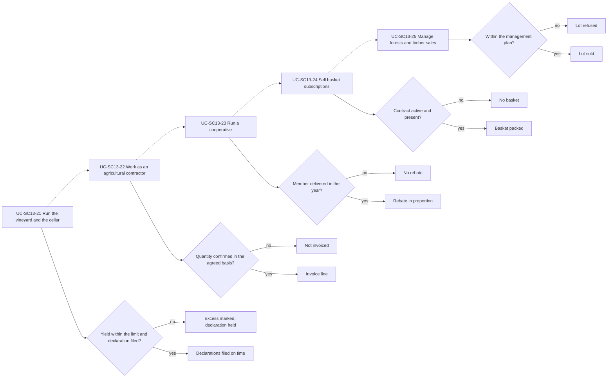
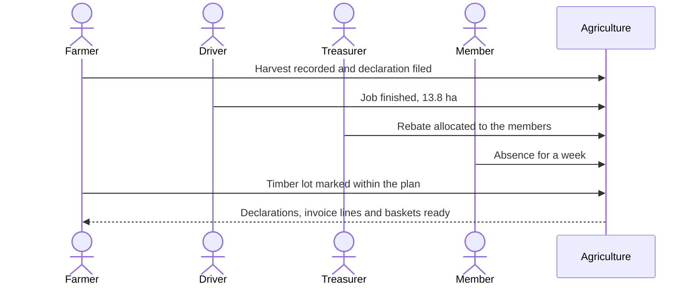

🏠 [Specs](../../../README.md) › 🏷️ [Sectors](../../README.md) › 🌾 [SC13 Agriculture and food](../README.md) ›
🔀 [Flows](README.md) › 🔀 FL-SC13-06 Vineyards, contractors, cooperatives, baskets, forests

# 🔀 FL-SC13-06 Vineyards, contractors, cooperatives, baskets, forests

**Status:** ✅ specified

## Summary

Five situations of farms and food that the sector had not covered: a vineyard and its cellar with their harvest and
stock declarations, an agricultural contractor billing by the hectare or the hour, a cooperative paying its members and
sharing a rebate, season baskets sold to members, and a forest sold by lot under its management plan
([D557](../../../06-decisions/sectors/d557-benchmark-gaps-sc13-agriculture-and-food.md)).

## Personas

- [U40 Farmer](../../../01-users/personas/u40-farmer.md), who runs the estate, the jobs, the baskets and the forest
- [U30 Driver](../../../01-users/personas/u30-driver.md), who works the jobs and records them on the phone
- [U31 Treasurer](../../../01-users/personas/u31-treasurer.md), who settles the members' deliveries and the rebate
- [U09 Customer](../../../01-users/personas/u09-customer.md), who holds a basket contract

## Flowchart

## Sequence diagram

## Steps

| Step | Persona | Screen | Use case | What happens |
|---|---|---|---|---|
| 1 | [U40](../../../01-users/personas/u40-farmer.md) | [S-SC13-21](../screens/06-vineyards-contractors-and-cooperatives/s-sc13-21-vineyard.md) | [UC-SC13-21](../use-cases/06-vineyards-contractors-and-cooperatives/uc-sc13-21-run-the-vineyard-and-the-cellar.md) | The farmer records each plot's harvest and files the harvest, stock and excise declarations |
| 2 | [U40](../../../01-users/personas/u40-farmer.md) | [S-SC13-22](../screens/06-vineyards-contractors-and-cooperatives/s-sc13-22-farm-contractor.md) | [UC-SC13-22](../use-cases/06-vineyards-contractors-and-cooperatives/uc-sc13-22-work-as-an-agricultural-contractor.md) | The farmer plans the contractor's jobs and the driver confirms the hectares or hours worked |
| 3 | [U31](../../../01-users/personas/u31-treasurer.md) | [S-SC13-23](../screens/06-vineyards-contractors-and-cooperatives/s-sc13-23-cooperative.md) | [UC-SC13-23](../use-cases/06-vineyards-contractors-and-cooperatives/uc-sc13-23-run-a-cooperative.md) | The treasurer pays the members' advances and balances and allocates the year's rebate |
| 4 | [U40](../../../01-users/personas/u40-farmer.md) | [S-SC13-24](../screens/06-vineyards-contractors-and-cooperatives/s-sc13-24-baskets.md) | [UC-SC13-24](../use-cases/06-vineyards-contractors-and-cooperatives/uc-sc13-24-sell-basket-subscriptions.md) | The farmer plans each week's baskets from the active contracts and the members' absences |
| 5 | [U40](../../../01-users/personas/u40-farmer.md) | [S-SC13-25](../screens/06-vineyards-contractors-and-cooperatives/s-sc13-25-forestry.md) | [UC-SC13-25](../use-cases/06-vineyards-contractors-and-cooperatives/uc-sc13-25-manage-forests-and-timber-sales.md) | The manager marks timber lots within the management plan and records each sale and load |

### Entities and screens

| Entity | States in this flow | Shown at step and screen | Aggregated view |
|---|---|---|---|
| [E-SC13-17 Vine plot](../data/e-sc13-17-vine-plot.md) | Planted, In production, Harvested, Declared, Grubbed up | 1 [S-SC13-21](../screens/06-vineyards-contractors-and-cooperatives/s-sc13-21-vineyard.md) | Vine plots |
| [E-SC13-18 Field job](../data/e-sc13-18-field-job.md) | Quoted, Scheduled, Done, Invoiced, Cancelled | 2 [S-SC13-22](../screens/06-vineyards-contractors-and-cooperatives/s-sc13-22-farm-contractor.md) | Field jobs |
| [E-SC13-19 Member delivery](../data/e-sc13-19-member-delivery.md) | Received, Graded, Advance paid, Settled | 3 [S-SC13-23](../screens/06-vineyards-contractors-and-cooperatives/s-sc13-23-cooperative.md) | Member deliveries |
| [E-SC13-20 Basket subscription](../data/e-sc13-20-basket-subscription.md) | Pending, Active, Paused, Ended | 4 [S-SC13-24](../screens/06-vineyards-contractors-and-cooperatives/s-sc13-24-baskets.md) | Basket subscriptions |
| [E-SC13-21 Timber lot](../data/e-sc13-21-timber-lot.md) | Marked, Sold, Felled, Delivered, Withdrawn | 5 [S-SC13-25](../screens/06-vineyards-contractors-and-cooperatives/s-sc13-25-forestry.md) | Timber lots |
| [E-SC13-01 Plot](../data/e-sc13-01-plot.md) | New | Shown elsewhere: [S-SC13-01 Plots](../screens/01-crops/s-sc13-01-plots.md) | Plots |
| [E-SC13-10 Cooperative statement](../data/e-sc13-10-cooperative-statement.md) | Active | Shown elsewhere: [S-SC13-11 Cooperative](../screens/04-sales-and-certification/s-sc13-11-cooperative.md) | Cooperative statements |

## Errors

- **E1 A declaration is late.** The harvest declaration date has passed while a plot has no harvest or the declaration
  is not filed: the declaration stays in review, the plot is named and the farmer is reminded
  ([BR-SC13-16](../business-rules/br-sc13-16-harvest-and-stock-declarations-are-filed-on-time.md), step 1).

## Images

Every step and error, for each persona taking part, in light and dark mode (D120). Steps are numbered as in the Steps
table; E rows are the error cases.

| Step | Persona | Device | Light | Dark |
|---|---|---|---|---|
| 1 | U40 | desktop | [light](../images/06-vineyards-contractors-and-cooperatives/u40-farmer/1-vineyard-desktop-light.png) | [dark](../images/06-vineyards-contractors-and-cooperatives/u40-farmer/1-vineyard-desktop-dark.png) |
| 1 | U40 | phone | [light](../images/06-vineyards-contractors-and-cooperatives/u40-farmer/1-vineyard-phone-light.png) | [dark](../images/06-vineyards-contractors-and-cooperatives/u40-farmer/1-vineyard-phone-dark.png) |
| 2 | U40 | desktop | [light](../images/06-vineyards-contractors-and-cooperatives/u40-farmer/2-farm-contractor-desktop-light.png) | [dark](../images/06-vineyards-contractors-and-cooperatives/u40-farmer/2-farm-contractor-desktop-dark.png) |
| 2 | U30 | phone | [light](../images/06-vineyards-contractors-and-cooperatives/u30-driver/2-farm-contractor-phone-light.png) | [dark](../images/06-vineyards-contractors-and-cooperatives/u30-driver/2-farm-contractor-phone-dark.png) |
| 2 | U40 | phone | [light](../images/06-vineyards-contractors-and-cooperatives/u40-farmer/2-farm-contractor-phone-light.png) | [dark](../images/06-vineyards-contractors-and-cooperatives/u40-farmer/2-farm-contractor-phone-dark.png) |
| 3 | U31 | desktop | [light](../images/06-vineyards-contractors-and-cooperatives/u31-treasurer/3-cooperative-desktop-light.png) | [dark](../images/06-vineyards-contractors-and-cooperatives/u31-treasurer/3-cooperative-desktop-dark.png) |
| 3 | U40 | phone | [light](../images/06-vineyards-contractors-and-cooperatives/u40-farmer/3-cooperative-phone-light.png) | [dark](../images/06-vineyards-contractors-and-cooperatives/u40-farmer/3-cooperative-phone-dark.png) |
| 3 | U31 | phone | [light](../images/06-vineyards-contractors-and-cooperatives/u31-treasurer/3-cooperative-phone-light.png) | [dark](../images/06-vineyards-contractors-and-cooperatives/u31-treasurer/3-cooperative-phone-dark.png) |
| 4 | U40 | desktop | [light](../images/06-vineyards-contractors-and-cooperatives/u40-farmer/4-baskets-desktop-light.png) | [dark](../images/06-vineyards-contractors-and-cooperatives/u40-farmer/4-baskets-desktop-dark.png) |
| 4 | U09 | phone | [light](../images/06-vineyards-contractors-and-cooperatives/u09-customer/4-baskets-phone-light.png) | [dark](../images/06-vineyards-contractors-and-cooperatives/u09-customer/4-baskets-phone-dark.png) |
| 4 | U40 | phone | [light](../images/06-vineyards-contractors-and-cooperatives/u40-farmer/4-baskets-phone-light.png) | [dark](../images/06-vineyards-contractors-and-cooperatives/u40-farmer/4-baskets-phone-dark.png) |
| 5 | U40 | desktop | [light](../images/06-vineyards-contractors-and-cooperatives/u40-farmer/5-forestry-desktop-light.png) | [dark](../images/06-vineyards-contractors-and-cooperatives/u40-farmer/5-forestry-desktop-dark.png) |
| 5 | U40 | phone | [light](../images/06-vineyards-contractors-and-cooperatives/u40-farmer/5-forestry-phone-light.png) | [dark](../images/06-vineyards-contractors-and-cooperatives/u40-farmer/5-forestry-phone-dark.png) |
| E1 | U40 | desktop | [light](../images/06-vineyards-contractors-and-cooperatives/u40-farmer/e1-a-declaration-is-late-desktop-light.png) | [dark](../images/06-vineyards-contractors-and-cooperatives/u40-farmer/e1-a-declaration-is-late-desktop-dark.png) |
| E1 | U40 | phone | [light](../images/06-vineyards-contractors-and-cooperatives/u40-farmer/e1-a-declaration-is-late-phone-light.png) | [dark](../images/06-vineyards-contractors-and-cooperatives/u40-farmer/e1-a-declaration-is-late-phone-dark.png) |

## Open questions

None.

---

⬅️ [FL-SC13-05 Food processing](fl-sc13-05-food-processing.md) · ⬆️ [Up](README.md)
