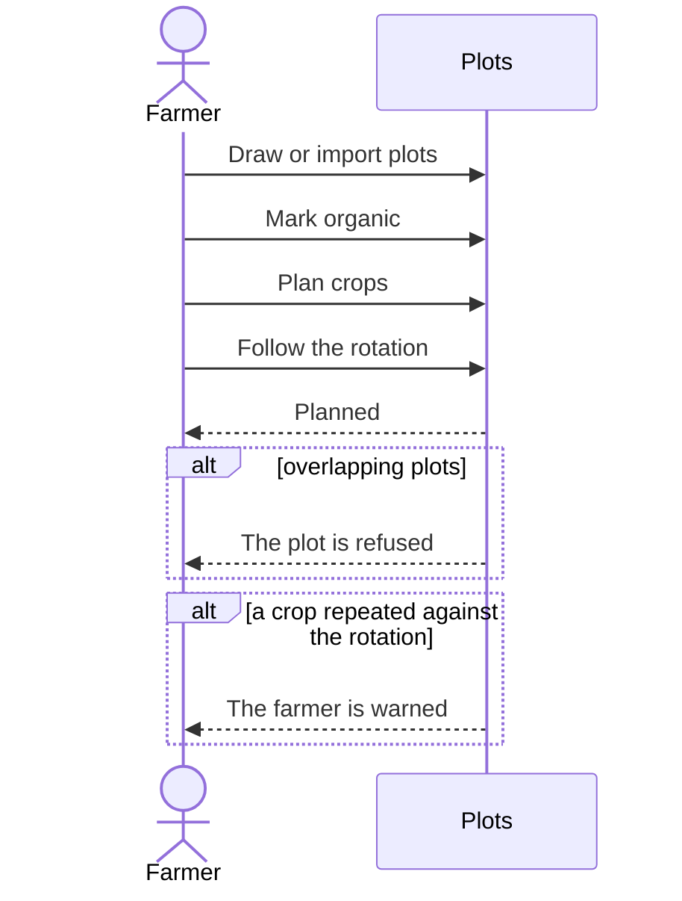

🏠 [Specs](../../../../README.md) › 🏷️ [Sectors](../../../README.md) › 🌾 [SC13 Agriculture and food](../../README.md) ›
📝 [Use cases](../README.md) › 📝 [Use cases: FL-SC13-01 Crops](README.md) › 📝 UC-SC13-01 Map plots and plan crops

# 📝 UC-SC13-01 Map plots and plan crops

**Status:** ✅ specified

## Summary

The farmer draws or imports plots with their area and organic status, plans each season's crop and follows the rotation.

## Personas

- [U40 Farmer](../../../../01-users/personas/u40-farmer.md)

## Goal

Plots and crops known for records, aid and margins.

## Trigger

A new season or a new plot.

## Frequency

Yearly, with changes.

## Preconditions

- The SC13 sector pack is installed for the company,
  [UC-F14-02](../../../../02-functional/f14-plugin-store/use-cases/01-find-and-install/uc-f14-02-install-a-plugin-or-sector-pack.md),
  and its users have their roles,
  [UC-F1-06](../../../../02-functional/f01-administration/use-cases/04-edit-a-role/uc-f01-06-edit-a-role-and-its-record-rules.md).

## Postconditions

- **Success:** plots and the crop plan are saved.
- **Failed:** the plan stays a draft.

## Main flow

1. The farmer draws plots on the map on [S-SC13-01 Plots](../../screens/01-crops/s-sc13-01-plots.md),
   [UC-F2-17](../../../../02-functional/f02-no-code-configuration/use-cases/08-views-and-bookings/uc-f02-17-add-a-kanban-calendar-map-gantt-or-timeline-view.md).
2. The farmer marks organic plots ([BR-SC13-08](../../business-rules/br-sc13-08-organic-kept-apart.md)).
3. The farmer plans the season's crop per plot.
4. The rotation over the years is shown.

## Alternative flows

- 1a. An import from the aid service: plots come from the aid service's file.

## Error flows

- 1e. Overlapping plots: the plot is refused.
- 3e. A crop repeated against the rotation: the farmer is warned.
- Any step: a call to a service or an outside system fails: it is retried first
  ([BR-F3-32](../../../../02-functional/f03-assistant/business-rules/br-f03-32-retry-before-an-error.md)), then the
  error message pattern ([D122](../../../../06-decisions/ux/d122-error-message-standard.md)) says what failed; what was
  typed is kept.

## Business rules

- [BR-SC13-01 Agriculture follows the country pack](../../business-rules/br-sc13-01-agriculture-follows-the-country-pack.md)
- [BR-SC13-08 Organic kept apart](../../business-rules/br-sc13-08-organic-kept-apart.md)

## Entities

- [E-SC13-01 Plot](../../data/e-sc13-01-plot.md)
- [E-SC13-02 Crop plan](../../data/e-sc13-02-crop-plan.md)

## Permissions

The farmer roles; the record rules of their role and site apply,
[UC-F1-06](../../../../02-functional/f01-administration/use-cases/04-edit-a-role/uc-f01-06-edit-a-role-and-its-record-rules.md).

## Notifications

None beyond the in-app updates of the records concerned.

## Audit events

Every creation, change and state change of plot, crop plan records, with who, when and the values before and after (T3).

## AI involvement

The AI assistant answers questions on the plot, crop plan records of this use case, with links, and prepares them as
drafts the user confirms. It works within the user's rights,
[BR-F3-34](../../../../02-functional/f03-assistant/business-rules/br-f03-34-every-capability-is-reachable-from-the-assistant.md),
and never deletes or does anything irreversible without the user's confirmation,
[BR-F3-07](../../../../02-functional/f03-assistant/business-rules/br-f03-07-no-deletes-no-irreversible-acts.md).

## API, MCP and A2A exposure

Through the API and webhooks (T5) and the MCP and A2A gateway (T6), with the caller's rights,
[BR-F3-34](../../../../02-functional/f03-assistant/business-rules/br-f03-34-every-capability-is-reachable-from-the-assistant.md),
reading, creating and changing the records of this use case; nothing irreversible without a person's confirmation.

## Screens

- [S-SC13-01 Plots](../../screens/01-crops/s-sc13-01-plots.md)

## Flowchart

See [FL-SC13-01 Crops](../../flows/fl-sc13-01-crops.md#flowchart).

## Sequence diagram

## Acceptance criteria

1. **Given** the example farm's Les Prés, 4.2 ha, organic **when** wheat is planned for 2027 **then** Les Prés shows
   wheat in 2027.
2. **Given** Les Prés overlapping a neighbouring plot **when** it is drawn **then** the plot is refused.

## Non-functional notes

[D408](../../../../06-decisions/technical/d408-performance-and-profiles.md)'s targets
([performance](../../../../05-non-functional/performance.md)): 95 % of screens within 1 second; lists paged on the
server, the first page within 1 second; reports within 5 seconds or in the background. WCAG 2.2 AA and RGAA
([D46](../../../../06-decisions/ux/d46-accessibility-standard.md)).

## Regulatory references

None specific to this use case; the sector's legal rules are listed in [SC13 regulatory](../../regulatory.md).

## Related use cases

- [UC-SC13-02 Record treatments and inputs](uc-sc13-02-record-treatments-and-inputs.md)
- [UC-SC13-07 Declare CAP aid](../03-farm-business/uc-sc13-07-declare-cap-aid.md)

## Open questions

None.

---

⬆️ [Up](README.md) · ➡️ [UC-SC13-02 Record treatments and inputs](uc-sc13-02-record-treatments-and-inputs.md)
