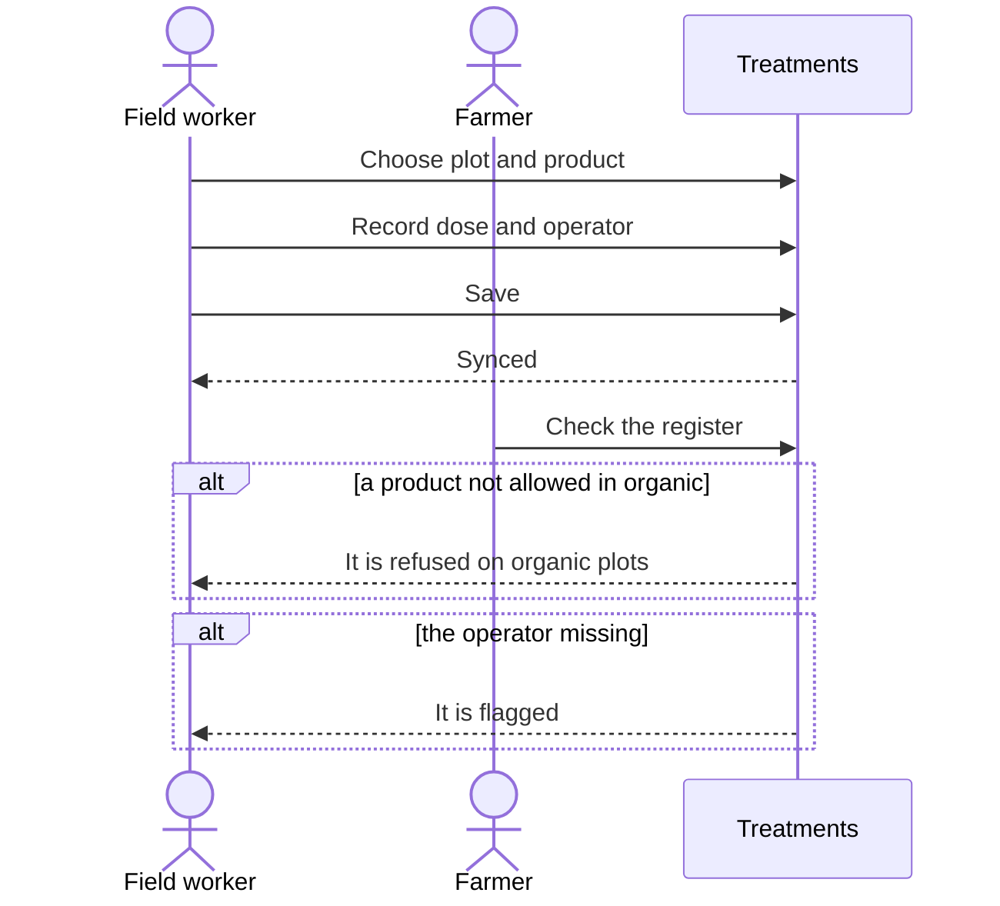

🏠 [Specs](../../../../README.md) › 🏷️ [Sectors](../../../README.md) › 🌾 [SC13 Agriculture and food](../../README.md) ›
📝 [Use cases](../README.md) › 📝 [Use cases: FL-SC13-01 Crops](README.md) › 📝 UC-SC13-02 Record treatments and inputs

# 📝 UC-SC13-02 Record treatments and inputs

**Status:** ✅ specified

## Summary

The farmer or a field worker records each plant-protection treatment with product, dose, plot, date and operator on the
phone, offline in the field.

## Personas

- [U40 Farmer](../../../../01-users/personas/u40-farmer.md)
- [U14 Field worker](../../../../01-users/personas/u14-field-worker.md)

## Goal

A complete treatment register.

## Trigger

A treatment.

## Frequency

Many in season.

## Preconditions

- The SC13 sector pack is installed for the company,
  [UC-F14-02](../../../../02-functional/f14-plugin-store/use-cases/01-find-and-install/uc-f14-02-install-a-plugin-or-sector-pack.md),
  and its users have their roles,
  [UC-F1-06](../../../../02-functional/f01-administration/use-cases/04-edit-a-role/uc-f01-06-edit-a-role-and-its-record-rules.md).
- The form works offline in the field,
  [UC-F2-21](../../../../02-functional/f02-no-code-configuration/use-cases/09-portals-and-offline-forms/uc-f02-21-make-a-phone-form-work-offline.md).

## Postconditions

- **Success:** the treatment is in the register.
- **Failed:** the record waits on the phone until synced.

## Main flow

1. The field worker chooses plot and product on [S-SC13-02 Treatments](../../screens/01-crops/s-sc13-02-treatments.md),
   [UC-F2-22](../../../../02-functional/f02-no-code-configuration/use-cases/09-portals-and-offline-forms/uc-f02-22-fill-a-form-offline-on-the-phone.md).
2. Dose, date and operator are recorded ([BR-SC13-02](../../business-rules/br-sc13-02-every-treatment-recorded.md)).
3. The record is kept on the phone and synced,
   [BR-F2-21](../../../../02-functional/f02-no-code-configuration/business-rules/br-f02-21-offline-forms-keep-only-what-is-needed-and-sync-in-order.md).
4. The farmer checks the register.

## Alternative flows

- 1a. Several plots at once: one record per plot is created.

## Error flows

- 2e. A product not allowed in organic: it is refused on organic plots.
- 2f. The operator missing: it is flagged.
- Any step: a call to a service or an outside system fails: it is retried first
  ([BR-F3-32](../../../../02-functional/f03-assistant/business-rules/br-f03-32-retry-before-an-error.md)), then the
  error message pattern ([D122](../../../../06-decisions/ux/d122-error-message-standard.md)) says what failed; what was
  typed is kept.

## Business rules

- [BR-SC13-02 Every treatment recorded](../../business-rules/br-sc13-02-every-treatment-recorded.md)
- [BR-SC13-15 Offline in the field](../../business-rules/br-sc13-15-offline-in-the-field.md)
- [BR-SC13-08 Organic kept apart](../../business-rules/br-sc13-08-organic-kept-apart.md)
- [BR-F2-21 Offline forms keep only what is needed and sync in order](../../../../02-functional/f02-no-code-configuration/business-rules/br-f02-21-offline-forms-keep-only-what-is-needed-and-sync-in-order.md)

## Entities

- [E-SC13-03 Field operation](../../data/e-sc13-03-field-operation.md)

## Permissions

The farmer and field worker roles; the record rules of their role and site apply,
[UC-F1-06](../../../../02-functional/f01-administration/use-cases/04-edit-a-role/uc-f01-06-edit-a-role-and-its-record-rules.md).

## Notifications

None beyond the in-app updates of the records concerned.

## Audit events

Every creation, change and state change of field operation records, with who, when and the values before and after (T3).

## AI involvement

The AI assistant answers questions on the field operation records of this use case, with links, and prepares them as
drafts the user confirms. It works within the user's rights,
[BR-F3-34](../../../../02-functional/f03-assistant/business-rules/br-f03-34-every-capability-is-reachable-from-the-assistant.md),
and never deletes or does anything irreversible without the user's confirmation,
[BR-F3-07](../../../../02-functional/f03-assistant/business-rules/br-f03-07-no-deletes-no-irreversible-acts.md).

## API, MCP and A2A exposure

Through the API and webhooks (T5) and the MCP and A2A gateway (T6), with the caller's rights,
[BR-F3-34](../../../../02-functional/f03-assistant/business-rules/br-f03-34-every-capability-is-reachable-from-the-assistant.md),
reading, creating and changing the records of this use case; nothing irreversible without a person's confirmation.

## Screens

- [S-SC13-02 Treatments](../../screens/01-crops/s-sc13-02-treatments.md)

## Flowchart

See [FL-SC13-01 Crops](../../flows/fl-sc13-01-crops.md#flowchart).

## Sequence diagram

## Acceptance criteria

1. **Given** the example farm's treatment on Les Prés on 3 April with product X at 1 l/ha by U40 **when** it syncs
   **then** the register shows it.
2. **Given** product X on Les Prés **when** it is recorded **then** it is refused on organic plots.

## Non-functional notes

Works offline on the phone,
[UC-F2-21](../../../../02-functional/f02-no-code-configuration/use-cases/09-portals-and-offline-forms/uc-f02-21-make-a-phone-form-work-offline.md).
[D408](../../../../06-decisions/technical/d408-performance-and-profiles.md)'s targets
([performance](../../../../05-non-functional/performance.md)): 95 % of screens within 1 second; lists paged on the
server, the first page within 1 second; reports within 5 seconds or in the background. WCAG 2.2 AA and RGAA
([D46](../../../../06-decisions/ux/d46-accessibility-standard.md)).

## Regulatory references

Legal values from the France country pack:
[CR-FR-161 Register of plant-protection treatments](../../../../10-country-packs/france/agriculture/cr-fr-161-plant-protection-register.md).

## Related use cases

- [UC-SC13-03 Record fertilisation and the nitrogen plan](uc-sc13-03-record-fertilisation-and-the-nitrogen-plan.md)

## Open questions

None.

---

⬅️ [UC-SC13-01 Map plots and plan crops](uc-sc13-01-map-plots-and-plan-crops.md) · ⬆️ [Up](README.md) ·
➡️ [UC-SC13-03 Record fertilisation and the nitrogen plan](uc-sc13-03-record-fertilisation-and-the-nitrogen-plan.md)
