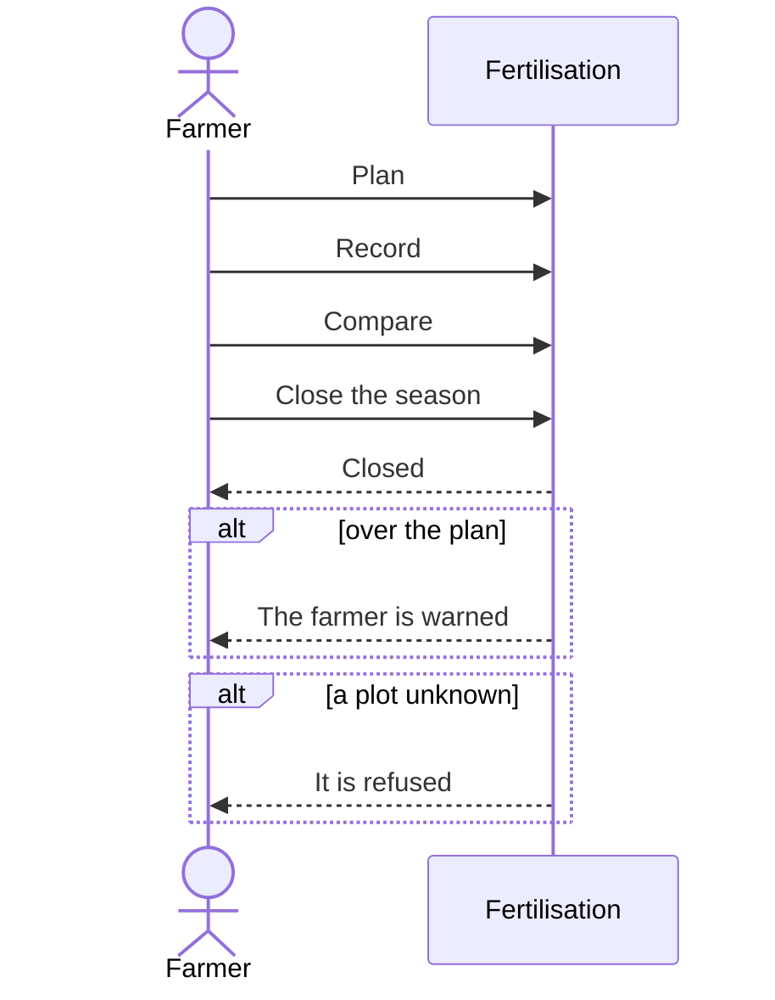

🏠 [Specs](../../../../README.md) › 🏷️ [Sectors](../../../README.md) › 🌾 [SC13 Agriculture and food](../../README.md) ›
📝 [Use cases](../README.md) › 📝 [Use cases: FL-SC13-01 Crops](README.md) ›
📝 UC-SC13-03 Record fertilisation and the nitrogen plan

# 📝 UC-SC13-03 Record fertilisation and the nitrogen plan

**Status:** ✅ specified

## Summary

The farmer plans fertilisation, records inputs and compares them with the plan.

## Personas

- [U40 Farmer](../../../../01-users/personas/u40-farmer.md)

## Goal

Fertilisation within the plan.

## Trigger

The season.

## Frequency

Seasonally.

## Preconditions

- The SC13 sector pack is installed for the company,
  [UC-F14-02](../../../../02-functional/f14-plugin-store/use-cases/01-find-and-install/uc-f14-02-install-a-plugin-or-sector-pack.md),
  and its users have their roles,
  [UC-F1-06](../../../../02-functional/f01-administration/use-cases/04-edit-a-role/uc-f01-06-edit-a-role-and-its-record-rules.md).
- The form works offline in the field,
  [UC-F2-21](../../../../02-functional/f02-no-code-configuration/use-cases/09-portals-and-offline-forms/uc-f02-21-make-a-phone-form-work-offline.md).

## Postconditions

- **Success:** inputs are recorded against the plan.
- **Failed:** the farmer is warned.

## Main flow

1. The farmer plans nitrogen per plot on [S-SC13-03 Fertilisation](../../screens/01-crops/s-sc13-03-fertilisation.md).
2. Inputs are recorded in the field,
   [UC-F2-22](../../../../02-functional/f02-no-code-configuration/use-cases/09-portals-and-offline-forms/uc-f02-22-fill-a-form-offline-on-the-phone.md).
3. Recorded and planned are compared.
4. The season is closed.

## Alternative flows

- 2a. Manure from the herd: its nitrogen is counted from the herd's records.

## Error flows

- 3e. Over the plan: the farmer is warned.
- 2e. A plot unknown: it is refused.
- Any step: a call to a service or an outside system fails: it is retried first
  ([BR-F3-32](../../../../02-functional/f03-assistant/business-rules/br-f03-32-retry-before-an-error.md)), then the
  error message pattern ([D122](../../../../06-decisions/ux/d122-error-message-standard.md)) says what failed; what was
  typed is kept.

## Business rules

- [BR-SC13-02 Every treatment recorded](../../business-rules/br-sc13-02-every-treatment-recorded.md)

## Entities

- [E-SC13-03 Field operation](../../data/e-sc13-03-field-operation.md)

## Permissions

The farmer roles; the record rules of their role and site apply,
[UC-F1-06](../../../../02-functional/f01-administration/use-cases/04-edit-a-role/uc-f01-06-edit-a-role-and-its-record-rules.md).

## Notifications

None beyond the in-app updates of the records concerned.

## Audit events

Every creation, change and state change of field operation records, with who, when and the values before and after (T3).

## AI involvement

The AI assistant answers questions on the field operation records of this use case, with links, and prepares them as
drafts the user confirms. It works within the user's rights,
[BR-F3-34](../../../../02-functional/f03-assistant/business-rules/br-f03-34-every-capability-is-reachable-from-the-assistant.md),
and never deletes or does anything irreversible without the user's confirmation,
[BR-F3-07](../../../../02-functional/f03-assistant/business-rules/br-f03-07-no-deletes-no-irreversible-acts.md).

## API, MCP and A2A exposure

Through the API and webhooks (T5) and the MCP and A2A gateway (T6), with the caller's rights,
[BR-F3-34](../../../../02-functional/f03-assistant/business-rules/br-f03-34-every-capability-is-reachable-from-the-assistant.md),
reading, creating and changing the records of this use case; nothing irreversible without a person's confirmation.

## Screens

- [S-SC13-03 Fertilisation](../../screens/01-crops/s-sc13-03-fertilisation.md)

## Flowchart

See [FL-SC13-01 Crops](../../flows/fl-sc13-01-crops.md#flowchart).

## Sequence diagram

## Acceptance criteria

1. **Given** the example farm's Les Prés with 120 units planned **when** 100 are recorded **then** 20 units remain.
2. **Given** Les Prés over the plan by 20 units **when** an input is recorded **then** the farmer is warned.

## Non-functional notes

[D408](../../../../06-decisions/technical/d408-performance-and-profiles.md)'s targets
([performance](../../../../05-non-functional/performance.md)): 95 % of screens within 1 second; lists paged on the
server, the first page within 1 second; reports within 5 seconds or in the background. WCAG 2.2 AA and RGAA
([D46](../../../../06-decisions/ux/d46-accessibility-standard.md)).

## Regulatory references

None specific to this use case; the sector's legal rules are listed in [SC13 regulatory](../../regulatory.md).

## Related use cases

- [UC-SC13-04 Record harvests, yields and lots](uc-sc13-04-record-harvests-yields-and-lots.md)

## Open questions

None.

---

⬅️ [UC-SC13-02 Record treatments and inputs](uc-sc13-02-record-treatments-and-inputs.md) · ⬆️ [Up](README.md) ·
➡️ [UC-SC13-04 Record harvests, yields and lots](uc-sc13-04-record-harvests-yields-and-lots.md)
