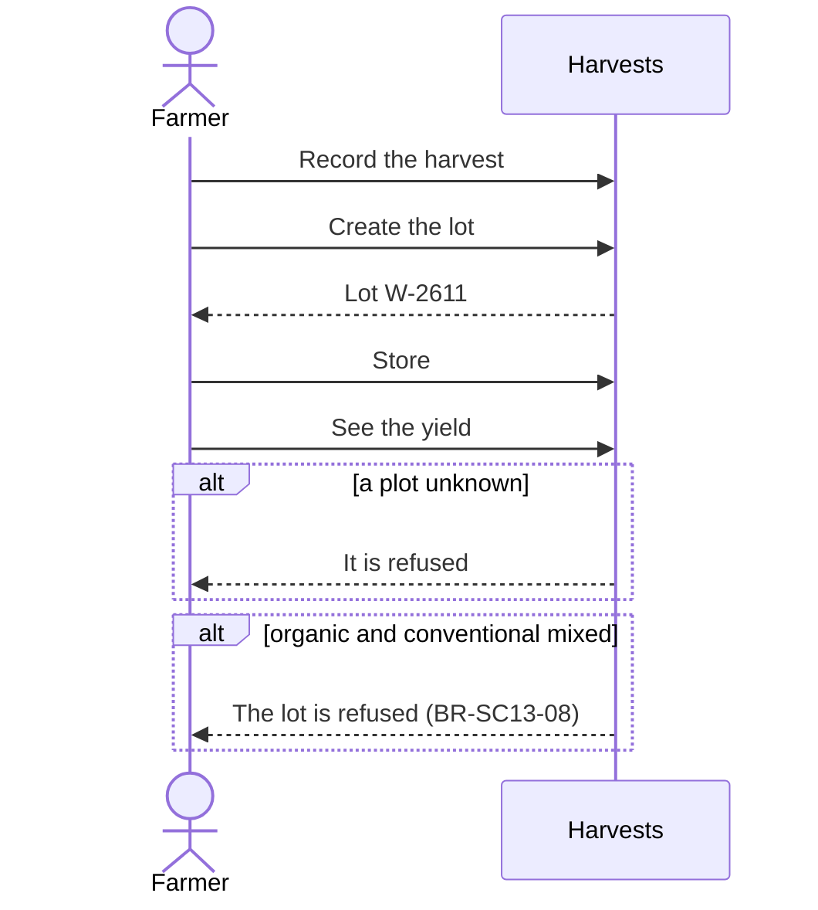

🏠 [Specs](../../../../README.md) › 🏷️ [Sectors](../../../README.md) › 🌾 [SC13 Agriculture and food](../../README.md) ›
📝 [Use cases](../README.md) › 📝 [Use cases: FL-SC13-01 Crops](README.md) ›
📝 UC-SC13-04 Record harvests, yields and lots

# 📝 UC-SC13-04 Record harvests, yields and lots

**Status:** ✅ specified

## Summary

The farmer records the harvest, creates the lot linked to its plots, and stores it.

## Personas

- [U40 Farmer](../../../../01-users/personas/u40-farmer.md)

## Goal

Every harvest in a traced lot.

## Trigger

Harvest.

## Frequency

Seasonally.

## Preconditions

- The SC13 sector pack is installed for the company,
  [UC-F14-02](../../../../02-functional/f14-plugin-store/use-cases/01-find-and-install/uc-f14-02-install-a-plugin-or-sector-pack.md),
  and its users have their roles,
  [UC-F1-06](../../../../02-functional/f01-administration/use-cases/04-edit-a-role/uc-f01-06-edit-a-role-and-its-record-rules.md).
- The form works offline in the field,
  [UC-F2-21](../../../../02-functional/f02-no-code-configuration/use-cases/09-portals-and-offline-forms/uc-f02-21-make-a-phone-form-work-offline.md).

## Postconditions

- **Success:** the lot is in stock.
- **Failed:** the record is refused.

## Main flow

1. The farmer records quantity per plot on [S-SC13-04 Harvests](../../screens/01-crops/s-sc13-04-harvests.md).
2. The lot links its plots ([BR-SC13-06](../../business-rules/br-sc13-06-lots-traced-field-to-customer.md)).
3. The lot is stored,
   [UC-F7-03](../../../../02-functional/f07-purchasing-and-stock/use-cases/02-receive-and-store/uc-f07-03-receive-goods.md).
4. The yield per hectare is shown.

## Alternative flows

- 1a. A weighbridge: weights come through the connector (T12).

## Error flows

- 1e. A plot unknown: it is refused.
- 2e. Organic and conventional mixed: the lot is refused
  ([BR-SC13-08](../../business-rules/br-sc13-08-organic-kept-apart.md)).
- Any step: a call to a service or an outside system fails: it is retried first
  ([BR-F3-32](../../../../02-functional/f03-assistant/business-rules/br-f03-32-retry-before-an-error.md)), then the
  error message pattern ([D122](../../../../06-decisions/ux/d122-error-message-standard.md)) says what failed; what was
  typed is kept.

## Business rules

- [BR-SC13-06 Lots traced from field to customer](../../business-rules/br-sc13-06-lots-traced-field-to-customer.md)

## Entities

- [E-SC13-04 Lot](../../data/e-sc13-04-lot.md)

## Permissions

The farmer roles; the record rules of their role and site apply,
[UC-F1-06](../../../../02-functional/f01-administration/use-cases/04-edit-a-role/uc-f01-06-edit-a-role-and-its-record-rules.md).

## Notifications

None beyond the in-app updates of the records concerned.

## Audit events

Every creation, change and state change of lot records, with who, when and the values before and after (T3).

## AI involvement

The AI assistant answers questions on the lot records of this use case, with links, and prepares them as drafts the user
confirms. It works within the user's rights,
[BR-F3-34](../../../../02-functional/f03-assistant/business-rules/br-f03-34-every-capability-is-reachable-from-the-assistant.md),
and never deletes or does anything irreversible without the user's confirmation,
[BR-F3-07](../../../../02-functional/f03-assistant/business-rules/br-f03-07-no-deletes-no-irreversible-acts.md).

## API, MCP and A2A exposure

Through the API and webhooks (T5) and the MCP and A2A gateway (T6), with the caller's rights,
[BR-F3-34](../../../../02-functional/f03-assistant/business-rules/br-f03-34-every-capability-is-reachable-from-the-assistant.md),
reading, creating and changing the records of this use case; nothing irreversible without a person's confirmation.

## Screens

- [S-SC13-04 Harvests](../../screens/01-crops/s-sc13-04-harvests.md)

## Flowchart

See [FL-SC13-01 Crops](../../flows/fl-sc13-01-crops.md#flowchart).

## Sequence diagram

## Acceptance criteria

1. **Given** the example farm's 32 t of wheat from Les Prés **when** the lot is created **then** W-2611 shows 32 t and
   7.6 t a hectare.
2. **Given** a harvest on an unmapped plot **when** it is recorded **then** it is refused.

## Non-functional notes

[D408](../../../../06-decisions/technical/d408-performance-and-profiles.md)'s targets
([performance](../../../../05-non-functional/performance.md)): 95 % of screens within 1 second; lists paged on the
server, the first page within 1 second; reports within 5 seconds or in the background. WCAG 2.2 AA and RGAA
([D46](../../../../06-decisions/ux/d46-accessibility-standard.md)).

## Regulatory references

None specific to this use case; the sector's legal rules are listed in [SC13 regulatory](../../regulatory.md).

## Related use cases

- [UC-SC13-14 Trace lots from field to customer](../05-food-processing/uc-sc13-14-trace-lots-from-field-to-customer.md)

## Open questions

None.

---

⬅️ [UC-SC13-03 Record fertilisation and the nitrogen plan](uc-sc13-03-record-fertilisation-and-the-nitrogen-plan.md) ·
⬆️ [Up](README.md) · ➡️ [UC-SC13-05](../02-livestock/uc-sc13-05-identify-animals-and-keep-the-herd-register.md)
