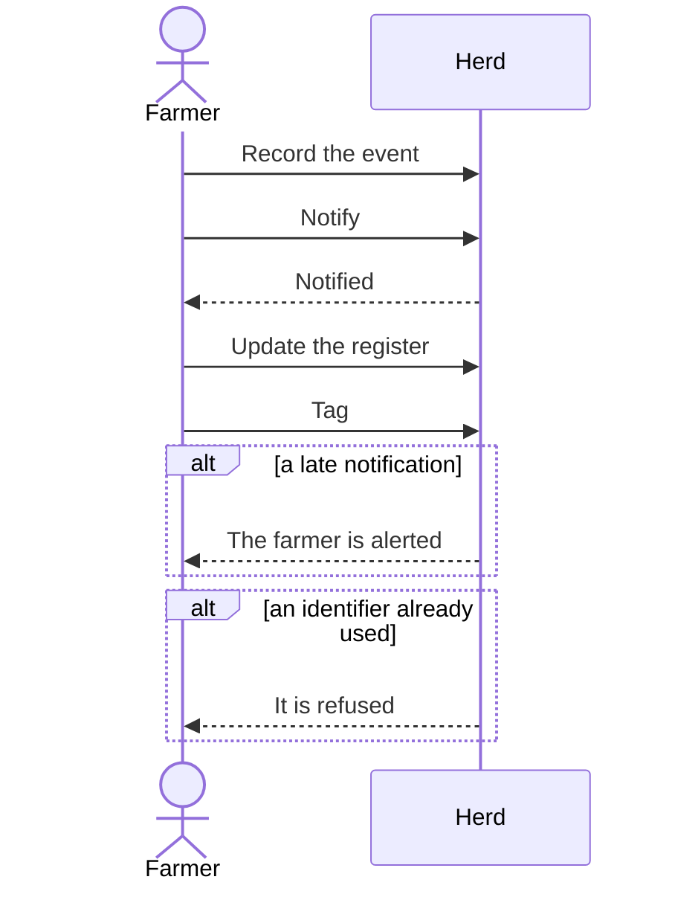

🏠 [Specs](../../../../README.md) › 🏷️ [Sectors](../../../README.md) › 🌾 [SC13 Agriculture and food](../../README.md) ›
📝 [Use cases](../README.md) › 📝 [Use cases: FL-SC13-02 Livestock](README.md) ›
📝 UC-SC13-05 Identify animals and keep the herd register

# 📝 UC-SC13-05 Identify animals and keep the herd register

**Status:** ✅ specified

## Summary

The farmer records births, purchases, movements and deaths, notifies them within the delays and keeps the herd register.

## Personas

- [U40 Farmer](../../../../01-users/personas/u40-farmer.md)

## Goal

A herd register always current.

## Trigger

A birth, a movement or a death.

## Frequency

Weekly.

## Preconditions

- The SC13 sector pack is installed for the company,
  [UC-F14-02](../../../../02-functional/f14-plugin-store/use-cases/01-find-and-install/uc-f14-02-install-a-plugin-or-sector-pack.md),
  and its users have their roles,
  [UC-F1-06](../../../../02-functional/f01-administration/use-cases/04-edit-a-role/uc-f01-06-edit-a-role-and-its-record-rules.md).
- The form works offline in the field,
  [UC-F2-21](../../../../02-functional/f02-no-code-configuration/use-cases/09-portals-and-offline-forms/uc-f02-21-make-a-phone-form-work-offline.md).

## Postconditions

- **Success:** the event is notified and in the register.
- **Failed:** a late notification alerts.

## Main flow

1. The farmer records the birth on [S-SC13-05 Herd](../../screens/02-livestock/s-sc13-05-herd.md) in the barn,
   [UC-F2-22](../../../../02-functional/f02-no-code-configuration/use-cases/09-portals-and-offline-forms/uc-f02-22-fill-a-form-offline-on-the-phone.md).
2. It is notified through the connector (T12)
   ([BR-SC13-03](../../business-rules/br-sc13-03-animals-notified-on-time.md)).
3. The register is updated.
4. The tag number is recorded.

## Alternative flows

- 1a. A purchase: the animal comes in with its passport.

## Error flows

- 2e. A late notification: the farmer is alerted.
- 1e. An identifier already used: it is refused.
- Any step: a call to a service or an outside system fails: it is retried first
  ([BR-F3-32](../../../../02-functional/f03-assistant/business-rules/br-f03-32-retry-before-an-error.md)), then the
  error message pattern ([D122](../../../../06-decisions/ux/d122-error-message-standard.md)) says what failed; what was
  typed is kept.

## Business rules

- [BR-SC13-03 Animals notified on time](../../business-rules/br-sc13-03-animals-notified-on-time.md)

## Entities

- [E-SC13-05 Animal](../../data/e-sc13-05-animal.md)

## Permissions

The farmer roles; the record rules of their role and site apply,
[UC-F1-06](../../../../02-functional/f01-administration/use-cases/04-edit-a-role/uc-f01-06-edit-a-role-and-its-record-rules.md).

## Notifications

None beyond the in-app updates of the records concerned.

## Audit events

Every creation, change and state change of animal records, with who, when and the values before and after (T3).

## AI involvement

The AI assistant answers questions on the animal records of this use case, with links, and prepares them as drafts the
user confirms. It works within the user's rights,
[BR-F3-34](../../../../02-functional/f03-assistant/business-rules/br-f03-34-every-capability-is-reachable-from-the-assistant.md),
and never deletes or does anything irreversible without the user's confirmation,
[BR-F3-07](../../../../02-functional/f03-assistant/business-rules/br-f03-07-no-deletes-no-irreversible-acts.md).

## API, MCP and A2A exposure

Through the API and webhooks (T5) and the MCP and A2A gateway (T6), with the caller's rights,
[BR-F3-34](../../../../02-functional/f03-assistant/business-rules/br-f03-34-every-capability-is-reachable-from-the-assistant.md),
reading, creating and changing the records of this use case; nothing irreversible without a person's confirmation.

## Screens

- [S-SC13-05 Herd](../../screens/02-livestock/s-sc13-05-herd.md)

## Flowchart

See [FL-SC13-02 Livestock](../../flows/fl-sc13-02-livestock.md#flowchart).

## Sequence diagram

## Acceptance criteria

1. **Given** the example farm's cow FR 69 1234 5678 born in 2024 **when** she is sold **then** the movement is notified.
2. **Given** a birth recorded 10 days late **when** the delay passes **then** the farmer is alerted.

## Non-functional notes

[D408](../../../../06-decisions/technical/d408-performance-and-profiles.md)'s targets
([performance](../../../../05-non-functional/performance.md)): 95 % of screens within 1 second; lists paged on the
server, the first page within 1 second; reports within 5 seconds or in the background. WCAG 2.2 AA and RGAA
([D46](../../../../06-decisions/ux/d46-accessibility-standard.md)).

## Regulatory references

Legal values from the France country pack:
[CR-FR-162 Animal identification and herd register](../../../../10-country-packs/france/agriculture/cr-fr-162-animal-identification.md).

## Related use cases

- [UC-SC13-06 Record veterinary treatments](uc-sc13-06-record-veterinary-treatments.md)

## Open questions

None.

---

⬅️ [UC-SC13-04 Record harvests, yields and lots](../01-crops/uc-sc13-04-record-harvests-yields-and-lots.md) ·
⬆️ [Up](README.md) · ➡️ [UC-SC13-06 Record veterinary treatments](uc-sc13-06-record-veterinary-treatments.md)
