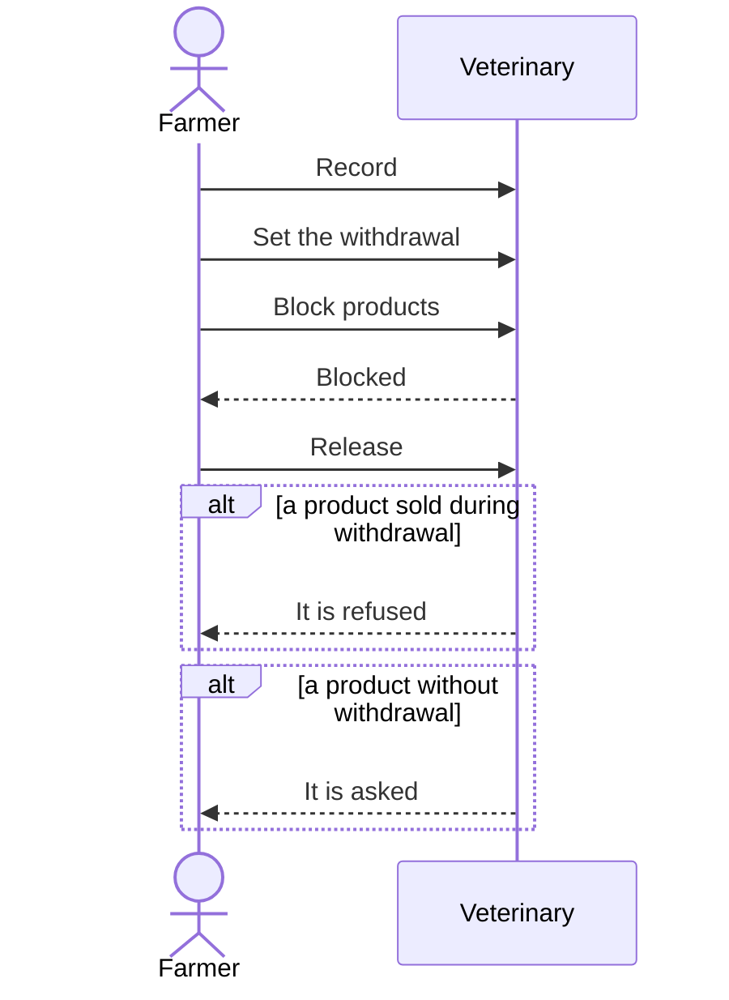

🏠 [Specs](../../../../README.md) › 🏷️ [Sectors](../../../README.md) › 🌾 [SC13 Agriculture and food](../../README.md) ›
📝 [Use cases](../README.md) › 📝 [Use cases: FL-SC13-02 Livestock](README.md) ›
📝 UC-SC13-06 Record veterinary treatments

# 📝 UC-SC13-06 Record veterinary treatments

**Status:** ✅ specified

## Summary

The farmer records treatments with their withdrawal period; products under withdrawal cannot be sold.

## Personas

- [U40 Farmer](../../../../01-users/personas/u40-farmer.md)

## Goal

Nothing sold during a withdrawal period.

## Trigger

A treatment.

## Frequency

Weekly.

## Preconditions

- The SC13 sector pack is installed for the company,
  [UC-F14-02](../../../../02-functional/f14-plugin-store/use-cases/01-find-and-install/uc-f14-02-install-a-plugin-or-sector-pack.md),
  and its users have their roles,
  [UC-F1-06](../../../../02-functional/f01-administration/use-cases/04-edit-a-role/uc-f01-06-edit-a-role-and-its-record-rules.md).

## Postconditions

- **Success:** the treatment is recorded and products blocked.
- **Failed:** the sale is refused.

## Main flow

1. The farmer records the treatment on [S-SC13-06 Veterinary](../../screens/02-livestock/s-sc13-06-veterinary.md).
2. The withdrawal end is set.
3. Milk or the animal is blocked ([BR-SC13-04](../../business-rules/br-sc13-04-withdrawal-before-sale.md)).
4. At its end, the block lifts.

## Alternative flows

- 1a. The vet's prescription attached: it is kept with the treatment.

## Error flows

- 3e. A product sold during withdrawal: it is refused.
- 1e. A product without withdrawal: it is asked.
- Any step: a call to a service or an outside system fails: it is retried first
  ([BR-F3-32](../../../../02-functional/f03-assistant/business-rules/br-f03-32-retry-before-an-error.md)), then the
  error message pattern ([D122](../../../../06-decisions/ux/d122-error-message-standard.md)) says what failed; what was
  typed is kept.

## Business rules

- [BR-SC13-04 Withdrawal before sale](../../business-rules/br-sc13-04-withdrawal-before-sale.md)

## Entities

- [E-SC13-06 Veterinary treatment](../../data/e-sc13-06-veterinary-treatment.md)

## Permissions

The farmer roles; the record rules of their role and site apply,
[UC-F1-06](../../../../02-functional/f01-administration/use-cases/04-edit-a-role/uc-f01-06-edit-a-role-and-its-record-rules.md).

## Notifications

None beyond the in-app updates of the records concerned.

## Audit events

Every creation, change and state change of veterinary treatment records, with who, when and the values before and after
(T3).

## AI involvement

The AI assistant answers questions on the veterinary treatment records of this use case, with links, and prepares them
as drafts the user confirms. It works within the user's rights,
[BR-F3-34](../../../../02-functional/f03-assistant/business-rules/br-f03-34-every-capability-is-reachable-from-the-assistant.md),
and never deletes or does anything irreversible without the user's confirmation,
[BR-F3-07](../../../../02-functional/f03-assistant/business-rules/br-f03-07-no-deletes-no-irreversible-acts.md).

## API, MCP and A2A exposure

Through the API and webhooks (T5) and the MCP and A2A gateway (T6), with the caller's rights,
[BR-F3-34](../../../../02-functional/f03-assistant/business-rules/br-f03-34-every-capability-is-reachable-from-the-assistant.md),
reading, creating and changing the records of this use case; nothing irreversible without a person's confirmation.

## Screens

- [S-SC13-06 Veterinary](../../screens/02-livestock/s-sc13-06-veterinary.md)

## Flowchart

See [FL-SC13-02 Livestock](../../flows/fl-sc13-02-livestock.md#flowchart).

## Sequence diagram

## Acceptance criteria

1. **Given** the example farm's treatment on 3 December with withdrawal to 7 December **when** milk is sold on 5
   December **then** the sale is refused.
2. **Given** milk of FR 69... before 7 December **when** it is sold **then** it is refused.

## Non-functional notes

[D408](../../../../06-decisions/technical/d408-performance-and-profiles.md)'s targets
([performance](../../../../05-non-functional/performance.md)): 95 % of screens within 1 second; lists paged on the
server, the first page within 1 second; reports within 5 seconds or in the background. WCAG 2.2 AA and RGAA
([D46](../../../../06-decisions/ux/d46-accessibility-standard.md)).

## Regulatory references

Legal values from the France country pack:
[CR-FR-163 Livestock health register and withdrawal periods](../../../../10-country-packs/france/agriculture/cr-fr-163-livestock-health-register.md).

## Related use cases

- [UC-SC13-05 Identify animals and keep the herd register](uc-sc13-05-identify-animals-and-keep-the-herd-register.md)

## Open questions

None.

---

⬅️ [UC-SC13-05 Identify animals and keep the herd register](uc-sc13-05-identify-animals-and-keep-the-herd-register.md) ·
⬆️ [Up](README.md) · ➡️ [UC-SC13-07 Declare CAP aid](../03-farm-business/uc-sc13-07-declare-cap-aid.md)
