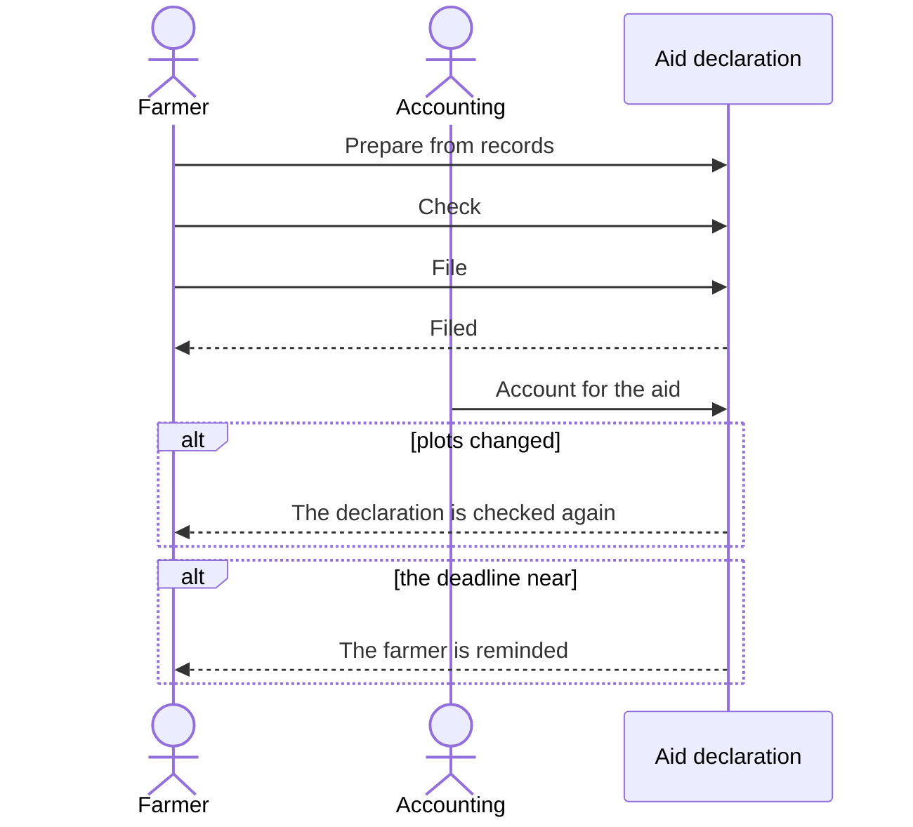

🏠 [Specs](../../../../README.md) › 🏷️ [Sectors](../../../README.md) › 🌾 [SC13 Agriculture and food](../../README.md) ›
📝 [Use cases](../README.md) › 📝 [Use cases: FL-SC13-03 Farm business](README.md) › 📝 UC-SC13-07 Declare CAP aid

# 📝 UC-SC13-07 Declare CAP aid

**Status:** ✅ specified

## Summary

The farmer prepares the yearly CAP aid declaration from plots, crops and herds, checks it and files it; aid received is
accounted for with the shared grant accounting.

## Personas

- [U40 Farmer](../../../../01-users/personas/u40-farmer.md)
- [U05 Accounting](../../../../01-users/personas/u05-accounting.md)

## Goal

Aid declared from the records and accounted.

## Trigger

The declaration campaign.

## Frequency

Yearly.

## Preconditions

- The SC13 sector pack is installed for the company,
  [UC-F14-02](../../../../02-functional/f14-plugin-store/use-cases/01-find-and-install/uc-f14-02-install-a-plugin-or-sector-pack.md),
  and its users have their roles,
  [UC-F1-06](../../../../02-functional/f01-administration/use-cases/04-edit-a-role/uc-f01-06-edit-a-role-and-its-record-rules.md).

## Postconditions

- **Success:** the declaration is filed and aid recorded.
- **Failed:** the declaration is held.

## Main flow

1. The declaration is prepared on
   [S-SC13-07 Aid declaration](../../screens/03-farm-business/s-sc13-07-aid-declaration.md)
   ([BR-SC13-05](../../business-rules/br-sc13-05-aid-declared-from-the-records.md)).
2. The farmer checks.
3. It is filed on the official service.
4. The aid is recorded as a grant,
   [UC-F8-22](../../../../02-functional/f08-accounting/use-cases/07-client-money-grants-and-non-profits/uc-f08-22-account-for-a-grant.md).

## Alternative flows

- 3a. Corrections after filing: a corrected declaration is filed.

## Error flows

- 2e. Plots changed: the declaration is checked again.
- 3e. The deadline near: the farmer is reminded.
- Any step: a call to a service or an outside system fails: it is retried first
  ([BR-F3-32](../../../../02-functional/f03-assistant/business-rules/br-f03-32-retry-before-an-error.md)), then the
  error message pattern ([D122](../../../../06-decisions/ux/d122-error-message-standard.md)) says what failed; what was
  typed is kept.

## Business rules

- [BR-SC13-05 Aid declared from the records](../../business-rules/br-sc13-05-aid-declared-from-the-records.md)
- [BR-F8-14 A grant is earned as its conditions are met](../../../../02-functional/f08-accounting/business-rules/br-f08-14-a-grant-is-earned-as-its-conditions-are-met.md)

## Entities

- [E-SC13-01 Plot](../../data/e-sc13-01-plot.md)
- [E-SC13-05 Animal](../../data/e-sc13-05-animal.md)
- [E-F8-18 Grant](../../../../02-functional/f08-accounting/data/e-f08-18-grant.md)
- [E-SC13-16 CAP aid declaration](../../data/e-sc13-16-cap-aid-declaration.md)

## Permissions

The farmer and accounting roles; the record rules of their role and site apply,
[UC-F1-06](../../../../02-functional/f01-administration/use-cases/04-edit-a-role/uc-f01-06-edit-a-role-and-its-record-rules.md).

## Notifications

None beyond the in-app updates of the records concerned.

## Audit events

Every creation, change and state change of plot, animal, grant records, with who, when and the values before and after
(T3).

## AI involvement

The AI assistant answers questions on the plot, animal, grant records of this use case, with links, and prepares them as
drafts the user confirms. It works within the user's rights,
[BR-F3-34](../../../../02-functional/f03-assistant/business-rules/br-f03-34-every-capability-is-reachable-from-the-assistant.md),
and never deletes or does anything irreversible without the user's confirmation,
[BR-F3-07](../../../../02-functional/f03-assistant/business-rules/br-f03-07-no-deletes-no-irreversible-acts.md).

## API, MCP and A2A exposure

Through the API and webhooks (T5) and the MCP and A2A gateway (T6), with the caller's rights,
[BR-F3-34](../../../../02-functional/f03-assistant/business-rules/br-f03-34-every-capability-is-reachable-from-the-assistant.md),
reading, creating and changing the records of this use case; nothing irreversible without a person's confirmation.

## Screens

- [S-SC13-07 Aid declaration](../../screens/03-farm-business/s-sc13-07-aid-declaration.md)

## Flowchart

See [FL-SC13-03 Farm business](../../flows/fl-sc13-03-farm-business.md#flowchart).

## Sequence diagram

## Acceptance criteria

1. **Given** the example farm's 2027 plots and herd **when** the declaration is prepared **then** Les Prés shows 4.2 ha
   of wheat.
2. **Given** Les Prés redrawn after preparing **when** it is filed **then** the declaration is checked again.

## Non-functional notes

[D408](../../../../06-decisions/technical/d408-performance-and-profiles.md)'s targets
([performance](../../../../05-non-functional/performance.md)): 95 % of screens within 1 second; lists paged on the
server, the first page within 1 second; reports within 5 seconds or in the background. WCAG 2.2 AA and RGAA
([D46](../../../../06-decisions/ux/d46-accessibility-standard.md)).

## Regulatory references

Legal values from the France country pack:
[CR-FR-164 Common agricultural policy (CAP) aid declaration](../../../../10-country-packs/france/agriculture/cr-fr-164-cap-aid-declaration.md).

## Related use cases

- [UC-SC13-01 Map plots and plan crops](../01-crops/uc-sc13-01-map-plots-and-plan-crops.md)

## Open questions

None.

---

⬅️ [UC-SC13-06 Record veterinary treatments](../02-livestock/uc-sc13-06-record-veterinary-treatments.md) ·
⬆️ [Up](README.md) ·
➡️ [UC-SC13-08 Manage machinery, fuel and maintenance](uc-sc13-08-manage-machinery-fuel-and-maintenance.md)
