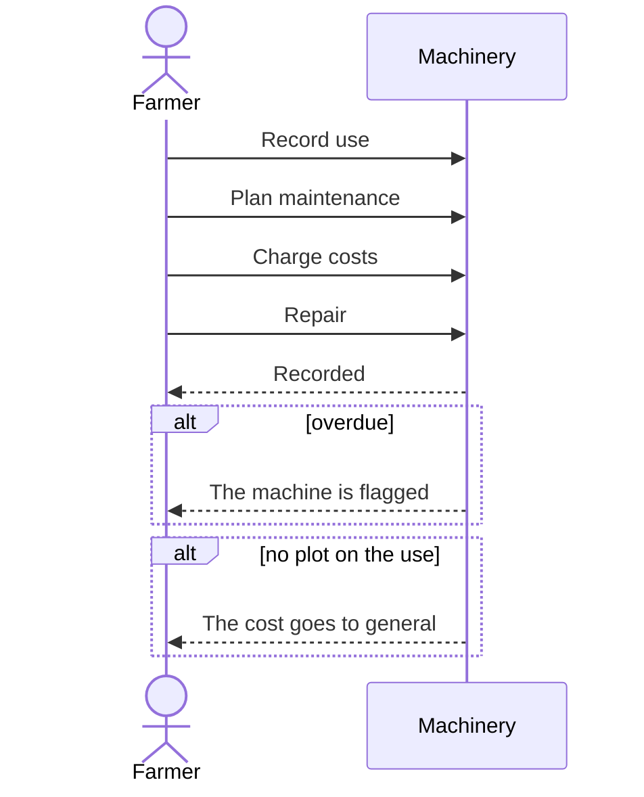

🏠 [Specs](../../../../README.md) › 🏷️ [Sectors](../../../README.md) › 🌾 [SC13 Agriculture and food](../../README.md) ›
📝 [Use cases](../README.md) › 📝 [Use cases: FL-SC13-03 Farm business](README.md) ›
📝 UC-SC13-08 Manage machinery, fuel and maintenance

# 📝 UC-SC13-08 Manage machinery, fuel and maintenance

**Status:** ✅ specified

## Summary

The farmer records machine use, fuel and repairs, plans maintenance and charges costs to crops.

## Personas

- [U40 Farmer](../../../../01-users/personas/u40-farmer.md)

## Goal

Machines maintained and their costs charged.

## Trigger

Use or a due date.

## Frequency

Weekly.

## Preconditions

- The SC13 sector pack is installed for the company,
  [UC-F14-02](../../../../02-functional/f14-plugin-store/use-cases/01-find-and-install/uc-f14-02-install-a-plugin-or-sector-pack.md),
  and its users have their roles,
  [UC-F1-06](../../../../02-functional/f01-administration/use-cases/04-edit-a-role/uc-f01-06-edit-a-role-and-its-record-rules.md).

## Postconditions

- **Success:** costs are charged.
- **Failed:** overdue machines are flagged.

## Main flow

1. Hours and fuel are recorded on [S-SC13-08 Machinery](../../screens/03-farm-business/s-sc13-08-machinery.md).
2. Maintenance is planned,
   [UC-F12-07](../../../../02-functional/f12-manufacturing/use-cases/04-quality-and-maintenance/uc-f12-07-run-quality-checks-and-handle-non-conformities.md).
3. Costs go to crops ([BR-SC13-14](../../business-rules/br-sc13-14-costs-per-crop-and-herd.md)).
4. Repairs are recorded.

## Alternative flows

- 1a. Shared machinery: use is billed by the cooperative.

## Error flows

- 2e. Overdue: the machine is flagged.
- 1e. No plot on the use: the cost goes to general.
- Any step: a call to a service or an outside system fails: it is retried first
  ([BR-F3-32](../../../../02-functional/f03-assistant/business-rules/br-f03-32-retry-before-an-error.md)), then the
  error message pattern ([D122](../../../../06-decisions/ux/d122-error-message-standard.md)) says what failed; what was
  typed is kept.

## Business rules

- [BR-SC13-14 Costs per crop and herd](../../business-rules/br-sc13-14-costs-per-crop-and-herd.md)

## Entities

- [E-SC13-07 Machine](../../data/e-sc13-07-machine.md)

## Permissions

The farmer roles; the record rules of their role and site apply,
[UC-F1-06](../../../../02-functional/f01-administration/use-cases/04-edit-a-role/uc-f01-06-edit-a-role-and-its-record-rules.md).

## Notifications

None beyond the in-app updates of the records concerned.

## Audit events

Every creation, change and state change of machine records, with who, when and the values before and after (T3).

## AI involvement

The AI assistant answers questions on the machine records of this use case, with links, and prepares them as drafts the
user confirms. It works within the user's rights,
[BR-F3-34](../../../../02-functional/f03-assistant/business-rules/br-f03-34-every-capability-is-reachable-from-the-assistant.md),
and never deletes or does anything irreversible without the user's confirmation,
[BR-F3-07](../../../../02-functional/f03-assistant/business-rules/br-f03-07-no-deletes-no-irreversible-acts.md).

## API, MCP and A2A exposure

Through the API and webhooks (T5) and the MCP and A2A gateway (T6), with the caller's rights,
[BR-F3-34](../../../../02-functional/f03-assistant/business-rules/br-f03-34-every-capability-is-reachable-from-the-assistant.md),
reading, creating and changing the records of this use case; nothing irreversible without a person's confirmation.

## Screens

- [S-SC13-08 Machinery](../../screens/03-farm-business/s-sc13-08-machinery.md)

## Flowchart

See [FL-SC13-03 Farm business](../../flows/fl-sc13-03-farm-business.md#flowchart).

## Sequence diagram

## Acceptance criteria

1. **Given** the example farm's tractor T1 with 5 hours on Les Prés **when** it is recorded **then** 5 hours go to Les
   Prés' wheat.
2. **Given** tractor T1 at 4,210 hours past its service **when** it is used **then** the machine is flagged.

## Non-functional notes

[D408](../../../../06-decisions/technical/d408-performance-and-profiles.md)'s targets
([performance](../../../../05-non-functional/performance.md)): 95 % of screens within 1 second; lists paged on the
server, the first page within 1 second; reports within 5 seconds or in the background. WCAG 2.2 AA and RGAA
([D46](../../../../06-decisions/ux/d46-accessibility-standard.md)).

## Regulatory references

None specific to this use case; the sector's legal rules are listed in [SC13 regulatory](../../regulatory.md).

## Related use cases

- [UC-SC13-18 Follow costs per crop, herd and product](uc-sc13-18-follow-costs-per-crop-herd-and-product.md)

## Open questions

None.

---

⬅️ [UC-SC13-07 Declare CAP aid](uc-sc13-07-declare-cap-aid.md) · ⬆️ [Up](README.md) ·
➡️ [UC-SC13-09 Employ seasonal workers](uc-sc13-09-employ-seasonal-workers.md)
