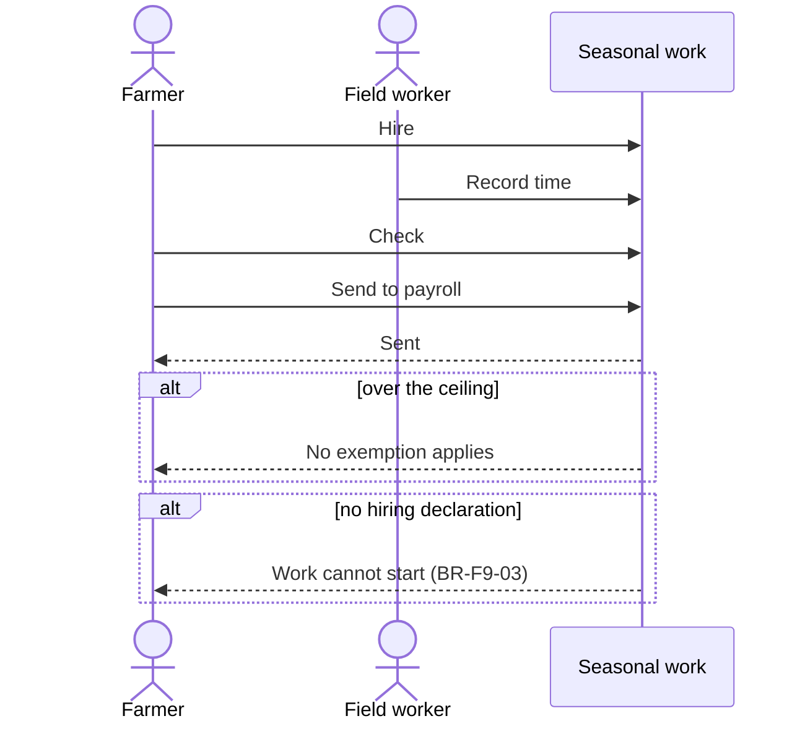

🏠 [Specs](../../../../README.md) › 🏷️ [Sectors](../../../README.md) › 🌾 [SC13 Agriculture and food](../../README.md) ›
📝 [Use cases](../README.md) › 📝 [Use cases: FL-SC13-03 Farm business](README.md) ›
📝 UC-SC13-09 Employ seasonal workers

# 📝 UC-SC13-09 Employ seasonal workers

**Status:** ✅ specified

## Summary

The farmer hires seasonal workers, records their time in the field and sends pay inputs; the seasonal exemption applies
within its ceiling.

## Personas

- [U40 Farmer](../../../../01-users/personas/u40-farmer.md)
- [U14 Field worker](../../../../01-users/personas/u14-field-worker.md)

## Goal

Seasonal workers paid with the right exemption.

## Trigger

The season.

## Frequency

Seasonally.

## Preconditions

- The SC13 sector pack is installed for the company,
  [UC-F14-02](../../../../02-functional/f14-plugin-store/use-cases/01-find-and-install/uc-f14-02-install-a-plugin-or-sector-pack.md),
  and its users have their roles,
  [UC-F1-06](../../../../02-functional/f01-administration/use-cases/04-edit-a-role/uc-f01-06-edit-a-role-and-its-record-rules.md).

## Postconditions

- **Success:** pay inputs are sent.
- **Failed:** no exemption above the ceiling.

## Main flow

1. The farmer hires on [S-SC13-09 Seasonal work](../../screens/03-farm-business/s-sc13-09-seasonal-work.md),
   [UC-F9-07](../../../../02-functional/f09-hr-and-projects/use-cases/02-recruit/uc-f09-07-make-an-offer-and-hire.md).
2. Workers record time in the field,
   [UC-F2-22](../../../../02-functional/f02-no-code-configuration/use-cases/09-portals-and-offline-forms/uc-f02-22-fill-a-form-offline-on-the-phone.md).
3. The farmer checks time.
4. Pay inputs go to payroll under the farm regime,
   [UC-F13-25](../../../../02-functional/f13-payroll/use-cases/07-schemes-and-special-contracts/uc-f13-25-pay-farm-workers-under-the-msa.md),
   [BR-SC13-12](../../business-rules/br-sc13-12-seasonal-exemption-checked.md).

## Alternative flows

- 1a. Housing provided: it is valued as a benefit.

## Error flows

- 4e. Over the ceiling: no exemption applies.
- 1e. No hiring declaration: work cannot start,
  [BR-F9-03](../../../../02-functional/f09-hr-and-projects/business-rules/br-f09-03-dpae-before-the-first-day.md).
- Any step: a call to a service or an outside system fails: it is retried first
  ([BR-F3-32](../../../../02-functional/f03-assistant/business-rules/br-f03-32-retry-before-an-error.md)), then the
  error message pattern ([D122](../../../../06-decisions/ux/d122-error-message-standard.md)) says what failed; what was
  typed is kept.

## Business rules

- [BR-SC13-12 Seasonal exemption checked](../../business-rules/br-sc13-12-seasonal-exemption-checked.md)
- [BR-F9-03 DPAE before the first day](../../../../02-functional/f09-hr-and-projects/business-rules/br-f09-03-dpae-before-the-first-day.md)

## Entities

- [E-SC13-08 Seasonal contract](../../data/e-sc13-08-seasonal-contract.md)

## Permissions

The farmer and field worker roles; the record rules of their role and site apply,
[UC-F1-06](../../../../02-functional/f01-administration/use-cases/04-edit-a-role/uc-f01-06-edit-a-role-and-its-record-rules.md).

## Notifications

None beyond the in-app updates of the records concerned.

## Audit events

Every creation, change and state change of seasonal contract records, with who, when and the values before and after
(T3).

## AI involvement

The AI assistant answers questions on the seasonal contract records of this use case, with links, and prepares them as
drafts the user confirms. It works within the user's rights,
[BR-F3-34](../../../../02-functional/f03-assistant/business-rules/br-f03-34-every-capability-is-reachable-from-the-assistant.md),
and never deletes or does anything irreversible without the user's confirmation,
[BR-F3-07](../../../../02-functional/f03-assistant/business-rules/br-f03-07-no-deletes-no-irreversible-acts.md).

## API, MCP and A2A exposure

Through the API and webhooks (T5) and the MCP and A2A gateway (T6), with the caller's rights,
[BR-F3-34](../../../../02-functional/f03-assistant/business-rules/br-f03-34-every-capability-is-reachable-from-the-assistant.md),
reading, creating and changing the records of this use case; nothing irreversible without a person's confirmation.

## Screens

- [S-SC13-09 Seasonal work](../../screens/03-farm-business/s-sc13-09-seasonal-work.md)

## Flowchart

See [FL-SC13-03 Farm business](../../flows/fl-sc13-03-farm-business.md#flowchart).

## Sequence diagram

## Acceptance criteria

1. **Given** the example farm's P. L. in September **when** his hours are sent **then** payroll gets them under the farm
   regime.
2. **Given** P. L. paid 1.1 times the minimum **when** the ceiling is lower **then** no exemption applies.

## Non-functional notes

[D408](../../../../06-decisions/technical/d408-performance-and-profiles.md)'s targets
([performance](../../../../05-non-functional/performance.md)): 95 % of screens within 1 second; lists paged on the
server, the first page within 1 second; reports within 5 seconds or in the background. WCAG 2.2 AA and RGAA
([D46](../../../../06-decisions/ux/d46-accessibility-standard.md)).

## Regulatory references

Legal values from the France country pack:
[CR-FR-167 Seasonal agricultural workers' contribution exemption](../../../../10-country-packs/france/labour/cr-fr-167-seasonal-workers-exemption.md).

## Related use cases

- [UC-SC13-19 Report to the accountant and the farmers' social insurance](uc-sc13-19-report-to-the-accountant-and-the-farmers-social-insurance.md)

## Open questions

None.

---

⬅️ [UC-SC13-08 Manage machinery, fuel and maintenance](uc-sc13-08-manage-machinery-fuel-and-maintenance.md) ·
⬆️ [Up](README.md) · ➡️ [UC-SC13-10 Sell directly](../04-sales-and-certification/uc-sc13-10-sell-directly.md)
