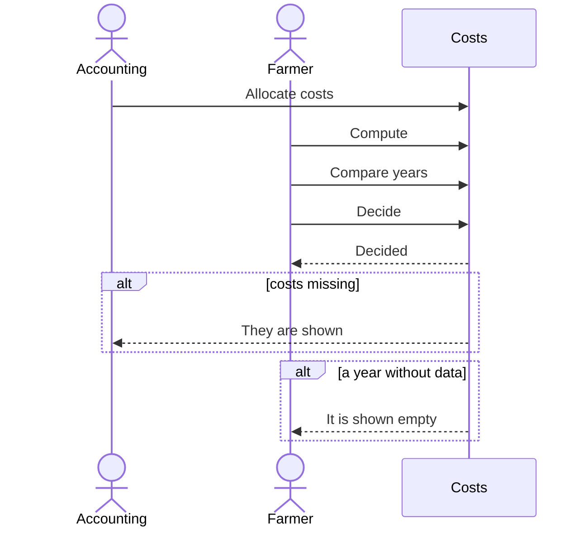

🏠 [Specs](../../../../README.md) › 🏷️ [Sectors](../../../README.md) › 🌾 [SC13 Agriculture and food](../../README.md) ›
📝 [Use cases](../README.md) › 📝 [Use cases: FL-SC13-03 Farm business](README.md) ›
📝 UC-SC13-18 Follow costs per crop, herd and product

# 📝 UC-SC13-18 Follow costs per crop, herd and product

**Status:** ✅ specified

## Summary

The farmer and accounting allocate costs and compute margins per crop, herd and product.

## Personas

- [U40 Farmer](../../../../01-users/personas/u40-farmer.md)
- [U05 Accounting](../../../../01-users/personas/u05-accounting.md)

## Goal

Know what pays.

## Trigger

Season end.

## Frequency

Yearly.

## Preconditions

- The SC13 sector pack is installed for the company,
  [UC-F14-02](../../../../02-functional/f14-plugin-store/use-cases/01-find-and-install/uc-f14-02-install-a-plugin-or-sector-pack.md),
  and its users have their roles,
  [UC-F1-06](../../../../02-functional/f01-administration/use-cases/04-edit-a-role/uc-f01-06-edit-a-role-and-its-record-rules.md).

## Postconditions

- **Success:** margins are computed.
- **Failed:** missing costs are shown.

## Main flow

1. Costs are allocated on [S-SC13-18 Costs](../../screens/03-farm-business/s-sc13-18-costs.md).
2. Margins are computed,
   [UC-F8-20](../../../../02-functional/f08-accounting/use-cases/06-benchmark-additions/uc-f08-20-analyse-profitability.md).
3. Years are compared.
4. The farmer adjusts the crop plan.

## Alternative flows

- 2a. Per plot: margins per plot.

## Error flows

- 1e. Costs missing: they are shown.
- 3e. A year without data: it is shown empty.
- Any step: a call to a service or an outside system fails: it is retried first
  ([BR-F3-32](../../../../02-functional/f03-assistant/business-rules/br-f03-32-retry-before-an-error.md)), then the
  error message pattern ([D122](../../../../06-decisions/ux/d122-error-message-standard.md)) says what failed; what was
  typed is kept.

## Business rules

- [BR-SC13-14 Costs per crop and herd](../../business-rules/br-sc13-14-costs-per-crop-and-herd.md)

## Entities

- [E-SC13-02 Crop plan](../../data/e-sc13-02-crop-plan.md)
- [E-SC13-07 Machine](../../data/e-sc13-07-machine.md)

## Permissions

The farmer and accounting roles; the record rules of their role and site apply,
[UC-F1-06](../../../../02-functional/f01-administration/use-cases/04-edit-a-role/uc-f01-06-edit-a-role-and-its-record-rules.md).

## Notifications

None beyond the in-app updates of the records concerned.

## Audit events

Every creation, change and state change of crop plan, machine records, with who, when and the values before and after
(T3).

## AI involvement

The AI assistant answers questions on the crop plan, machine records of this use case, with links, and prepares them as
drafts the user confirms. It works within the user's rights,
[BR-F3-34](../../../../02-functional/f03-assistant/business-rules/br-f03-34-every-capability-is-reachable-from-the-assistant.md),
and never deletes or does anything irreversible without the user's confirmation,
[BR-F3-07](../../../../02-functional/f03-assistant/business-rules/br-f03-07-no-deletes-no-irreversible-acts.md).

## API, MCP and A2A exposure

Through the API and webhooks (T5) and the MCP and A2A gateway (T6), with the caller's rights,
[BR-F3-34](../../../../02-functional/f03-assistant/business-rules/br-f03-34-every-capability-is-reachable-from-the-assistant.md),
reading, creating and changing the records of this use case; nothing irreversible without a person's confirmation.

## Screens

- [S-SC13-18 Costs](../../screens/03-farm-business/s-sc13-18-costs.md)

## Flowchart

See [FL-SC13-03 Farm business](../../flows/fl-sc13-03-farm-business.md#flowchart).

## Sequence diagram

## Acceptance criteria

1. **Given** the example farm's Les Prés wheat with 32 t sold at 210 EUR and 4,000 EUR of costs **when** the margin is
   computed **then** it shows 2,720 EUR.
2. **Given** Les Prés without fuel costs **when** margins are computed **then** they are shown.

## Non-functional notes

[D408](../../../../06-decisions/technical/d408-performance-and-profiles.md)'s targets
([performance](../../../../05-non-functional/performance.md)): 95 % of screens within 1 second; lists paged on the
server, the first page within 1 second; reports within 5 seconds or in the background. WCAG 2.2 AA and RGAA
([D46](../../../../06-decisions/ux/d46-accessibility-standard.md)).

## Regulatory references

None specific to this use case; the sector's legal rules are listed in [SC13 regulatory](../../regulatory.md).

## Related use cases

- [UC-SC13-08 Manage machinery, fuel and maintenance](uc-sc13-08-manage-machinery-fuel-and-maintenance.md)

## Open questions

None.

---

⬅️ [UC-SC13-17](../05-food-processing/uc-sc13-17-manage-shelf-life-rotation-and-recalls.md) · ⬆️ [Up](README.md) ·
➡️ [UC-SC13-19](uc-sc13-19-report-to-the-accountant-and-the-farmers-social-insurance.md)
