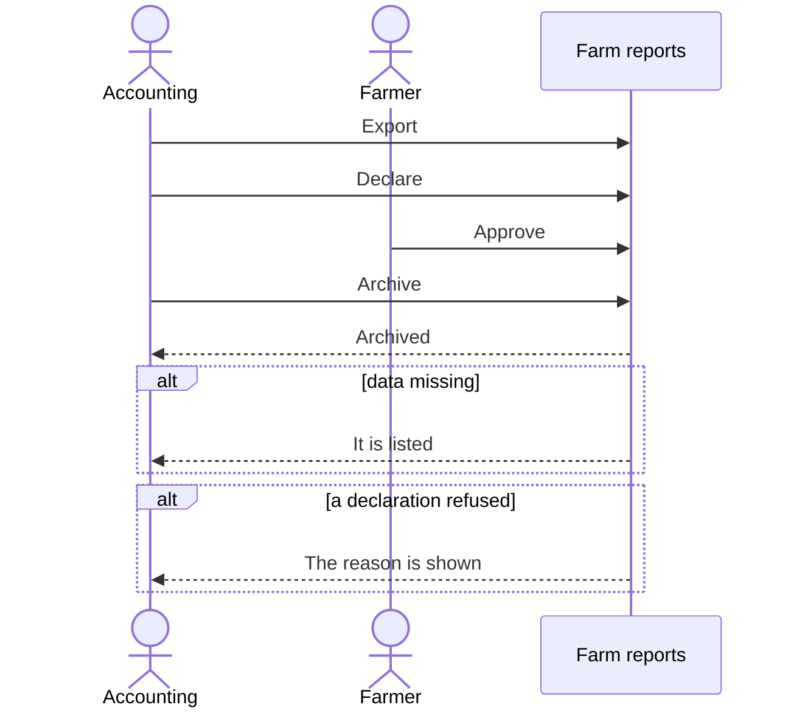

🏠 [Specs](../../../../README.md) › 🏷️ [Sectors](../../../README.md) › 🌾 [SC13 Agriculture and food](../../README.md) ›
📝 [Use cases](../README.md) › 📝 [Use cases: FL-SC13-03 Farm business](README.md) ›
📝 UC-SC13-19 Report to the accountant and the farmers' social insurance

# 📝 UC-SC13-19 Report to the accountant and the farmers' social insurance

**Status:** ✅ specified

## Summary

Accounting exports the books and declarations to the accountant and the farmers' social insurance, and archives them.

## Personas

- [U05 Accounting](../../../../01-users/personas/u05-accounting.md)
- [U40 Farmer](../../../../01-users/personas/u40-farmer.md)

## Goal

Exports and declarations on time.

## Trigger

Period ends.

## Frequency

Monthly and yearly.

## Preconditions

- The SC13 sector pack is installed for the company,
  [UC-F14-02](../../../../02-functional/f14-plugin-store/use-cases/01-find-and-install/uc-f14-02-install-a-plugin-or-sector-pack.md),
  and its users have their roles,
  [UC-F1-06](../../../../02-functional/f01-administration/use-cases/04-edit-a-role/uc-f01-06-edit-a-role-and-its-record-rules.md).

## Postconditions

- **Success:** exports are sent.
- **Failed:** missing data is listed.

## Main flow

1. Accounting exports on [S-SC13-19 Farm reports](../../screens/03-farm-business/s-sc13-19-farm-reports.md),
   [UC-F8-14](../../../../02-functional/f08-accounting/use-cases/01-set-up-and-post/uc-f08-14-work-with-the-external-accountant.md).
2. Declarations go to the farmers' social insurance,
   [UC-F13-25](../../../../02-functional/f13-payroll/use-cases/07-schemes-and-special-contracts/uc-f13-25-pay-farm-workers-under-the-msa.md).
3. The farmer approves.
4. They are archived.

## Alternative flows

- 1a. The accountant's portal: the accountant reads directly.

## Error flows

- 1e. Data missing: it is listed.
- 2e. A declaration refused: the reason is shown.
- Any step: a call to a service or an outside system fails: it is retried first
  ([BR-F3-32](../../../../02-functional/f03-assistant/business-rules/br-f03-32-retry-before-an-error.md)), then the
  error message pattern ([D122](../../../../06-decisions/ux/d122-error-message-standard.md)) says what failed; what was
  typed is kept.

## Business rules

- [BR-SC13-12 Seasonal exemption checked](../../business-rules/br-sc13-12-seasonal-exemption-checked.md)

## Entities

- [E-SC13-08 Seasonal contract](../../data/e-sc13-08-seasonal-contract.md)

## Permissions

The accounting and farmer roles; the record rules of their role and site apply,
[UC-F1-06](../../../../02-functional/f01-administration/use-cases/04-edit-a-role/uc-f01-06-edit-a-role-and-its-record-rules.md).

## Notifications

None beyond the in-app updates of the records concerned.

## Audit events

Every creation, change and state change of seasonal contract records, with who, when and the values before and after
(T3).

## AI involvement

The AI assistant answers questions on the seasonal contract records of this use case, with links, and prepares them as
drafts the user confirms. It works within the user's rights,
[BR-F3-34](../../../../02-functional/f03-assistant/business-rules/br-f03-34-every-capability-is-reachable-from-the-assistant.md),
and never deletes or does anything irreversible without the user's confirmation,
[BR-F3-07](../../../../02-functional/f03-assistant/business-rules/br-f03-07-no-deletes-no-irreversible-acts.md).

## API, MCP and A2A exposure

Through the API and webhooks (T5) and the MCP and A2A gateway (T6), with the caller's rights,
[BR-F3-34](../../../../02-functional/f03-assistant/business-rules/br-f03-34-every-capability-is-reachable-from-the-assistant.md),
reading, creating and changing the records of this use case; nothing irreversible without a person's confirmation.

## Screens

- [S-SC13-19 Farm reports](../../screens/03-farm-business/s-sc13-19-farm-reports.md)

## Flowchart

See [FL-SC13-03 Farm business](../../flows/fl-sc13-03-farm-business.md#flowchart).

## Sequence diagram

## Acceptance criteria

1. **Given** the example farm's September **when** it is declared **then** P. L.'s hours are in the declaration.
2. **Given** seasonal hours not checked **when** the export runs **then** it is listed.

## Non-functional notes

[D408](../../../../06-decisions/technical/d408-performance-and-profiles.md)'s targets
([performance](../../../../05-non-functional/performance.md)): 95 % of screens within 1 second; lists paged on the
server, the first page within 1 second; reports within 5 seconds or in the background. WCAG 2.2 AA and RGAA
([D46](../../../../06-decisions/ux/d46-accessibility-standard.md)).

## Regulatory references

None specific to this use case; the sector's legal rules are listed in [SC13 regulatory](../../regulatory.md).

## Related use cases

- [UC-SC13-09 Employ seasonal workers](uc-sc13-09-employ-seasonal-workers.md)

## Open questions

None.

---

⬅️ [UC-SC13-18 Follow costs per crop, herd and product](uc-sc13-18-follow-costs-per-crop-herd-and-product.md) ·
⬆️ [Up](README.md) · ➡️ [UC-SC13-20 Ask the AI assistant](uc-sc13-20-ask-the-assistant.md)
