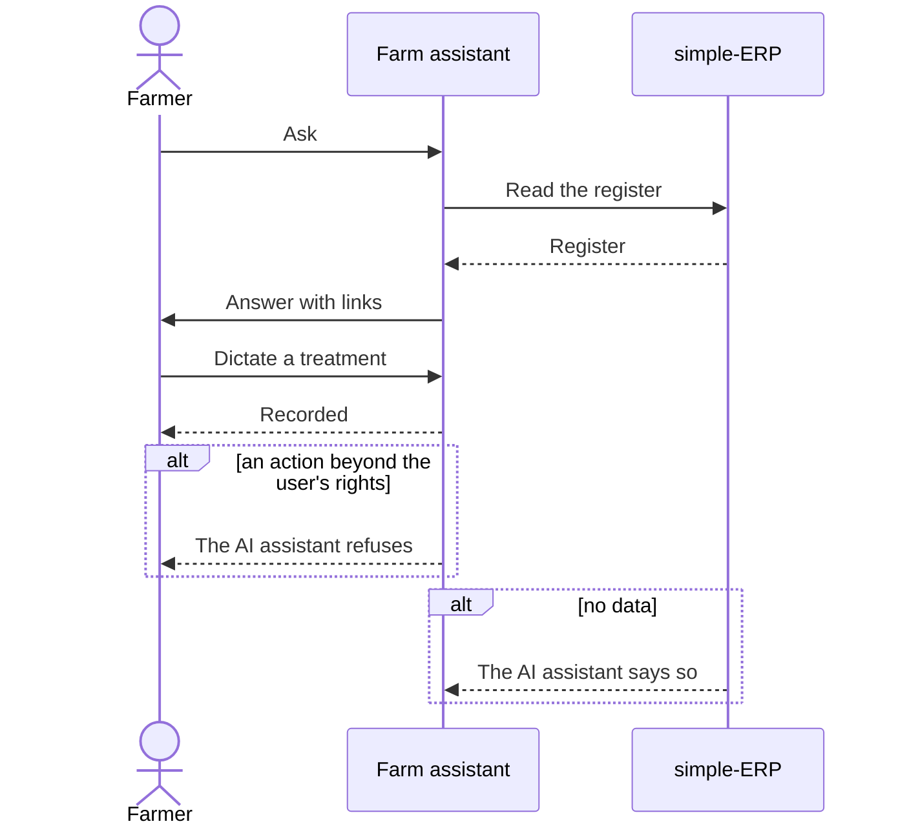

🏠 [Specs](../../../../README.md) › 🏷️ [Sectors](../../../README.md) › 🌾 [SC13 Agriculture and food](../../README.md) ›
📝 [Use cases](../README.md) › 📝 [Use cases: FL-SC13-03 Farm business](README.md) › 📝 UC-SC13-20 Ask the AI assistant

# 📝 UC-SC13-20 Ask the AI assistant

**Status:** ✅ specified

## Summary

The farmer asks the AI assistant about a plot's last treatment, animals to notify or aid deadlines, and can dictate a
treatment in the cab.

## Personas

- [U40 Farmer](../../../../01-users/personas/u40-farmer.md)

## Goal

Answers and records hands-free.

## Trigger

A question.

## Frequency

Daily.

## Preconditions

- The SC13 sector pack is installed for the company,
  [UC-F14-02](../../../../02-functional/f14-plugin-store/use-cases/01-find-and-install/uc-f14-02-install-a-plugin-or-sector-pack.md),
  and its users have their roles,
  [UC-F1-06](../../../../02-functional/f01-administration/use-cases/04-edit-a-role/uc-f01-06-edit-a-role-and-its-record-rules.md).

## Postconditions

- **Success:** the answer cites the records, or the dictated record is confirmed.
- **Failed:** the AI assistant says it cannot answer or act, and why.

## Main flow

1. The farmer asks on [S-SC13-20 Farm assistant](../../screens/03-farm-business/s-sc13-20-farm-assistant.md): "Last
   treatment on Les Prés?".
2. The AI assistant reads within the user's rights.
3. The AI assistant answers: product X on 3 April.
4. The farmer dictates a treatment; the AI assistant fills it to confirm,
   [UC-F3-09](../../../../02-functional/f03-assistant/use-cases/09-assistant-on-a-phone/uc-f03-09-use-the-assistant-on-a-phone.md).

## Alternative flows

- 4a. No network in the cab: the dictation is kept and processed when back.

## Error flows

- 4e. An action beyond the user's rights: the AI assistant refuses.
- 2e. No data: the AI assistant says so.
- Any step: a call to a service or an outside system fails: it is retried first
  ([BR-F3-32](../../../../02-functional/f03-assistant/business-rules/br-f03-32-retry-before-an-error.md)), then the
  error message pattern ([D122](../../../../06-decisions/ux/d122-error-message-standard.md)) says what failed; what was
  typed is kept.

## Business rules

- [BR-SC13-15 Offline in the field](../../business-rules/br-sc13-15-offline-in-the-field.md)
- [BR-F3-34 All capabilities via the AI assistant](../../../../02-functional/f03-assistant/business-rules/br-f03-34-every-capability-is-reachable-from-the-assistant.md)
- [BR-F3-07 No deletes, no irreversible acts](../../../../02-functional/f03-assistant/business-rules/br-f03-07-no-deletes-no-irreversible-acts.md)

## Entities

- [E-SC13-03 Field operation](../../data/e-sc13-03-field-operation.md)
- [E-SC13-05 Animal](../../data/e-sc13-05-animal.md)

## Permissions

The farmer roles; the record rules of their role and site apply,
[UC-F1-06](../../../../02-functional/f01-administration/use-cases/04-edit-a-role/uc-f01-06-edit-a-role-and-its-record-rules.md).

## Notifications

None beyond the in-app updates of the records concerned.

## Audit events

Every creation, change and state change of field operation, animal records, with who, when and the values before and
after (T3).

## AI involvement

The AI assistant answers questions on the field operation, animal records of this use case, with links, and prepares
them as drafts the user confirms. It works within the user's rights,
[BR-F3-34](../../../../02-functional/f03-assistant/business-rules/br-f03-34-every-capability-is-reachable-from-the-assistant.md),
and never deletes or does anything irreversible without the user's confirmation,
[BR-F3-07](../../../../02-functional/f03-assistant/business-rules/br-f03-07-no-deletes-no-irreversible-acts.md).

## API, MCP and A2A exposure

Through the API and webhooks (T5) and the MCP and A2A gateway (T6), with the caller's rights,
[BR-F3-34](../../../../02-functional/f03-assistant/business-rules/br-f03-34-every-capability-is-reachable-from-the-assistant.md),
reading, creating and changing the records of this use case; nothing irreversible without a person's confirmation.

## Screens

- [S-SC13-20 Farm assistant](../../screens/03-farm-business/s-sc13-20-farm-assistant.md)

## Flowchart

See [FL-SC13-03 Farm business](../../flows/fl-sc13-03-farm-business.md#flowchart).

## Sequence diagram

## Acceptance criteria

1. **Given** the example farm's Les Prés treated on 3 April **when** the farmer asks **then** the AI assistant answers
   product X on 3 April.
2. **Given** a seasonal worker asking to file the aid **when** he asks **then** the AI assistant refuses.

## Non-functional notes

[D408](../../../../06-decisions/technical/d408-performance-and-profiles.md)'s targets
([performance](../../../../05-non-functional/performance.md)): 95 % of screens within 1 second; lists paged on the
server, the first page within 1 second; reports within 5 seconds or in the background. WCAG 2.2 AA and RGAA
([D46](../../../../06-decisions/ux/d46-accessibility-standard.md)).

## Regulatory references

None specific to this use case; the sector's legal rules are listed in [SC13 regulatory](../../regulatory.md).

## Related use cases

- [UC-SC13-02 Record treatments and inputs](../01-crops/uc-sc13-02-record-treatments-and-inputs.md)

## Open questions

None.

---

⬅️ [UC-SC13-19](uc-sc13-19-report-to-the-accountant-and-the-farmers-social-insurance.md) · ⬆️ [Up](README.md) ·
➡️ [UC-SC13-21](../06-vineyards-contractors-and-cooperatives/uc-sc13-21-run-the-vineyard-and-the-cellar.md)
